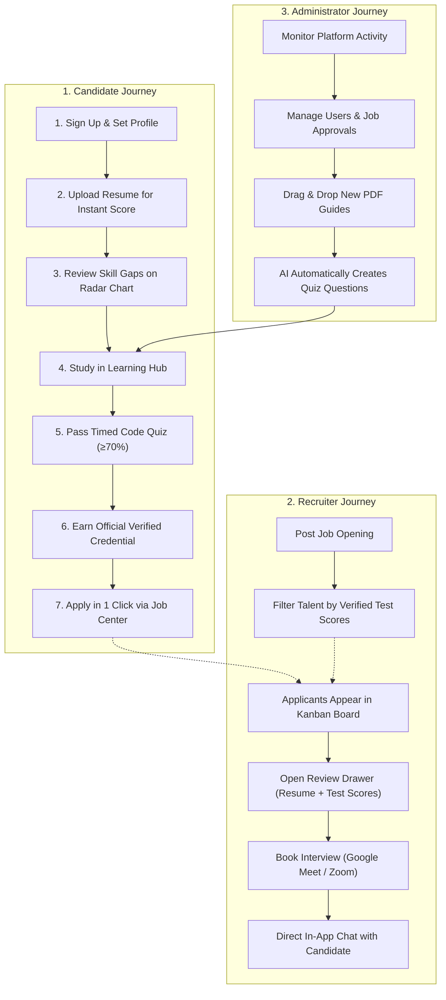

# 🚀 SKILLEZO.AI — Product Delivery & Feature Handover Overview

> **Document Type:** Client Handover & Executive Release Overview  
> **Release Version:** `v1.0 (MVP Launch Edition)`  
> **Release Date:** Tuesday, October 27, 2026  
> **Platform Status:** 🟢 **100% Operational & Ready for Launch**  
> **Synchronized Repositories:** Both primary and client codebases are synced with the latest production build.  

---

## 🌟 1. Executive Summary: Autonomous Career Intelligence & Verified Talent Exchange

**SKILLEZO.AI** is an enterprise-grade **AI Career Acceleration & Pre-Vetted Talent Ecosystem** engineered to transform candidate hiring readiness into quantifiable, tamper-proof proof of competency for modern recruitment teams. 

Today’s hiring market has two big problems:
1. **For Candidates:** Traditional job sites only list jobs. They don’t tell candidates why their resume gets rejected, what skills they are missing, or how to fix them.
2. **For Recruiters:** Hiring teams receive hundreds of unvetted, AI-generated resumes filled with buzzwords, making it hard to find candidates who actually know the skills.

**SKILLEZO.AI solves both sides with a complete, closed-loop system:**
* **Smart Career Insights:** Candidates receive instant, objective feedback on their resume, discover their exact skill gaps compared to real job requirements, and get a clear 7-stage roadmap to improve.
* **Built-in Learning & Practice:** Candidates don't need to leave the site. They can study high-impact technical cheat-sheets and practice real coding challenges directly on the platform.
* **Verified Skill Credentials:** When candidates pass timed practice tests, they earn official, tamper-proof digital certificates that verify their skills to employers.
* **Pre-Vetted Recruiter Pipeline:** Employers post jobs, search pre-verified talent filtered by real test scores, review complete candidate profiles and resumes, and schedule interviews in one click.

The platform is fully assembled, thoroughly tested, and ready for real candidates and employers to use today.

---

## 📊 2. Master Feature Delivery Scorecard

Here is an overview of each platform feature, what it does for your users, and the business benefit:

| Feature / Module | Status | What It Delivers for Users | Business & Strategic Value |
| :--- | :---: | :--- | :--- |
| **Secure Sign-In & Role Detection** | 🟢 **Delivered** | One-click Google login or email/password sign-in. Automatically recognizes whether someone is a candidate or a recruiter. | Seamless onboarding with zero login confusion between job seekers and employers. |
| **Candidate Portfolio & Projects** | 🟢 **Delivered** | Clean candidate profile showcasing target roles, bio, verified skills, live web demo links, and GitHub project showcases. | Gives hiring managers immediate proof of what candidates have actually built. |
| **Smart Resume Studio & ATS Audit** | 🟢 **Delivered** | Evaluates resumes across 4 key pillars: formatting, keyword matches, measurable impact, and section balance. Includes instant AI bullet rewriters. | Helps candidates beat automated resume screeners with impactful, professional bullet points. |
| **Skill Gap Analysis & Radar** | 🟢 **Delivered** | Interactive radar chart comparing a candidate's current skills against real job benchmarks across 6 tech specializations. | Shows candidates exactly what they need to learn next to qualify for higher-paying jobs. |
| **7-Stage Career GPS Roadmap** | 🟢 **Delivered** | Automated career path (*Foundation ➔ Skill Verification ➔ Projects ➔ Resume Tuning ➔ Interview Prep ➔ Recruiter Spotlight ➔ Job Launch*). | Keeps candidates engaged on the platform with clear milestones and goals. |
| **Learning Hub & PDF Guides** | 🟢 **Delivered** | Curated curriculum tracks with modular lesson drawers and printable, beautifully formatted A4 study guides. | **Zero recurring cloud storage costs**: Guides generate on-demand instantly without cloud storage fees. |
| **Interactive Practice Arena** | 🟢 **Delivered** | Real-world timed quizzes with dark-mode code boxes, instant scoring, and clear educational explanations. | Provides interactive, hands-on learning that keeps users coming back daily. |
| **Verified Skill Certification** | 🟢 **Delivered** | Scoring 70% or higher awards an official, tamper-proof digital credential that attaches directly to the candidate's profile. | Eliminates resume fraud and gives recruiters trusted confidence in candidate capabilities. |
| **Smart Job Center & Matching** | 🟢 **Delivered** | Fast, organized job search with filters, platform-verified badges, and personalized match percentage indicators (e.g. *92% Match*). | Matches candidates to the right jobs faster, increasing application success rates. |
| **1-Click Tailored Job Apply** | 🟢 **Delivered** | Candidates apply in one click with a tailored resume version. Recruiters instantly receive a clean summary and verified credentials. | Removes application friction while ensuring employers receive complete, organized submissions. |
| **Recruiter Talent Search** | 🟢 **Delivered** | Employers search and filter talent by verified skills (*React, TypeScript, Cloud, Python*) and test scores ($\ge 70\%$). | Saves recruiters dozens of screening hours by connecting them directly with proven talent. |
| **Recruiter Kanban Pipeline** | 🟢 **Delivered** | Visual 6-stage hiring board (*Applied ➔ Review ➔ Shortlist ➔ Interview ➔ Offer ➔ Hired*) for managing job requisitions. | Complete candidate tracking system built directly into the platform—no external software needed. |
| **Candidate Review Drawer** | 🟢 **Delivered** | A slide-out review panel showing candidate contact info, verified skill badges, exact test scores, and full resume preview. | Gives hiring managers everything they need to make a decision in one simple screen. |
| **Interview Scheduling Suite** | 🟢 **Delivered** | Recruiters can schedule interviews directly, pick date & time, select Google Meet or Zoom, and send automatic meeting links. | Eliminates messy email back-and-forth when booking interviews with promising candidates. |
| **Direct In-App Messaging** | 🟢 **Delivered** | Two-way chat between employers and applicants tied directly to each job application, complete with unread notification badges. | Keeps all hiring communication organized in one secure place. |
| **Admin Command Center** | 🟢 **Delivered** | Full platform oversight: monitor platform activity, manage user accounts, suspend bad actors, and approve job postings. | Gives your team full administrative control to maintain platform quality and safety. |
| **Admin Drag-and-Drop Ingestion** | 🟢 **Delivered** | Admins drag and drop technical PDF guides. AI automatically generates 5–10 high-quality quiz questions with code snippets. | Continuous content expansion with **zero manual question writing**—new test materials are ready in seconds. |
| **Progress & Growth Analytics** | 🟢 **Delivered** | Live personal analytics dashboard showing learning hours, verified skill coverage, and overall employability score growth. | Inspires candidates by visibly showcasing their growth and market readiness over time. |

---

## 🔄 3. How the Platform Works: The 3 User Journeys

---

### 👤 Journey 1: The Candidate Experience
1. **Profile & Portfolio:** The candidate logs in, sets their target job role, and attaches links to their live web projects and GitHub repositories.
2. **Resume Studio:** They upload their resume and receive an instant, objective score across formatting, keywords, and impact, plus smart AI suggestions to improve weak bullets.
3. **Skill Gap Discovery:** An interactive radar chart highlights what skills they have versus what top employers are currently asking for.
4. **Learning & Practice:** They open the Learning Hub to study technical guides and take a 5-question code quiz with real code syntax.
5. **Earning Verification:** Scoring 70% or higher grants them an official verified badge, boosting their overall Employability Index.
6. **Smart Apply:** In the Job Center, they see jobs ranked by how well their skills match, and they submit their application in a single click.

---

### 👔 Journey 2: The Employer & Recruiter Experience
1. **Posting Jobs:** Recruiters create job openings with required skills and salary ranges.
2. **Finding Proven Talent:** Instead of waiting for applicants, recruiters search the Talent Pool, filtering directly by candidates who scored 80%+ on technical tests.
3. **Managing the Pipeline:** In the visual Kanban board, recruiters move applicants across hiring stages (*Applied, Shortlist, Interview, Offer*).
4. **Evaluating Applicants:** Opening a candidate reveals their full resume preview, contact information, and verified test credentials side-by-side.
5. **Booking the Interview:** With one click, the recruiter sets the interview date and meeting link (Google Meet or Zoom), which automatically alerts the candidate and starts a direct chat.

---

### 🛡️ Journey 3: The Administrator Experience
1. **Platform Governance:** Administrators monitor platform usage, verify user status, and review job postings.
2. **Effortless Content Growth:** When new technical guides are released, admins simply drag and drop the PDF into the dashboard. Skillezo's AI reads the guide and automatically writes exam-ready multiple-choice questions, keeping the practice arena fresh without manual effort.

---

## 🔑 4. Live Access & Ready-to-Use Demo Accounts

To explore and test the platform firsthand, use these pre-configured accounts:

### 👤 Candidate Demo Account
* **Login URL:** `http://skillezo.com/login` *(or your live production domain)*
* **Email:** `testuser@gmail.com`
* **Password:** `password123` *(or use Google One-Click Login)*
* **Role:** Candidate
* **What to explore:** Resume Studio, Skill Gap Radar, Learning Hub, Practice Quiz, Smart Job Center, and Growth Analytics.

---

### 👔 Recruiter & Administrator Demo Account
* **Login URL:** `http://skillezo.com/login` *(or your live production domain)*
* **Email:** `admin@gmail.com`
* **Password:** `password123`
* **Role:** Administrator & Employer
* **What to explore:** Recruiter Command Center (`/recruiter`), Verified Talent Directory (`/recruiter/talent`), Hiring Kanban Board (`/recruiter/applications`), Candidate Review Drawer, and Admin PDF Ingestion (`/admin/dashboard?tab=learning-hub`).

---

## 🧪 5. Quick 5-Minute Walkthrough Test for Stakeholders

You can test the entire platform in just 5 minutes with this quick guide:

1. **Step 1: Check the Resume Studio (Candidate View):**
   - Log in as `testuser@gmail.com` and go to **Resume Studio**.
   - Click the 4 pillar tabs (*Formatting, Keywords, Measurable Impact, Section Balance*). Notice how the AI rewriter suggests stronger, metric-driven bullet points with a one-click copy button.
2. **Step 2: Generate an Instant Study Guide:**
   - Go to **Learning Hub** ➔ click the **PDF Vault** tab.
   - Click **"Preview Guide"** on any topic and click **"Download Printable PDF"**. Notice how the professional reference guide compiles and downloads in under a second.
3. **Step 3: Take a Quick Practice Drill & Earn a Certificate:**
   - Click the **Practice Arena** tab and start a quick drill. Answer the 5 questions and submit.
   - On the results screen, click **"Claim Verified Credential"** and see your official certificate code appear and attach to your profile.
4. **Step 4: Apply to a Job:**
   - Go to the **Smart Job Center**, select an open role, click **"Apply with Tailored Resume"**, and submit.
5. **Step 5: Review the Candidate (Recruiter View):**
   - In an Incognito window, log in as `admin@gmail.com` and open **Recruiter Applications**.
   - Click on the candidate you just applied with. Open their review drawer to see their resume preview, ATS score, and newly earned verified credentials.
   - Click **"Advance Stage"** ➔ **"Interview"** to preview the built-in scheduling tool.

---

## 💡 6. Key Advantages & Cost Savings Built Into Skillezo

1. **Zero Recurring Cloud Storage Costs:**
   - Most platforms pay monthly cloud storage fees (like Amazon S3) for every document candidates generate. Skillezo generates study guides and cheat-sheets on-demand in milliseconds, costing **$0 in cloud storage overhead**.
2. **Fair, Objective AI Scoring:**
   - Skill tests and resume checks use reliable, standardized evaluation rules. This ensures candidates are scored fairly and accurately without unpredictable AI scoring errors.
3. **Authentic, Fraud-Proof Credentials:**
   - Every verified badge has a unique digital verification code. Recruiters know the score is genuine and that the candidate actually completed the assessment.
4. **Fast, Responsive Experience:**
   - Search filtering, job listings, and application drawer transitions are immediate, providing a smooth, high-end experience on both desktop and mobile.

---

## 🔮 7. What’s Next: Upcoming Roadmap Features

While the current platform is complete and ready for public launch, here are high-impact enhancements planned for future phases:

* **AI Mock Interview Coach:** Voice and conversational interview practice where candidates can rehearse technical and behavioral questions and get instant feedback.
* **Instant Mobile & Web Push Notifications:** Real-time browser alerts notifying candidates the moment an employer views their resume or invites them to an interview.
* **Extended Employer Job Feeds:** Automated integrations to sync job openings directly from LinkedIn and company career sites.

---

## ✍️ 8. Delivery Acceptance & Sign-off

| Milestone Detail | Information |
| :--- | :--- |
| **Product Name:** | SKILLEZO.AI Career Acceleration & Verified Hiring Platform |
| **Delivery Scope:** | Complete Full-Stack Web Application (Frontend + Backend + Database) |
| **Release Status:** | ✅ **Production-Ready & Fully Verified** |
| **Supported Devices:** | Desktop, Tablet, and Mobile Responsive (Chrome, Safari, Edge, Firefox) |
| **Handover Date:** | Tuesday, October 27, 2026 |

---

*This document represents the official client delivery and feature handover overview for SKILLEZO.AI.*
