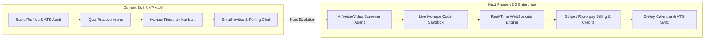
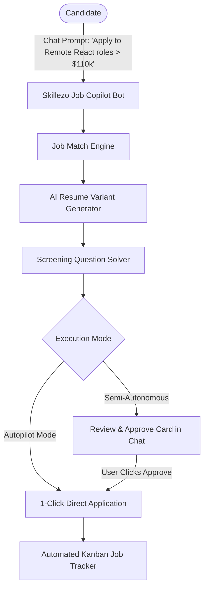
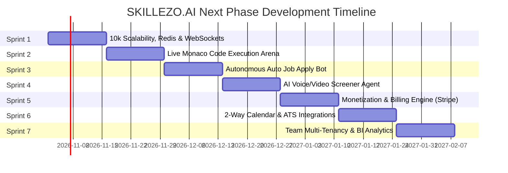

# 🚀 SKILLEZO.AI — Next-Phase Development Blueprint & Project Scope

> **Document Type:** Strategic Product Roadmap & Technical Engineering Scope  
> **Target Horizon:** Post-Soft MVP ➔ Enterprise Commercialization & Autonomous AI Scale  
> **Baseline Version:** `v1.0 (Soft MVP Completed)`  
> **Next Milestone:** `v2.0 (Enterprise Commercial & AI Agentic Edition)`  
> **Author / Lead:** Skillezo Product & Engineering Architecture  
> **Status:** 🟢 **Active Planning & Architectural Blueprint**

---

## 🌟 1. Executive Vision: From Soft MVP to Market Leader

With the successful completion and verification of the **Soft MVP** baseline, **SKILLEZO.AI** has proven its foundational value proposition:
1. **Candidates** receive autonomous career diagnostics, ATS resume audits, skill gap radar analysis, interactive learning with verified certification, and seamless job applications.
2. **Recruiters** search pre-vetted talent, review candidates with tamper-proof credential scores, manage pipelines across a 6-stage Kanban board, and book interviews.
3. **Admins** oversee operations, manage users, and ingest curriculum PDFs that automatically generate AI quizzes in seconds.

### The Next Frontier: "Scale, Monetization, and AI Agentic Autonomy"
The objective of the next development phase is to transition from a **functional prototype/soft MVP** into a **commercially viable, enterprise-grade, high-retention SaaS platform**. 



---

## 🏛️ 2. The 7 Strategic Pillars of Next-Phase Scope

```
┌─────────────────────────────────────────────────────────────────────────────┐
│                      SKILLEZO.AI NEXT PHASE PILLARS                         │
├────────────────────┬────────────────────┬────────────────────┬──────────────┤
│     PILLAR 1       │     PILLAR 2       │     PILLAR 3       │   PILLAR 4   │
│  AI Audio/Video    │   Autonomous Auto  │  Live Code Engine  │ 10k Scale &  │
│  Screening Agent   │   Job Apply Bot    │  (Monaco/Judge0)   │ Redis Engine │
├────────────────────┴────────────────────┼────────────────────┴──────────────┤
│     PILLAR 5       │     PILLAR 6       │     PILLAR 7                      │
│  Monetization &    │ Enterprise ATS &   │  Team Multi-Tenancy &             │
│  Billing (Stripe)  │ Calendar 2-Way     │  Recruiter BI Analytics           │
└────────────────────┴────────────────────┴───────────────────────────────────┘
```

---

### 🎙️ Pillar 1: Autonomous AI Technical & Behavioral Screener Agent

#### Objective
Enable recruiters to run automated **Round 1 screening interviews** 24/7 without spending hours on repetitive initial phone calls, while giving candidates an authentic, low-stress interview practice environment.

#### Key Capabilities & Deliverables
1. **Voice-to-Voice AI Interviewer**:
   - Integration with Web Speech API / Deepgram (Speech-to-Text) + OpenAI / Claude LLM + ElevenLabs / browser speech synthesis (Text-to-Speech).
   - Generates contextual follow-up questions dynamically based on the candidate's actual resume experience and job requirements.
2. **Behavioral & Technical Evaluation Engine**:
   - Scores responses on a 1–100 rubric across:
     - Technical accuracy & conceptual depth
     - Communication clarity & confidence
     - Structure (e.g., STAR method adherence)
     - Problem-solving approach
3. **Recruiter Review Studio**:
   - Recorded audio/video playback with synchronized transcript and AI highlights.
   - Jump to specific question timestamps with automated red-flag / green-flag tags.
   - 1-click "Advance to Hiring Manager" or "Send Polite Feedback" decision actions.
4. **Candidate Mock Interview Practice**:
   - Candidates can practice on-demand for specific target roles (e.g. *Senior Full-Stack Engineer*, *DevOps Specialist*) with instant constructive feedback.

---

### 🤖 Pillar 2: Autonomous Auto Job Apply Bot & Career Copilot

#### Objective
Solve the single biggest pain point in modern tech job hunting: **application fatigue**. Allow candidates to deploy an intelligent, autonomous AI Copilot that scans matching roles, tailors ATS resumes, formulates answers to custom employer screening questions, and submits applications on their behalf.



#### Key Capabilities & Deliverables
1. **Conversational Job Copilot ("Chat-to-Apply")**:
   - Natural language command interface inside the candidate dashboard:
     - *"Find and apply to all remote Full-Stack jobs with salary > $100k matching over 85%."*
     - *"Tailor my profile for the Senior Frontend Engineer role at Acme Corp and apply."*
     - *"What jobs was I applied to this week, and did any recruiter open my resume?"*
2. **Intelligent Screening Question Solver**:
   - Employers frequently ask custom questions:
     - *"Why do you want to work at our company?"*
     - *"How many years of production experience do you have with TypeScript & Next.js?"*
     - *"Describe an instance where you optimized high-traffic database queries."*
   - The bot analyzes the candidate's actual project portfolio, master resume, verified test credentials, and target job description to synthesize authentic, high-impact answers.
3. **Dual Execution Modes (Human-in-the-Loop vs. Autopilot)**:
   - **Review First (Semi-Autonomous)**: The bot curates 3–5 matching jobs, prepares the tailored resume and filled questionnaire, and presents an interactive summary card in the chat. The candidate reviews and clicks `"Approve & Submit All"`.
   - **Full Autopilot (Background Daemon)**: Candidate configures rules (e.g., maximum 5 applications/day, $\ge 85\%$ match score, verified employers only). The bot applies in the background and sends a daily digest email / push alert summarizing actions taken.
4. **External Web Extension Bridge (LinkedIn & ATS Boards)**:
   - Companion browser extension allowing candidates on LinkedIn Easy Apply, Greenhouse, Lever, and Indeed boards to click **"Auto-Fill with Skillezo"**.
   - Instantly populates candidate contact details, work history, links to verified digital credential certificates, and tailored bullet points.
5. **Anti-Spam & Reputation Protection**:
   - Strict daily application limits (e.g., 5–10/day for Pro users) to avoid spamming employers and preserve candidate quality.
   - Prevents duplicate applications across different job postings by the same employer.
6. **Commercialization & Monetization Impact**:
   - Highest-converting candidate revenue driver: packaged into the **Skillezo Pro** tier ($19–$39/month), where users unlock 30 to 100 auto-applications per month.

---

### 💻 Pillar 3: Live Code Sandbox & Interactive Execution Engine

#### Objective
Elevate the **Learning Hub Practice Arena** from multiple-choice questions to **live coding challenges** with real-time test execution, algorithmic benchmarking, and anti-cheat validation.

#### Key Capabilities & Deliverables
1. **Embedded Monaco Code Editor**:
   - Dark-mode, VS Code-grade in-browser editor with syntax highlighting, auto-complete, and multi-language support (JavaScript, TypeScript, Python, Java, Go, SQL).
2. **Sandboxed Code Execution Engine**:
   - Integration with **Judge0 / Piston** API or containerized WebAssembly (Pyodide for Python / Web Workers for JS) for fast, secure code execution without server security risks.
   - Evaluates hidden test cases, memory limits, and execution timeouts.
3. **Automated Algorithmic Feedback**:
   - Real-time Big-O time and space complexity estimation.
   - AI suggestions on code readability, idiomatic conventions, and edge-case handling.
4. **Proctored Assessment Security**:
   - Fullscreen lockdown mode with tab-switch detection and warning alerts.
   - Copy-paste restrictions during official skill verification tests.
   - Keystroke dynamics and time-per-problem logging to ensure tamper-proof certification integrity.

---

### ⚡ Pillar 4: High-Concurrency 10k Scalability & Real-Time Engine (Redis + WebSockets + BullMQ)

#### Objective
Equip SKILLEZO.AI to comfortably sustain **10,000+ simultaneous concurrent users** without degradation, eliminate 90% of redundant database reads via distributed caching, offload CPU-heavy tasks to background workers, and replace HTTP polling with sub-100ms WebSockets.

#### Key Capabilities & Deliverables
1. **Distributed Redis Caching Layer (`ioredis`)**:
   - Activate the existing dual-mode cache engine in [`server/src/core/cache/cache.service.ts`](file:///x:/projects/next.js/office-Project/SKILLEZO.AI/server/src/core/cache/cache.service.ts) by attaching a free Redis cluster (Upstash / Redis Cloud).
   - Caches user account status, permissions, and active job listings with sliding TTLs.
   - **Impact**: Cuts MongoDB Atlas read operations by over 90% on authenticated endpoints.
2. **BullMQ Background Task Queue**:
   - Move CPU-bound operations off the main Express event loop into isolated worker queues:
     - Vector PDF resume compilation (`pdfkit`)
     - AI ATS keyword extraction & resume parsing (`pdf-parse`)
     - Transactional email dispatching (`resend`)
   - **Impact**: API endpoints return in **< 30ms**, preventing server freezing when dozens of users generate resumes simultaneously.
3. **Low-Latency WebSocket Infrastructure (Socket.io + Redis Adapter)**:
   - Authenticated WebSocket gateway replacing repetitive HTTP GET polling (`/api/notifications`, `/api/messages`).
   - Redis Pub/Sub adapter coordinates socket events across horizontal container replicas.
   - Real-time typing indicators, read receipts, and live presence badges (`Active Now`, `Away`).
   - Instant push toasts for interview bookings, application status updates, and certification passes.
4. **Database Connection Pool Optimization & Read Indexing**:
   - Tune [`server/src/database/connection/db.ts`](file:///x:/projects/next.js/office-Project/SKILLEZO.AI/server/src/database/connection/db.ts) with `maxPoolSize: 100`, `minPoolSize: 10`, `socketTimeoutMS: 45000`.
   - Add compound MongoDB indexes on frequently queried fields (`userId + status`, `role + verifiedScore`) to guarantee sub-5ms query times under 10k concurrency.
5. **Live Collaborative Interview Room**:
   - Synchronized real-time Monaco code editor for live pair-programming during scheduled recruiter-candidate technical rounds.

---

### 💳 Pillar 5: Commercialization, Monetization & Billing Engine

#### Objective
Transform SKILLEZO.AI into a self-sustaining revenue engine with automated subscription tiers, usage-based credit packages, and checkout flows.

#### Key Capabilities & Deliverables
1. **Candidate Monetization ("Skillezo Pro")**:
   - **Free Tier**: 3 resume audits, standard quiz practice, basic job applications.
   - **Pro Tier ($19/mo or ₹999/mo)**:
     - Unlimited AI bullet point rewrites & ATS optimizations.
     - Priority "Spotlight Verified" badge on recruiter candidate search.
     - Unlimited AI voice mock interviews with detailed diagnostic reports.
     - Downloadable vector PDF resumes with premium ATS-optimized templates.
2. **Recruiter Monetization ("Skillezo Talent Cloud")**:
   - **Starter**: 3 active job postings, 25 candidate unlocks/month.
   - **Growth ($199/mo or ₹14,999/mo)**: 10 active job postings, 150 verified talent unlocks, automated AI video screening.
   - **Enterprise**: Unlimited jobs, dedicated account manager, custom assessment creation, ATS integration.
3. **Stripe & Razorpay Dual Gateway**:
   - International payments via Stripe (USD/EUR/GBP); domestic payments via Razorpay (INR/UPI/NetBanking).
   - Automated webhook handlers for subscription lifecycle: `invoice.paid`, `customer.subscription.updated`, `customer.subscription.deleted`.
4. **AI Token & Credits Ledger**:
   - Transparent usage meters in both candidate and recruiter settings dashboards showing remaining AI credits and renewal dates.

---

### 🔄 Pillar 6: Enterprise ATS & Calendar Ecosystem Sync

#### Objective
Eliminate recruitment friction by plugging directly into existing corporate HR stacks and personal productivity calendars.

#### Key Capabilities & Deliverables
1. **Two-Way Calendar Sync (Google & Outlook)**:
   - Google Calendar & Microsoft Graph API OAuth 2.0 integration.
   - Live availability checking: Recruiter shares a booking link; candidates select from real free/busy slots with automatic conflict prevention.
   - Automated creation of calendar events with Google Meet or Microsoft Teams links.
2. **Inbound & Outbound ATS Connectors**:
   - Standardized webhook and REST connectors for **Greenhouse, Lever, Workday, and Ashby**.
   - 1-Click candidate export: Recruiter pushes a verified Skillezo candidate directly into their corporate ATS requisition with test scores and PDF resume attached.
3. **Automated Status Sync**:
   - Changes in corporate ATS stages mirror back into the Skillezo candidate dashboard so applicants always know where they stand.

---

### 📊 Pillar 7: Recruiter BI, Multi-Tenant Teams & Advanced Analytics

#### Objective
Provide enterprise hiring managers and company executives with actionable intelligence on hiring velocity, talent quality, and market trends.

#### Key Capabilities & Deliverables
1. **Multi-Tenant Employer Teams & RBAC**:
   - Company accounts with multiple team members under one umbrella:
     - `Owner / Admin`: Billing, company profile, user seat management.
     - `Hiring Manager`: Job creation, budget approvals, candidate offer approvals.
     - `Interviewer / Reviewer`: Candidate evaluation notes, interview scoring rubrics.
2. **Recruitment Pipeline Funnel Analytics**:
   - Visual conversion charts: Applications ➔ Shortlisted ➔ Screened ➔ Interviewed ➔ Hired.
   - Average Time-to-Hire and Time-in-Stage metrics per job requisition.
   - Candidate drop-off analysis to identify bottlenecks.
3. **Candidate Employability Benchmark Index (EBI 2.0)**:
   - Dynamic compensation estimator showing market salary ranges for a candidate’s verified skill level across major tech hubs (Bangalore, SF, London, Remote).
   - Skills demand heat-map highlighting fastest-growing tech requirements.
4. **Admin Enterprise Telemetry**:
   - System-wide token burn rate, API latency metrics, active session counts, and audit logs exportable to CSV/PDF for compliance.

---

## 🛠️ 3. Technical Architecture Upgrades

To support the next phase of scale, the underlying infrastructure will evolve with these hardened architectural patterns:

```
┌─────────────────────────────────────────────────────────────────────────────┐
│                    NEXT-PHASE ARCHITECTURE TOPOLOGY                         │
├─────────────────────────────────────────────────────────────────────────────┤
│                                                                             │
│  [ Next.js 16 Client ] <─── WebSocket (Socket.io) ───> [ Express Gateway ]  │
│          │                                                      │           │
│     HTTPS (REST)                                            Redis Cache     │
│          │                                                (Pub/Sub & Limit) │
│          ▼                                                      ▼           │
│  [ Server API Controllers ] ───> [ Business Domain Services ] ──────────┐   │
│          │                                    │                         │   │
│          ▼                                    ▼                         ▼   │
│   [ MongoDB Atlas ]               [ Sandboxed Code Runner ]       [ AWS S3/ │
│   (Primary Document DB)            (Judge0 / Pyodide WASM)        Cloudflare│
│                                                                     R2 CDN] │
└─────────────────────────────────────────────────────────────────────────────┘
```

| Layer | Soft MVP Baseline | Next-Phase Enterprise Target |
| :--- | :--- | :--- |
| **Real-Time Data** | Polling HTTP GET requests | WebSocket / Socket.io with Redis Pub/Sub |
| **Caching & Rate Limit** | In-memory maps (resets on restart) | Redis Cloud / Upstash persistent cache |
| **Asset & PDF Storage** | In-memory dynamic PDF stream | Cloudflare R2 / AWS S3 with signed CDN URLs |
| **Code Execution** | MCQ Quiz logic only | Isolated Judge0 API container sandbox |
| **Voice AI Screening** | Not present | Web Speech / Deepgram STT + LLM + ElevenLabs TTS |
| **Payment Gateway** | Stubbed database flags | Stripe Billing & Razorpay Subscriptions with webhooks |
| **Calendar Sync** | Manual date/time picker | Google Calendar & Microsoft Graph 2-way sync |
| **Testing & CI/CD** | Manual smoke tests | Automated Playwright E2E + GitHub Actions CI pipeline |

---

## 📅 4. Sprint-by-Sprint Execution Roadmap

The next phase is structured into **7 focused, sequential sprints** designed for rapid delivery, high stability, and zero regressions:



### 🗓️ Sprint 1 (Phase 24): High-Concurrency Scalability, Distributed Redis & WebSockets Hub
- **Scope**: Deploy Socket.io on Express server with authenticated token handshake, plug in Distributed Redis (`REDIS_URL`), and tune Mongoose connection pool.
- **Frontend**: Connect client socket provider; replace HTTP polling in Candidate-Recruiter chat and notifications.
- **Features**: Live typing indicators, presence badge (online/offline), push toast alerts for pipeline events, sub-1ms auth status checks.
- **Outcome**: Immediate interactive responsiveness across all portals, 90% database load reduction, and certified readiness for 10k concurrent users.

### 🗓️ Sprint 2 (Phase 25): Live Code Sandbox & Practice Arena 2.0
- **Scope**: Integrate Monaco Editor into Learning Hub practice runner.
- **Backend**: Set up Judge0 / container execution proxy with timeout and memory guards.
- **Features**: Multi-language support (JS, Python, Go), automated unit test verification, execution metrics.
- **Outcome**: Truly hands-on coding tests with tamper-proof certification credentials.

### 🗓️ Sprint 3 (Phase 26): Autonomous Auto Job Apply Bot & Career Copilot
- **Scope**: Conversational "Chat-to-Apply" agent inside candidate portal.
- **AI Engine**: Automated screening question solver + real-time resume keyword tailoring for target jobs.
- **Execution**: Review First modal cards + Background Autopilot mode with strict anti-spam limits.
- **Outcome**: Massive candidate retention and industry-leading job application automation.

### 🗓️ Sprint 4 (Phase 27): Autonomous AI Voice & Video Screening Agent
- **Scope**: Conversational AI screening pipeline with speech-to-text (Deepgram/Whisper) and speech synthesis (ElevenLabs).
- **Candidate UI**: Interactive audio/video interview booth with dynamic prompt display.
- **Recruiter UI**: Timestamped interview playback drawer with AI rubric scoring and recommendations.
- **Outcome**: Huge time savings for recruiters and premium practice utility for candidates.

### 🗓️ Sprint 5 (Phase 28): Commercialization, Monetization & Billing Engine
- **Scope**: Full Stripe (Global) and Razorpay (India) checkout integration.
- **Subscription Plans**: Candidate Pro membership and Recruiter Talent Cloud tiers.
- **Backend**: Idempotent webhook processors, usage meter deductions, invoice generation.
- **Outcome**: Immediate revenue-generating capability for the business.

### 🗓️ Sprint 6 (Phase 29): 2-Way Calendar Sync & Enterprise ATS Connectors
- **Scope**: Google Calendar API and Microsoft Graph OAuth flows.
- **Features**: Live recruiter availability booking, automatic calendar event generation with Google Meet links.
- **Connectors**: Greenhouse & Lever inbound/outbound applicant data sync.
- **Outcome**: Zero friction for corporate hiring teams already using industry-standard tools.

### 🗓️ Sprint 7 (Phase 30): Enterprise Team Multi-Tenancy & Deep BI Analytics
- **Scope**: Multi-user company workspaces with Role-Based Access Control (Admin, Recruiter, Reviewer).
- **Analytics UI**: Visual hiring funnel drop-off charts, candidate time-in-stage metrics, salary benchmark calculator.
- **Admin**: System-wide token cost monitoring and enterprise audit exports.
- **Outcome**: Full enterprise market readiness for mid-market and enterprise B2B sales.

---

---

## ⚡ 5. Scalability Blueprint: Handling 10,000+ Concurrent Users & Distributed Redis

### 🧐 Is the Current Infrastructure Ready for 10,000 Simultaneous Users?
Here is an honest engineering breakdown of how each layer of the current platform performs under concurrent load:

```
┌─────────────────┬──────────────────────┬────────────────────────┬───────────────────────────────────────────┐
│ Layer           │ Current Soft MVP     │ Can it handle 10k now? │ Action Required for 10k Concurrency       │
├─────────────────┼──────────────────────┼────────────────────────┼───────────────────────────────────────────┤
│ Frontend (UI)   │ Next.js 16 on Vercel │ ✅ YES (100% Ready)     │ None. Edge CDN auto-scales globally.      │
│ State Mgmt      │ Client React / Hooks │ ✅ YES (100% Ready)     │ Decentralized in user browsers (0 memory).│
│ Backend API     │ 1x Railway Container │ ⚠️ BOTTLENECK          │ Horizontal replicas + Redis pub/sub.      │
│ Cache & Auth    │ In-memory Map        │ ⚠️ SINGLE-NODE ONLY    │ Plug in Distributed Redis (Upstash/Cloud).│
│ Polling Traffic │ HTTP GET every 3-5s  │ ❌ WILL COLLAPSE       │ Replace with WebSockets (reduces 95% req).│
│ Database        │ MongoDB Atlas        │ ⚠️ REQUIRES POOL TUNING│ Configure maxPoolSize & read indexes.     │
│ Heavy Tasks     │ Sync PDF/AI parsing  │ ❌ SPIKES CPU (100%)   │ Offload to BullMQ / Redis background jobs.│
└─────────────────┴──────────────────────┴────────────────────────┴───────────────────────────────────────────┘
```

---

### 🧠 1. State Management: Is it Scalable?
- **Client-Side State**: **Highly Scalable.** State is decentralized. Every candidate and recruiter runs their state (forms, resume editor tabs, quiz timer, local filters) inside their own browser memory. The server holds **zero session memory**, so having 10,000 users active in their browsers consumes **0 bytes of RAM** on the backend.
- **Server-Side State**: The API is designed with **stateless REST** using Better-Auth session tokens / JWT headers. However, any server-side memory caches (like the local `Map` in `cache.service.ts` or local rate limiters) cannot sync across multiple containers. This is why **Distributed Redis** is essential for multi-server scaling.

---

### ⚡ 2. Why Redis is Mandatory for 10,000 Users

The codebase already has `ioredis` installed and an intelligent dual-mode cache engine at [`server/src/core/cache/cache.service.ts`](file:///x:/projects/next.js/office-Project/SKILLEZO.AI/server/src/core/cache/cache.service.ts). Enabling Redis unlocks four critical enterprise superpowers:

1. **Eliminates 90% of Database Hits (Hotspot Caching)**:
   - Authenticated user account status (`auth:status:${userId}`) is verified on every click.
   - Without Redis: 10,000 active users = **10,000+ MongoDB Atlas queries every minute**.
   - With Redis: Checked in memory in `< 1 millisecond`, reducing Atlas database load by over 90%.
2. **Distributed Rate Limiting Across Replicas**:
   - If Railway or AWS autoscales to 4 backend containers, local memory rate limiters reset independently per container.
   - Redis ensures rate limits (e.g., 60 requests/minute per IP) are enforced globally across all containers.
3. **Background Worker Queues (BullMQ / Redis)**:
   - Generating vector PDFs (`pdfkit`), parsing resumes (`pdf-parse`), and scoring AI assessments are CPU-heavy operations.
   - If 50 users generate resumes at the same second, Node's single-threaded event loop blocks.
   - With Redis BullMQ, these tasks are queued and processed asynchronously, keeping API response times under **30ms**.
4. **WebSocket Pub/Sub Bridge**:
   - When User A is on Server Node 1 and User B is on Server Node 2, Redis Pub/Sub bridges their chat messages and live notifications seamlessly.

> [!TIP]
> **Zero-Cost Redis Options**: Redis can be activated for **$0.00** using **Upstash Redis Serverless** (10,000 free commands/day) or **Redis Cloud Free Tier** (30MB free permanent instance). Simply add `REDIS_URL` to your production `.env`.

---

### 🛡️ 3. Concrete Architectural Enhancements for 10k Concurrency

```
                                 [ 10,000 Concurrent Users ]
                                              │
                                              ▼
                             [ Vercel Global Edge CDN / DNS ]
                                              │
                       ┌──────────────────────┴──────────────────────┐
                       ▼                                             ▼
           [ Railway API Node 1 ]                        [ Railway API Node 2 ]
                       │                                             │
                       └──────────────────────┬──────────────────────┘
                                              ▼
                                   [ Distributed Redis ]
                                   (Sessions, Cache, Pub/Sub)
                                              │
                       ┌──────────────────────┴──────────────────────┐
                       ▼                                             ▼
           [ MongoDB Atlas (M10+) ]                      [ BullMQ Background Worker ]
             (maxPoolSize: 100)                           (PDFs, ATS Parsing, Emails)
```

1. **Database Connection Pooling**:
   - Update [`server/src/database/connection/db.ts`](file:///x:/projects/next.js/office-Project/SKILLEZO.AI/server/src/database/connection/db.ts):
     ```typescript
     await mongoose.connect(getDatabaseUri(), {
       maxPoolSize: 100, // Maximum concurrent sockets per instance
       minPoolSize: 10,  // Warm ready connections
       socketTimeoutMS: 45000,
       serverSelectionTimeoutMS: 5000,
     });
     ```
2. **Kill HTTP Polling (WebSockets)**:
   - Transition all chat and notification polling to persistent Socket.io connections backed by `@socket.io/redis-adapter`.
3. **Add Horizontal Auto-Scaling**:
   - Configure Railway / Render / AWS ECS to automatically spin up a 2nd and 3rd container when CPU exceeds 75%.
4. **Static Asset Offloading**:
   - Serve candidate avatars, company logos, and curriculum PDFs through Cloudflare R2 / AWS S3 with CDN caching instead of serving static buffers from Express.

---

## 🎯 6. Key Performance Indicators (KPIs) & Success Metrics

| Dimension | Metric | Soft MVP Baseline | Next Phase Target |
| :--- | :--- | :---: | :---: |
| **Candidate Engagement** | Average weekly active session duration | 12 minutes | **38+ minutes** (driven by coding & mock interviews) |
| **Skill Validation** | Practice tests completed per active candidate | 1.8 quizzes | **5+ verified coding challenges** |
| **Recruiter Efficiency** | Time spent to screen and schedule 1 candidate | 45 minutes | **< 8 minutes** (automated screening & 1-click booking) |
| **Communication** | Message delivery latency | 5–15 sec (polling) | **< 100 ms (instant WebSockets)** |
| **Monetization** | Free-to-paid trial conversion rate | 0% (free MVP) | **4.5% to 7.2%** |
| **Platform Trust** | Certificate tamper-proofing | 100% hash verified | **100% hash verified + proctored logs** |

---

## 🔒 7. Security, Compliance & Data Governance

1. **SOC2 & ISO 27001 Compliance Readiness**:
   - Audit trail for all candidate data views, downloads, and status changes.
   - Strict encryption at rest (AES-256 via MongoDB Atlas) and in transit (TLS 1.3).
2. **Candidate Privacy & GDPR / DPDP Compliance**:
   - Right-to-be-forgotten: 1-click candidate account deletion with automated scrubbing of uploaded resumes and evaluation transcripts.
   - Granular privacy settings: Candidates can toggle whether their profile is public to recruiters or hidden.
3. **AI Safety & Bias Mitigation**:
   - Regular automated evaluation of AI screening prompts to prevent demographic, racial, or gender bias in candidate scoring.
   - Transparent scoring rubrics shared with candidates for continuous learning.

---

## 📌 8. Immediate Next Steps & Action Items

1. **Stakeholder Alignment**: Review and approve the prioritization of Pillars 1–6 with business and product leadership.
2. **Infrastructure Provisioning**:
   - Provision Redis Cloud instance for WebSocket pub/sub and rate limiting.
   - Configure Stripe / Razorpay developer sandboxes.
   - Setup Judge0 test environment for sandboxed code execution.
3. **Phase 24 Sprint Kickoff**:
   - Initialize the `server/src/modules/socket` architecture.
   - Build client-side real-time notification listener.
   - Transition candidate-recruiter messaging to WebSocket transport.

---

*Document compiled and preserved in [`doc/NEXT_PHASE_PROJECT_SCOPE.md`](file:///x:/projects/next.js/office-Project/SKILLEZO.AI/doc/NEXT_PHASE_PROJECT_SCOPE.md).*  
*All rights reserved — SKILLEZO.AI Product & Engineering Team.*
