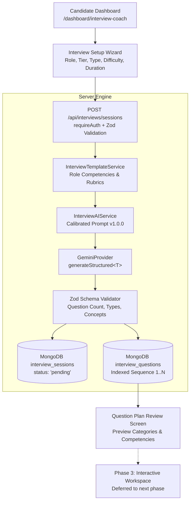

# Phase 2 — AI Mock Interview Coach: Configuration & Question Engine Plan

> **Product:** SKILLEZO AI Career Intelligence & Candidate Experience  
> **Module:** AI Mock Interview Coach  
> **Phase:** 2 of 8  
> **Target Date:** November 2026  
> **Status:** Proposed Implementation Plan  
> **Dependencies:** Phase 1 (Foundation & Architecture — Completed & Verified)  

---

## 1. Executive Summary & Boundaries

Phase 1 established the data modeling foundation, candidate privacy isolation (`findByUserAndId`), Mongoose compound indexes, and protected route scaffolding with 29 automated tests passing.

**Phase 2 activates the core Interview Configuration & Question Generation Engine.** Candidates will be able to configure an interview tailored to their target career path and seniority tier, and trigger **Google Gemini** to generate a structured, calibrated question itinerary that is validated and persisted into MongoDB.



---

## 2. Zero-Redundancy Architectural Audit (Reuse Before Rebuild)

To keep the codebase maintainable and eliminate duplicate code, Phase 2 strictly reuses established infrastructure:

| Capability | Existing Infrastructure to Reuse | What NOT to Build |
| :--- | :--- | :--- |
| **AI Provider** | [`server/src/core/ai/providers/gemini.provider.ts`](file:///x:/projects/next.js/office-Project/SKILLEZO.AI/server/src/core/ai/providers/gemini.provider.ts) — already implements `generateStructured<T>()`, model cascading (`gemini-flash-lite`, `gemini-3.1-flash`, etc.), abort timeouts, and 429 backoff. | ❌ Do NOT install `@google/genai` or write parallel Gemini fetch callers. |
| **Authentication** | [`server/src/core/auth/middleware/requireAuth.ts`](file:///x:/projects/next.js/office-Project/SKILLEZO.AI/server/src/core/auth/middleware/requireAuth.ts) — extracts verified candidate `req.user.id`. | ❌ Do NOT add custom session middleware or trust client `userId`. |
| **Database Models** | [`InterviewSessionModel`](file:///x:/projects/next.js/office-Project/SKILLEZO.AI/server/src/database/models/InterviewSession.model.ts), [`InterviewQuestionModel`](file:///x:/projects/next.js/office-Project/SKILLEZO.AI/server/src/database/models/InterviewQuestion.model.ts), [`InterviewTemplateModel`](file:///x:/projects/next.js/office-Project/SKILLEZO.AI/server/src/database/models/InterviewTemplate.model.ts) — built and indexed in Phase 1. | ❌ Do NOT alter schema structures or modify ID strategies. |
| **Platform Roles** | [`Role.model.ts`](file:///x:/projects/next.js/office-Project/SKILLEZO.AI/server/src/database/models/Role.model.ts) & [`platform-roles.service.ts`](file:///x:/projects/next.js/office-Project/SKILLEZO.AI/server/src/modules/platform-roles/platform-roles.service.ts). | ❌ Do NOT hardcode disconnected role lists; sync with platform catalog. |
| **Validation** | [`server/src/core/middleware/validate.middleware.ts`](file:///x:/projects/next.js/office-Project/SKILLEZO.AI/server/src/core/middleware/validate.middleware.ts) + Zod v4 schemas. | ❌ Do NOT use ad-hoc manual req.body parsers. |
| **Candidate Context** | [`Resume.model.ts`](file:///x:/projects/next.js/office-Project/SKILLEZO.AI/server/src/database/models/Resume.model.ts) and [`Job.model.ts`](file:///x:/projects/next.js/office-Project/SKILLEZO.AI/server/src/database/models/Job.model.ts). | Reuses candidate's existing resume summary when attached. |

---

## 3. Scope Boundaries

### ✅ In Scope for Phase 2
1. **Interview Configuration & Template Engine**:
   - Seed and serve 10 core technical and non-technical role tracks:
     1. *.NET Developer*
     2. *React Developer*
     3. *MERN Developer*
     4. *Python Developer*
     5. *Java Developer*
     6. *Data Analyst*
     7. *AI/ML Specialist*
     8. *Cloud Engineer*
     9. *DevOps Engineer*
     10. *Business Analyst*
   - Supported experience tiers: `entry`, `junior`, `mid`, `senior`, `lead`.
   - Supported interview types: `technical`, `hr`, `behavioral`, `managerial`.
   - Supported difficulties: `easy`, `medium`, `hard`.
   - Supported durations: 15 min (3 questions), 30 min (5 questions), 45 min (7 questions), 60 min (10 questions).
2. **AI Question Generation Service**:
   - Calibrated prompt template (`promptVersion: "1.0.0"`).
   - Strict Zod validation of AI output (`GeneratedQuestionPlanSchema`).
   - Graceful fallback: Deterministic offline question packs if Gemini API key is unset or 429 quota is hit.
3. **Session Creation & Question Persistence API**:
   - `POST /api/interviews/sessions`: Validates input, creates session, generates questions, persists questions to `interview_questions`, and returns the itinerary.
   - `GET /api/interviews/templates`: Returns template catalog and role metadata.
   - `GET /api/interviews/sessions/:sessionId/questions`: Fetches ordered question sequence for candidate.
4. **Candidate Setup Wizard UI (`client/app/dashboard/interview-coach`)**:
   - Sidebar link in `Sidebar.tsx` and `MobileSidebar.tsx`.
   - Hub page displaying past sessions and a **"New Mock Interview"** action.
   - Multi-step interactive setup wizard (Role $\rightarrow$ Seniority $\rightarrow$ Type/Mode $\rightarrow$ Duration $\rightarrow$ Review).
   - Question Plan Preview card displaying generated question itinerary.

### ❌ Explicitly Out of Scope (Deferred to Future Phases)
* **Phase 3 (Text-Based Interview Engine)**: Answer submission, live countdown timer, autosave drafts, question navigation stepper, and adaptive follow-up generation.
* **Phase 4 (AI Evaluation & Scoring Engine)**: Rubric evaluation, scoring weights, evidence citations, and grade calculations.
* **Phase 5 (Interview Report & Analytics)**: Performance charts, readiness tier calculation, and PDF export.
* **Phase 6 (Voice Interview System)**: Speech recognition, text-to-speech, and microphone permissions.

---

## 4. Technical Specifications & Endpoints

### 4.1 REST API Contracts

#### A. `GET /api/interviews/templates`
* **Access:** Public or Authenticated Candidate.
* **Response:**
  ```json
  {
    "success": true,
    "data": [
      {
        "id": "tpl_react_1",
        "name": "React & Frontend Architecture",
        "role": "React Developer",
        "interviewType": "technical",
        "supportedExperienceLevels": ["entry", "junior", "mid", "senior", "lead"],
        "supportedDifficulties": ["easy", "medium", "hard"],
        "defaultDurationMinutes": 30,
        "defaultQuestionCount": 5,
        "competencyAreas": ["Component Lifecycle", "State Management", "Hooks", "SSR/RSC", "Performance"]
      }
    ]
  }
  ```

#### B. `POST /api/interviews/sessions`
* **Access:** Protected (`requireAuth`).
* **Request Body:**
  ```json
  {
    "role": "React Developer",
    "experienceLevel": "mid",
    "interviewType": "technical",
    "difficulty": "medium",
    "mode": "text",
    "durationMinutes": 30,
    "totalQuestions": 5,
    "resumeId": "optional_resume_id",
    "jobId": "optional_job_id"
  }
  ```
* **Response (201 Created):**
  ```json
  {
    "success": true,
    "data": {
      "session": {
        "id": "672b1234abcd5678",
        "role": "React Developer",
        "experienceLevel": "mid",
        "interviewType": "technical",
        "difficulty": "medium",
        "mode": "text",
        "durationMinutes": 30,
        "totalQuestions": 5,
        "status": "pending",
        "createdAt": "2026-11-09T12:00:00Z"
      },
      "questions": [
        {
          "id": "672b9988aabbcc11",
          "sequence": 1,
          "questionText": "Can you explain the rendering differences between React 19 Server Components and traditional Client Components?",
          "category": "React Architecture",
          "difficulty": "medium",
          "expectedConcepts": ["Server execution", "Client hydration", "Bundle size reduction"]
        }
      ]
    }
  }
  ```

#### C. `GET /api/interviews/sessions/:sessionId/questions`
* **Access:** Protected (`requireAuth`). Scoped strictly to `req.user.id`.
* **Response:** Returns the ordered array of persisted `InterviewQuestion` records.

---

## 5. Gemini Prompt & Schema Engineering

### 5.1 System Instruction
```
You are an expert technical interviewer and talent evaluator at SKILLEZO.AI.
Generate a structured, rigorous, and fair interview question plan calibrated to the requested role, seniority level, and interview type.
Questions must assess real-world problem-solving, architectural reasoning, and fundamental principles.
Output MUST be strict JSON conforming to the requested schema with zero markdown wrapping.
```

### 5.2 Zod Output Validation Schema
```ts
export const GeneratedQuestionPlanSchema = z.object({
  role: z.string(),
  seniority: z.string(),
  questions: z.array(
    z.object({
      sequence: z.number().int().positive(),
      questionText: z.string().min(15).max(500),
      category: z.string().min(2).max(100),
      difficulty: z.enum(["easy", "medium", "hard"]),
      questionType: z.enum(["technical", "hr", "behavioral", "managerial"]),
      expectedConcepts: z.array(z.string()).min(2).max(6),
    })
  ).min(3).max(10),
});
```

---

## 6. Frontend User Experience Blueprint

### 6.1 Integration Point
- Add **"AI Mock Interview"** item to `client/components/layout/Sidebar.tsx` and `MobileSidebar.tsx`:
  - Icon: `Bot` or `Mic`
  - Badge: `AI`
  - Route: `/dashboard/interview-coach`

### 6.2 Component Hierarchy
```
client/
└── app/dashboard/interview-coach/
    ├── page.tsx                             # Main Interview Coach Portal
    └── components/
        ├── InterviewHeroBanner.tsx          # Stat overview (Completed, Readiness, Streak)
        ├── PreviousSessionsList.tsx         # Table/Cards of historical sessions (from Phase 1 API)
        ├── InterviewSetupWizard.tsx         # 4-Step configuration modal / drawer
        │   ├── StepRoleSelection.tsx        # Searchable cards for 10 roles + dynamic roles
        │   ├── StepSeniorityTier.tsx        # Entry, Junior, Mid, Senior, Lead pills
        │   ├── StepInterviewFormat.tsx      # Technical / HR / Behavioral + Text mode
        │   └── StepDurationDifficulty.tsx   # 15m, 30m, 45m + Easy, Medium, Hard
        └── QuestionPlanPreviewModal.tsx     # Review itinerary before beginning interview
```

---

## 7. Testing & Verification Strategy

1. **Unit Tests (`server/tests/unit/modules/interview-coach-phase2.spec.ts`)**:
   - Template catalog service returns all 10 roles with valid configuration schemas.
   - Question plan Zod validation accepts valid Gemini outputs and rejects malformed outputs.
   - Fallback generator produces valid, bounded questions when AI fails or quota is exceeded.
2. **Integration Tests (`server/tests/integration/interview-coach-phase2.routes.spec.ts`)**:
   - `POST /api/interviews/sessions` creates session and bulk-persists questions into MongoDB.
   - Candidate isolation verification: Candidate B cannot retrieve questions for Candidate A's session.
   - Unauthenticated requests rejected with 401.
3. **Static Verification**:
   - Zero TypeScript errors (`npm --prefix server run type-check`).
   - Clean lint check.

---

## 8. Acceptance Criteria for Phase 2 Completion

- [ ] All 10 initial roles are supported with configurable competencies and templates.
- [ ] Candidates can configure role, experience tier, type, difficulty, duration, and question count.
- [ ] Questions are generated via `GeminiProvider` using versioned prompt `v1.0.0`.
- [ ] AI responses are strictly validated against `GeneratedQuestionPlanSchema`.
- [ ] Deterministic fallback mechanism handles offline/quota-limited Gemini requests cleanly.
- [ ] Questions are persisted with sequential indexing in `interview_questions` collection.
- [ ] Interactive Setup Wizard is mounted on `/dashboard/interview-coach`.
- [ ] Sidebar navigation includes "AI Mock Interview".
- [ ] Zero Gemini calls in Phase 1 regression tests; all automated tests pass.
- [ ] Zero TypeScript errors across both client and server.

---

**Plan Prepared By:** Google DeepMind Advanced Agentic Coding Assistant (Antigravity)  
**Date:** November 09, 2026  
**SKILLEZO Engineering Team**

