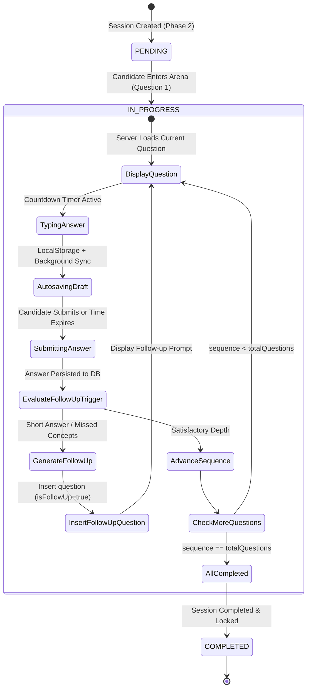

# 🚀 Implementation Plan — Phase 3: Text-Based Interactive Interview Engine

**Document:** Phase 3 Detailed Implementation Plan  
**Module:** SKILLEZO AI Mock Interview Coach  
**Location:** `doc/ai-mock-interview-coach/06_PHASE_3_TEXT_INTERVIEW_ENGINE_PLAN.md`  
**Status:** 📋 Ready for Execution  
**Target Architecture:** Next.js 16 (App Router) + React 19 + Express 5 + MongoDB Mongoose 9 + Vitest v4 + Tailwind CSS + Better Auth  

---

## 📌 1. Objective & Scope

The objective of **Phase 3** is to deliver the **first fully functional end-to-end interactive mock interview experience** using text responses.

Candidates will enter a live interview arena, navigate through server-controlled questions sequentially, view real-time countdown timers, draft answers with autosave protection, submit responses, trigger adaptive AI follow-up questions, and complete their interview session.

### 🚫 Strict Non-Redundancy & Boundary Rules
- **No parallel authentication or user lookup:** Fully reuse `requireAuth` and candidate identity via `req.user.id`.
- **No duplicate Gemini clients or models:** Reuse `GeminiProvider` (`server/src/core/ai/providers/gemini.provider.ts`) via `InterviewAIService`.
- **No evaluation or scoring calculations in this phase:** Scoring rubrics, AI grading, and report generation belong strictly to Phase 4 & Phase 5. Focus purely on interview execution, progression, answer persistence, and follow-ups.
- **Strict candidate data isolation:** Enforce `userId` checks on all operations (`findByUserAndId`).
- **No database breaking changes:** Leverage the existing `InterviewSession`, `InterviewQuestion`, and `InterviewAnswer` schemas already implemented and indexed in Phase 1 & 2.

---

## 🏗️ 2. Architectural Design & State Machine



---

## 🛠️ 3. Detailed Component & Service Specifications

### 3.1 Data Access Layer (Backend)

#### A. Repository Layer Updates
1. **`InterviewAnswerRepository.ts`** (New repository in `server/src/database/repositories/interview/`):
   - Extends `BaseRepository<IInterviewAnswer>` (using `InterviewAnswerModel`).
   - `findBySessionId(sessionId: string)`: Retrieves all submitted answers for a session.
   - `findBySessionAndQuestion(sessionId: string, questionId: string)`: Finds existing answer to prevent duplicate submissions.
   - `upsertAnswer(sessionId: string, questionId: string, userId: string, answerText: string, durationSeconds?: number)`: Idempotent submission.
   - `countAnswersBySessionId(sessionId: string)`: Counts submitted answers.

2. **`InterviewQuestionRepository.ts`** (Enhancements):
   - `insertFollowUpQuestion(questionData: Partial<IInterviewQuestion>)`: Inserts dynamic follow-up linked to `parentQuestionId` with recalculated sequence numbers.
   - `findNextUnansweredQuestion(sessionId: string)`: Finds the earliest question in sequence without a corresponding answer in `interview_answers`.

3. **`InterviewSessionRepository.ts`** (Enhancements):
   - `updateSessionProgress(sessionId: string, currentQuestionIndex: number, status?: InterviewSessionStatus)`: Atomic progression update.
   - `completeSession(sessionId: string)`: Sets `status: InterviewSessionStatus.COMPLETED` and `completedAt: new Date()`.

---

### 3.2 Service Layer Updates (`server/src/modules/interview-coach/services/`)

#### A. `InterviewSessionService` Enhancements
1. **`startOrResumeSession(userId: string, sessionId: string)`**:
   - Validates candidate ownership via `findByUserAndId`.
   - If session is `PENDING`, transitions to `IN_PROGRESS` and sets `startedAt = new Date()`.
   - Fetches all session questions and submitted answers.
   - Determines `currentQuestionIndex` and the exact question the candidate needs to answer next.
   - Returns session state, list of questions, answered status map, and active question details.

2. **`submitAnswer(userId: string, sessionId: string, questionId: string, payload: SubmitAnswerInput)`**:
   - Validates session ownership and verifies session status is `IN_PROGRESS`.
   - Validates that `questionId` belongs to `sessionId`.
   - Verifies the candidate is answering the expected sequential question (blocks sequence manipulation).
   - Creates or updates `InterviewAnswer` document:
     - `answerText`: Cleaned text response.
     - `responseDurationSeconds`: Time spent on this specific question.
     - `submittedAt`: Current timestamp.
   - Checks if adaptive follow-up is warranted (e.g., if response is under 30 words or candidate asks for clarification).
   - If follow-up triggered and session has not exceeded maximum questions:
     - Generates 1 follow-up question via `InterviewAIService`.
     - Inserts follow-up question directly following current sequence (`sequence = current + 1`, shifting subsequent sequences).
     - Increments `totalQuestions` on the session.
   - Advances `currentQuestionIndex`.
   - If all questions answered:
     - Transitions session to `COMPLETED`, records `completedAt = new Date()`.
   - Returns `{ answer, nextQuestion, isCompleted, progress: { current, total } }`.

#### B. `InterviewAIService` Adaptive Follow-Up Engine
1. **`generateFollowUpQuestion(params: FollowUpParams)`**:
   - Takes: `role`, `seniorityLevel`, `originalQuestionText`, `candidateAnswerText`, `expectedConcepts`.
   - Uses `GeminiProvider` to generate a 1-sentence targeted follow-up probing deeper technical implementation or trade-offs.
   - Validates output with Zod (`FollowUpQuestionSchema`).
   - If Gemini is unreachable, uses a deterministic follow-up fallback (e.g. *"Can you walk through how you would handle performance or edge cases in this scenario?"*).

---

### 3.3 Backend API Endpoints & Validation (`/api/interviews/`)

| Method | Endpoint | Purpose | Access & Validation |
| :--- | :--- | :--- | :--- |
| `POST` | `/api/interviews/sessions/:sessionId/start` | Starts or resumes interview session; returns active question | Protected (`requireAuth`) |
| `GET` | `/api/interviews/sessions/:sessionId/current-question` | Retrieves active unanswered question and session clock | Protected (`requireAuth`) |
| `POST` | `/api/interviews/sessions/:sessionId/answers` | Submits candidate answer, records duration, progresses session | Protected + `validate(submitAnswerSchema)` |
| `GET` | `/api/interviews/sessions/:sessionId/answers` | Retrieves candidate's answers for active or completed session | Protected (`requireAuth`) |
| `POST` | `/api/interviews/sessions/:sessionId/complete` | Explicitly completes/concludes interview session | Protected (`requireAuth`) |

#### Input Schema (`interview.schemas.ts`):
```typescript
export const submitAnswerSchema = z.object({
  questionId: z.string().min(1, "Question ID is required"),
  answerText: z.string().min(1, "Answer cannot be empty").max(10000, "Answer too long"),
  responseDurationSeconds: z.number().int().min(0).max(3600).optional(),
});
```

---

### 3.4 Frontend Candidate Live Arena (Next.js 16 & React 19)

#### A. Interactive Workspace Page
- **Route**: `client/app/dashboard/interview-coach/session/[sessionId]/page.tsx`
- **Client Components** in `client/components/dashboard/interview-coach/arena/`:
  1. **`InterviewArenaHeader.tsx`**:
     - Displays role title, seniority badge, and interview format.
     - Live progress bar indicator (e.g., *"Question 2 of 5"*).
     - "End Interview Early" modal trigger with confirmation prompt.
  2. **`QuestionDisplayCard.tsx`**:
     - Question text rendered prominently with category badge and difficulty indicator.
     - "Expected Areas" hint pill (without revealing model answers).
     - Spoken question audio button (prepared for future voice integration).
  3. **`LiveCountdownTimer.tsx`**:
     - Circular / linear progress timer showing allocated question time (e.g., 3:00 min).
     - Color transitions:
       - 🟢 Normal (> 60s)
       - 🟡 Amber warning (<= 60s)
       - 🔴 Red pulse (<= 20s)
     - Grace period audio chime or soft notification on timeout.
  4. **`AnswerEditor.tsx`**:
     - Distraction-free text response area.
     - Real-time character count and word count indicators.
     - "Draft saved" status pill with subtle checkmark.
     - Keyboard shortcut: `Ctrl + Enter` (or `Cmd + Enter`) to submit.
  5. **`InterviewCompletionView.tsx`**:
     - Rendered upon final answer submission.
     - Celebratory completion animation with summary statistics:
       - Total questions answered
       - Total time taken
       - Average words per answer
     - Direct CTA: "View Evaluation & Readiness Report" (routing to Phase 5 report page).

#### B. Autosave & Local Resilience Mechanics
- Draft responses are keyed in `localStorage` under `skillezo_draft_${sessionId}_${questionId}`.
- Debounced by 300ms on typing to guarantee zero lag in React 19.
- On browser reload, network drop, or tab close, the candidate's draft is restored automatically.
- Successfully submitting an answer clears the specific draft key.

---

## 🧪 4. Testing & Verification Strategy

### 4.1 Unit Tests (`server/tests/unit/modules/interview-coach-phase3.spec.ts`)
- [ ] Answer model validation & unique compound index constraint tests.
- [ ] `InterviewSessionService.startOrResumeSession` state transition (`PENDING` $\rightarrow$ `IN_PROGRESS`).
- [ ] `InterviewSessionService.submitAnswer` validation, duration recording, and progression.
- [ ] Prevention of duplicate answers for the same question.
- [ ] Out-of-order question submission rejection.
- [ ] Automatic completion transition when the last question is submitted.
- [ ] Adaptive follow-up generator triggering logic and offline fallback.

### 4.2 Integration Tests (`server/tests/integration/interview-coach-phase3.routes.spec.ts`)
- [ ] `POST /api/interviews/sessions/:id/start` requires authentication.
- [ ] Candidate A cannot submit answers to Candidate B's session (candidate isolation).
- [ ] `POST /api/interviews/sessions/:id/answers` validates payload with Zod.
- [ ] End-to-end full interview session run (Create $\rightarrow$ Start $\rightarrow$ Answer all $\rightarrow$ Complete).

### 4.3 Client Quality Checks
- [ ] TypeScript compilation check: `npm --prefix client run type-check` (0 errors).
- [ ] Component rendering unit tests with React Testing Library.

---

## 📅 5. Step-by-Step Implementation Sequence

```
Step 1: Domain & Repositories Foundation
  ├── Create server/src/database/repositories/interview/InterviewAnswerRepository.ts
  ├── Register in server/src/database/repositories/interview/index.ts
  └── Add question progression methods to InterviewQuestionRepository & InterviewSessionRepository

Step 2: Service Layer & Follow-Up Engine
  ├── Add submitAnswerSchema to server/src/modules/interview-coach/validation/interview.schemas.ts
  ├── Implement adaptive follow-up in server/src/modules/interview-coach/services/interview-ai.service.ts
  └── Implement startOrResumeSession & submitAnswer in InterviewSessionService

Step 3: Controller & Routes
  ├── Implement route handlers in interview.controller.ts
  └── Mount /sessions/:sessionId/start, /current-question, /answers in interview.routes.ts

Step 4: Automated Backend Test Suites
  ├── Author unit tests in tests/unit/modules/interview-coach-phase3.spec.ts
  ├── Author integration tests in tests/integration/interview-coach-phase3.routes.spec.ts
  └── Verify all test suites pass

Step 5: Frontend Candidate Arena        
  ├── Create client types in client/types/interview-coach.ts
  ├── Build arena components (Header, QuestionCard, Timer, AnswerEditor, CompletionView)
  └── Build workspace page at client/app/dashboard/interview-coach/session/[sessionId]/page.tsx

Step 6: End-to-End Verification & Documentation Update
  ├── Test full candidate flow in browser
  └── Update doc/ai-mock-interview-coach/05_ACTIVITY_AND_TASK_TRACKER.md
```

---

## 🏁 Exit Criteria for Phase 3
1. Authenticated candidate can start an interview session and step through all questions sequentially.
2. Candidate cannot access or submit answers to another candidate's session.
3. Every answer is persisted to MongoDB with timestamps and duration metrics.
4. Refreshing the browser or reconnecting restores the exact active question and draft.
5. Submitting the final question reliably transitions the session status to `COMPLETED`.
6. All automated backend and frontend test suites pass with 0 errors.

