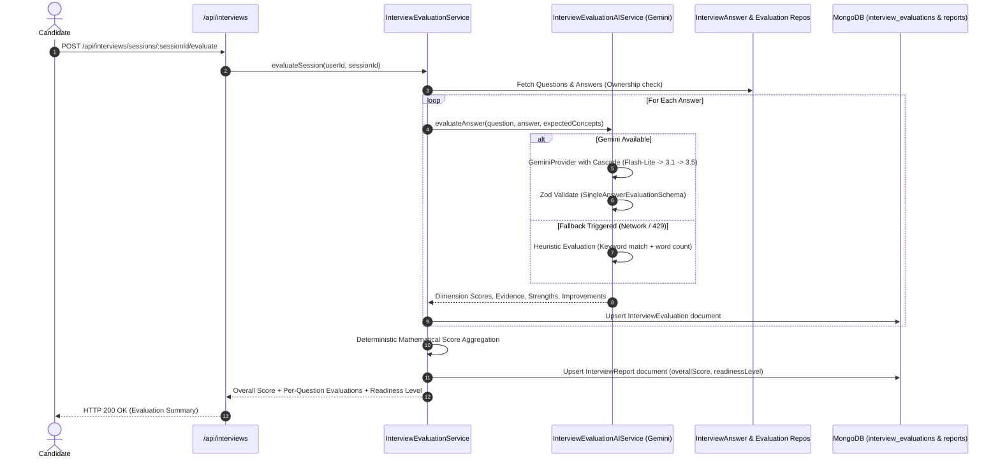

# 🚀 Implementation Plan — Phase 4: AI Evaluation & Scoring Engine

**Document:** Phase 4 Detailed Technical Implementation Plan  
**Module:** SKILLEZO AI Mock Interview Coach  
**Location:** `doc/ai-mock-interview-coach/07_PHASE_4_AI_EVALUATION_AND_SCORING_ENGINE_PLAN.md`  
**Status:** 📋 Ready for Execution  
**Target Architecture:** Next.js 16 (App Router) + React 19 + Express 5 + MongoDB Mongoose 9 + Vitest v4 + Tailwind CSS + Better Auth  

---

## 📌 1. Objective & Scope

The objective of **Phase 4** is to evaluate individual candidate answers using a transparent, multi-dimensional rubric, generate evidence-backed feedback, and produce consistent, deterministic overall readiness scores.

### 🚫 Strict Architectural Boundaries & Non-Redundancy Rules
1. **AI as an Objective Evaluator, Not the Score Calculator**:
   - Google Gemini evaluates semantic content, extracts key evidence, identifies strengths, improvement areas, and concept coverage.
   - Deterministic TypeScript code in Node.js aggregates category and overall scores (0–100) mathematically using fixed, weighted formulas. This guarantees zero score inflation and eliminates AI hallucination.
2. **Re-use Existing Provider Infrastructure**:
   - Consumes existing `GeminiProvider` (`server/src/core/ai/providers/gemini.provider.ts`) via `InterviewEvaluationAIService`.
   - No parallel SDK instances, duplicate HTTP clients, or unvalidated prompts.
3. **Re-use Existing Database Models**:
   - `InterviewEvaluation.model.ts` (collection: `interview_evaluations`) and `InterviewReport.model.ts` (collection: `interview_reports`) were created and indexed in Phase 1.
   - No schema changes required. We will build the repository and domain layer on top of them.
4. **Candidate Data Isolation**:
   - Enforce query-level checks (`findByUserAndId` / `findBySessionId`) to guarantee candidates can only evaluate and view their own sessions.
5. **Deterministic Offline Fallback Shield**:
   - If Gemini is unreachable or rate-limited, a heuristic fallback evaluator computes baseline scores from word count, expected keyword matches, and structural signals so the candidate's session evaluation never fails.

---

## 📊 2. Versioned 5-Dimension Scoring Rubric (v1.0.0)

Every answer is evaluated across 5 core dimensions on a scale of **0 to 100**:

| Dimension | Key Identifier | Description | Technical Weight | Behavioral/HR Weight | Managerial Weight |
| :--- | :--- | :--- | :---: | :---: | :---: |
| **Technical Accuracy & Relevance** | `technicalAccuracy` | Correctness of technical concepts, algorithms, tools, and relevance to question prompt. | **30%** | **15%** | **20%** |
| **Problem-Solving Depth & Trade-offs** | `problemSolvingDepth` | Depth of reasoning, edge-case consideration, scalability, and architectural trade-offs. | **25%** | **25%** | **30%** |
| **Answer Structure & Methodology** | `answerStructure` | Logical organization, STAR framework (for behavioral), step-by-step clarity. | **20%** | **25%** | **20%** |
| **Key Concept & Keyword Coverage** | `conceptCoverage` | Coverage of expected competency concepts and domain terminology defined in the question plan. | **15%** | **15%** | **15%** |
| **Communication & Professional Tone** | `communicationTone` | Clarity, concise articulation, professional demeanor, avoidance of rambling. | **10%** | **20%** | **15%** |

### Readiness Level Classification
Aggregated overall scores (0–100) map mathematically to standardized readiness classifications:
- **`role_model` (90 – 100)**: Exceptional mastery, deep trade-off analysis, articulate executive presence.
- **`interview_ready` (75 – 89)**: Strong technical understanding, structured reasoning, ready for real company interviews.
- **`developing` (55 – 74)**: Solid foundational concepts, but lacks depth, missed key trade-offs, or needs better structure.
- **`needs_practice` (0 – 54)**: Significant gaps in technical concepts, incomplete answers, or unaddressed prompt requirements.

---

## 🏗️ 3. Detailed Component & Service Architecture



---

## 🛠️ 4. File-by-File Implementation Plan

### 4.1 Data Access Layer (Backend)
1. **`InterviewEvaluationRepository.ts`** (New in `server/src/database/repositories/interview/`):
   - Extends `BaseRepository<IInterviewEvaluation>` (using `InterviewEvaluationModel`).
   - `findBySessionId(sessionId: string)`: Retrieves all evaluations for a session.
   - `findBySessionAndQuestion(sessionId: string, questionId: string)`: Retrieves evaluation for a specific question.
   - `upsertEvaluation(data: Partial<IInterviewEvaluation>)`: Idempotent persistence.
2. **`InterviewReportRepository.ts`** (New in `server/src/database/repositories/interview/`):
   - Extends `BaseRepository<IInterviewReport>` (using `InterviewReportModel`).
   - `findBySessionId(sessionId: string)`: Retrieves final readiness report.
   - `findByUserId(userId: string)`: Retrieves candidate's report history.
   - `upsertReport(data: Partial<IInterviewReport>)`: Idempotent persistence.
3. **Update Barrel Export**: Register both in `server/src/database/repositories/interview/index.ts`.

---

### 4.2 AI Evaluation Service Layer (`server/src/modules/interview-coach/services/`)
1. **`interview-evaluation-ai.service.ts`** (New):
   - Zod Output Schema:
     ```typescript
     export const SingleAnswerEvaluationSchema = z.object({
       scores: z.object({
         technicalAccuracy: z.number().min(0).max(100),
         problemSolvingDepth: z.number().min(0).max(100),
         answerStructure: z.number().min(0).max(100),
         conceptCoverage: z.number().min(0).max(100),
         communicationTone: z.number().min(0).max(100),
       }),
       evidence: z.array(z.string()).min(1),
       strengths: z.array(z.string()).min(1),
       improvementAreas: z.array(z.string()).min(1),
       keyConceptsIdentified: z.array(z.string()),
       modelAnswerSuggestion: z.string().min(20),
     });
     ```
   - Uses `GeminiProvider.generateStructured` with versioned system prompt (`promptVersion: "1.0.0"`).
   - Deterministic Fallback Shield: Analyzes keyword coverage from `question.expectedConcepts`, word count density, and paragraph structuring to assign fair, defensive baseline scores if AI is offline.

2. **`interview-evaluation.service.ts`** (New):
   - Orchestrates the full evaluation lifecycle:
     - `evaluateSession(userId, sessionId)`: Iterates through answers, calls AI evaluator, persists to `interview_evaluations`.
     - `aggregateSessionScore(evaluations, interviewType)`: Computes mathematically weighted dimension averages and overall score (0–100).
     - `mapReadinessLevel(overallScore)`: Maps numeric score to `role_model`, `interview_ready`, `developing`, or `needs_practice`.
     - `generateReport(userId, sessionId, evaluations, scoreResult)`: Compiles strengths, areas for improvement, and recommendations into `InterviewReport`.
     - `getSessionEvaluationSummary(userId, sessionId)`: Retrieves completed evaluation summary for the client.

---

### 4.3 REST API Endpoints & Route Definitions
Mounted under `/api/interviews` in `interview.routes.ts`:

| Method | Endpoint | Description | Validation / Access |
| :--- | :--- | :--- | :--- |
| `POST` | `/api/interviews/sessions/:sessionId/evaluate` | Triggers evaluation for completed session answers | Protected (`requireAuth` + `sessionParamSchema`) |
| `GET` | `/api/interviews/sessions/:sessionId/evaluations` | Retrieves question-by-question evaluations | Protected (`requireAuth` + `sessionParamSchema`) |
| `GET` | `/api/interviews/sessions/:sessionId/report` | Retrieves final readiness report and scores | Protected (`requireAuth` + `sessionParamSchema`) |

---

### 4.4 Client-Side Contracts & Types
Update `client/types/interview-coach.ts`:
- Add `DimensionScores`: `{ technicalAccuracy, problemSolvingDepth, answerStructure, conceptCoverage, communicationTone }`.
- Add `QuestionEvaluation`: Includes scores, evidence, strengths, improvements, model answer.
- Add `InterviewReport`: Includes overallScore, readinessLevel, dimensionScores, recommendations.

---

## 🧪 5. Testing & Verification Plan

### 5.1 Unit Tests (`server/tests/unit/modules/interview-coach-phase4.spec.ts`)
- [ ] Zod schema validation for Gemini structured output.
- [ ] Deterministic mathematical aggregation formula (verifies that weighted percentages sum to 100% and output matches exact calculation).
- [ ] Readiness level threshold mapping (`role_model`, `interview_ready`, `developing`, `needs_practice`).
- [ ] Heuristic fallback evaluator produces valid bounded scores (0–100) when AI provider is unavailable.
- [ ] Idempotent upsert verification for evaluations and reports.

### 5.2 Route Integration Tests (`server/tests/integration/interview-coach-phase4.routes.spec.ts`)
- [ ] `POST /api/interviews/sessions/:sessionId/evaluate` requires authentication.
- [ ] Candidate A cannot trigger evaluation or view report for Candidate B's session.
- [ ] Returns HTTP 200 with completed report, overall score, and dimension breakdowns.

### 5.3 Quality & Type Checks
- [ ] `npm --prefix server run type-check` (0 errors).
- [ ] `npm --prefix client test` and client `tsc --noEmit` (0 errors).

---

## 📅 6. Execution Sequence

```
Step 1: Repositories Foundation
  ├── Create server/src/database/repositories/interview/InterviewEvaluationRepository.ts
  ├── Create server/src/database/repositories/interview/InterviewReportRepository.ts
  └── Register in repositories/interview/index.ts

Step 2: AI Evaluator & Heuristic Fallback Engine
  ├── Create server/src/modules/interview-coach/services/interview-evaluation-ai.service.ts
  └── Implement Zod schema, Gemini integration, and deterministic heuristic fallback

Step 3: Core Evaluation Orchestrator & Scoring Math
  ├── Create server/src/modules/interview-coach/services/interview-evaluation.service.ts
  └── Implement session evaluation, deterministic weighting, and report persistence

Step 4: Controller & Routes
  ├── Add evaluateSession, getSessionEvaluations, getSessionReport in interview.controller.ts
  └── Mount endpoints in server/src/modules/interview-coach/routes/interview.routes.ts

Step 5: Client Contracts
  └── Update client/types/interview-coach.ts with evaluation and report interfaces

Step 6: Automated Testing & Verification
  ├── Author unit tests in tests/unit/modules/interview-coach-phase4.spec.ts
  ├── Author integration tests in tests/integration/interview-coach-phase4.routes.spec.ts
  ├── Run full test suite & type-check
  └── Update doc/ai-mock-interview-coach/05_ACTIVITY_AND_TASK_TRACKER.md
```

---

## 🏁 Exit Criteria for Phase 4
1. All candidate answers in a completed session can be evaluated via `POST /api/interviews/sessions/:sessionId/evaluate`.
2. Evaluations include actionable evidence, strengths, improvement areas, and concept coverage.
3. Final overall score (0–100) is calculated deterministically by Node.js application code without score inflation.
4. If Gemini API is offline or rate-limited, the heuristic fallback generates valid scores without crashing.
5. Candidate isolation is strictly enforced.
6. All automated tests pass with 0 TypeScript errors.

