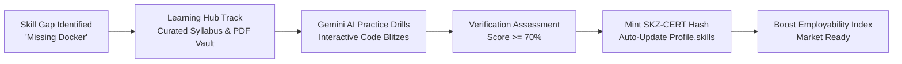
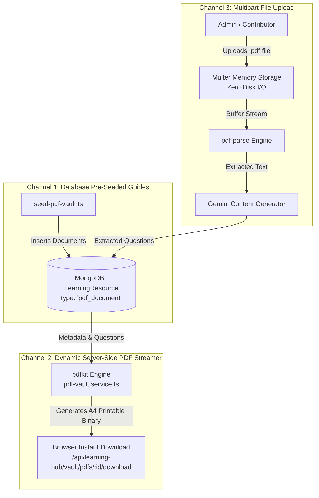
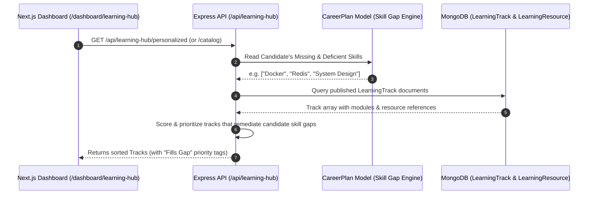
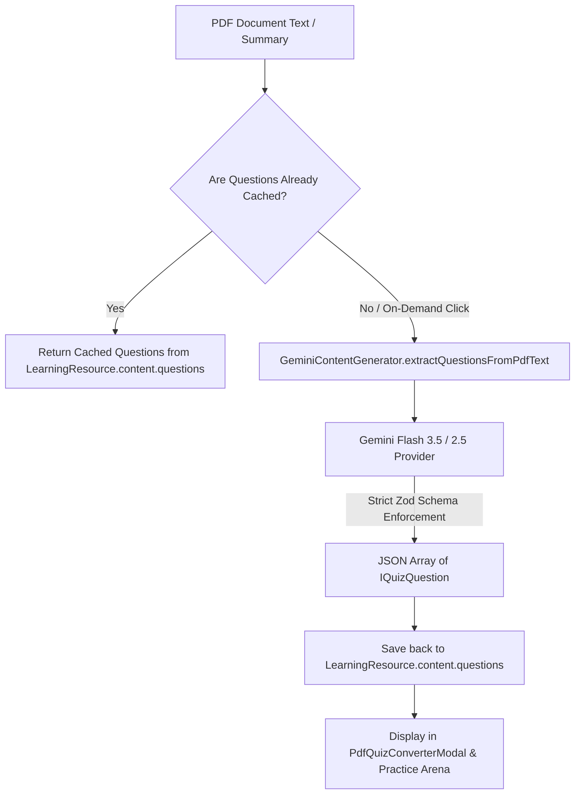
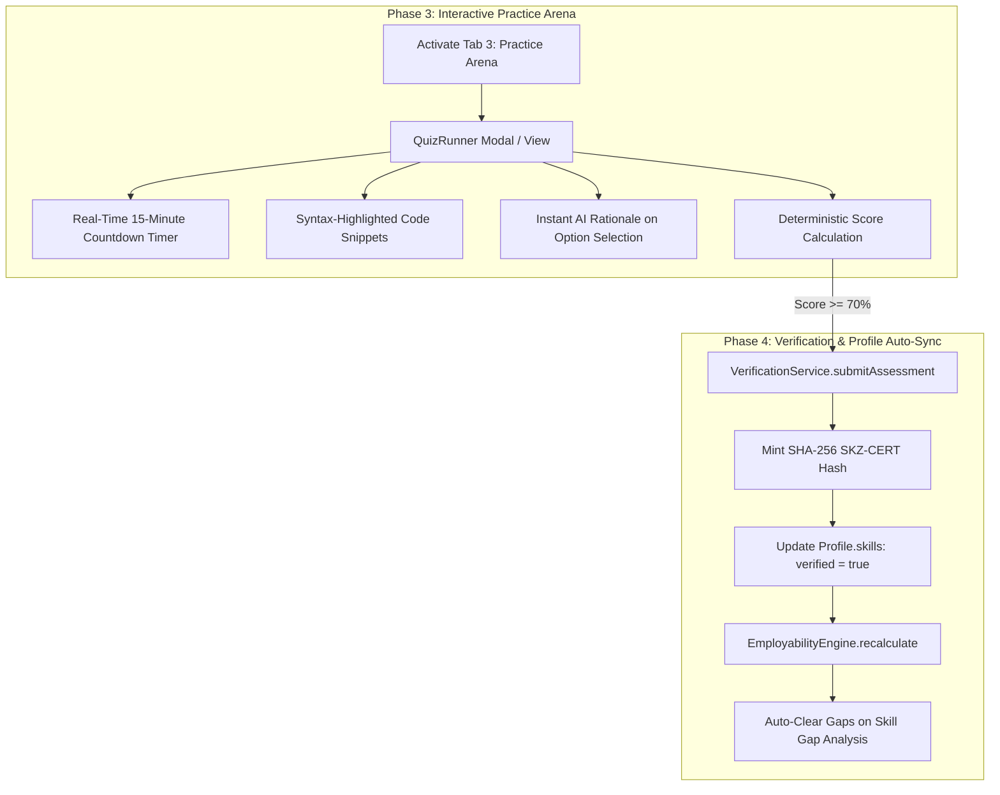

# 🎓 SKILLEZO AI Learning Hub — Complete System Architecture & Data Flow

> **Document Type:** Master Architecture & Engineering Data Flow Blueprint  
> **Target Module:** SKILLEZO Learning Hub (`client` + `server` + `database`)  
> **Route:** `/dashboard/learning-hub`  
> **Last Updated:** October 2026  
> **Status:** Phase 1 & 2 Completed | Phase 3 & 4 Upcoming  

---

## 1. Executive Summary: What is the Learning Hub?

In SKILLEZO, candidates discover their market readiness through diagnostic modules:
1. **Resume Studio & ATS Analysis** detects missing keywords and unproven capabilities.
2. **Career GPS & Skill Gap Analysis** highlights exact missing skills (e.g., missing *Docker*, deficient in *System Design*).
3. **Employability Index** scores the candidate across 5 weighted pillars.

Previously, there was an **open educational loop**: when a candidate was told they were deficient in a critical skill, there was nowhere on SKILLEZO to bridge that gap. 

The **AI Learning Hub** closes this loop:


---

## 2. Implementation Status: What is Done vs. What is Next

| Phase / Feature | Component / Service | Status | Description |
| :--- | :--- | :--- | :--- |
| **Phase 1: Foundation (Backend)** | `LearningTrack.model.ts`, `LearningResource.model.ts`, `UserLearningProgress.model.ts` | ✅ **DONE** | MongoDB Mongoose schemas for tracks, modules, atomic resources, and learner tracking. |
| **Phase 1: Catalog API** | `learning-hub.service.ts`, `learning-hub.controller.ts`, `learning-hub.routes.ts` | ✅ **DONE** | Endpoints for catalog listing, category filtering, search, syllabus retrieval, and progress tracking. |
| **Phase 1: Seed Engine** | `seed-learning-hub.ts` | ✅ **DONE** | Seeds 5 production-grade tracks (React 19, Node.js, PostgreSQL, Docker/K8s, System Design). |
| **Phase 1: Frontend Hub** | `client/app/dashboard/learning-hub/page.tsx` + `TrackCard.tsx`, `TrackSyllabusModal.tsx` | ✅ **DONE** | Replaced placeholder with interactive tracks catalog, module progress indicators, and syllabus modal. |
| **Phase 2: PDF Vault Backend** | `pdf-vault.service.ts`, `pdf-upload.middleware.ts` | ✅ **DONE** | Multer memory storage, `pdf-parse` text extraction, `pdfkit` dynamic A4 streaming generator. |
| **Phase 2: PDF Seed Vault** | `seed-pdf-vault.ts` | ✅ **DONE** | Seeds 5 high-signal technical PDF guides with pre-extracted questions and markdown summaries. |
| **Phase 2: Gemini AI Extraction** | `gemini-content.generator.ts` | ✅ **DONE** | Strict Zod structured output extraction of interactive MCQs and code snippets from PDF text. |
| **Phase 2: Frontend PDF Vault** | `PdfCard.tsx`, `PdfPreviewModal.tsx`, `PdfQuizConverterModal.tsx` | ✅ **DONE** | Searchable & filterable vault cards, in-browser reader, and 1-click AI quiz generation modal. |
| **Phase 3: Interactive Practice Arena** | `QuizRunnerModal.tsx` / `/quiz/[id]` | ⏳ **NEXT** | Active question timer, syntax-highlighted code snippets, real-time explanation reveal, score grading. |
| **Phase 4: Verification Bridge** | `VerificationService` integration | ⏳ **PENDING** | Automatically minting `SKZ-CERT-...` and setting `Profile.skills[skill].verified = true` upon scoring $\ge 70\%$. |
| **Phase 4: Skill-Gap 1-Click Link** | `/dashboard/skill-gap-analysis` UI | ⏳ **PENDING** | Adding direct "Learn on Hub" CTA buttons beside missing skills. |

---

## 3. Where Does the Data Come From? (Answering Your Core Questions)

### 3.1 "Where is the PDF coming from?"
The PDFs in the Technical PDF Vault arrive through **three distinct channels**:



1. **Pre-Seeded Catalog (`seed-pdf-vault.ts`)**:
   Contains curated technical cheat-sheets and interview guides (React 19 & Next.js 15, Node.js Concurrency, PostgreSQL Indexing, Docker & Kubernetes, System Design Cheat-Sheet) stored directly in MongoDB as `LearningResource` documents with `type: "pdf_document"`.
2. **On-The-Fly PDF Generator (`pdfkit`)**:
   When a user clicks **"Download Guide"** on any PDF card, the server endpoint `GET /api/learning-hub/vault/pdfs/:id/download` uses `pdfkit` to compile an A4 technical reference sheet with headers, skills breakdown, overview markdown, and extracted questions on the fly.
3. **Multipart PDF Upload (`POST /api/learning-hub/vault/upload`)**:
   Users/Admins can upload any raw PDF. Multer loads it into memory (no disk leaks), `pdf-parse` extracts the plain text, Gemini extracts the quiz questions, and saves it into the database.

---

### 3.2 "How does the Learning Tracks catalog get created and where does the info come from?"

The Learning Tracks catalog represents structured curricula (e.g. *Frontend Architecture*, *Cloud DevOps*).



1. **Database Source (`LearningTrack` collection)**:
   - Stored in MongoDB collection `learningtracks`.
   - Seeded by `server/src/database/seed-learning-hub.ts`.
   - Each track defines: `title`, `slug`, `category`, `targetRoles`, `targetSkills`, `difficulty`, `estimatedMinutes`, and an array of `modules`.
   - Each module references atomic `LearningResource` records (lessons, official doc links, quizzes).
2. **Personalization Engine (`/api/learning-hub/personalized`)**:
   - Queries the authenticated user's `CareerPlanModel`.
   - Identifies high-priority gaps from the **Skill Gap Engine**.
   - Tags tracks with `fillsGap: true` and floats them to the top of the candidate's view.

---

### 3.3 "Where does this PDF Question Bank come from?"

The question bank attached to each PDF document is generated through a **hybrid curation + AI extraction pipeline**:



1. **Structured Schema**:
   Every question adheres strictly to:
   ```typescript
   export interface IQuizQuestion {
     id: string;
     question: string;
     codeSnippet?: string;        // Optional syntax-highlighted code
     options: string[];           // Exactly 4 options
     correctOptionIndex: number;  // 0-3
     explanation: string;         // Why this answer is correct & others are wrong
     difficulty: "beginner" | "intermediate" | "advanced";
   }
   ```
2. **Deterministic Extraction via Gemini**:
   When **"Extract to AI Practice Quiz"** is clicked, `GeminiContentGenerator` passes the guide's content to Google Gemini with strict prompt instructions and Zod validation, guaranteeing 0 hallucination in answer indexing and formatting.
3. **Persistent Caching**:
   Once generated, questions are written into the document's `content.questions` array in MongoDB so future requests are instantaneous ($<20\text{ms}$).

---

## 4. End-to-End File Map & Code Locations

### 4.1 Client Layer (`client/`)
- [page.tsx](file:///x:/projects/next.js/office-Project/SKILLEZO.AI/client/app/dashboard/learning-hub/page.tsx): Main Learning Hub container (Tabs: Learning Tracks, PDF Vault, Practice Arena).
- [LearningHubHeader.tsx](file:///x:/projects/next.js/office-Project/SKILLEZO.AI/client/components/dashboard/learning-hub/LearningHubHeader.tsx): Header with greeting, readiness indicators, search, and tab switching.
- [SkillGapRecommendationBanner.tsx](file:///x:/projects/next.js/office-Project/SKILLEZO.AI/client/components/dashboard/learning-hub/SkillGapRecommendationBanner.tsx): Dynamic banner linking candidate's missing skills to recommended tracks.
- [TrackCard.tsx](file:///x:/projects/next.js/office-Project/SKILLEZO.AI/client/components/dashboard/learning-hub/TrackCard.tsx): Learning Track card with progress bar, skill pills, and "View Syllabus" trigger.
- [TrackSyllabusModal.tsx](file:///x:/projects/next.js/office-Project/SKILLEZO.AI/client/components/dashboard/learning-hub/TrackSyllabusModal.tsx): Interactive drawer/modal listing modules, lessons, and checkable completion toggles.
- [PdfCard.tsx](file:///x:/projects/next.js/office-Project/SKILLEZO.AI/client/components/dashboard/learning-hub/pdf-vault/PdfCard.tsx): PDF vault card with page badge, preview trigger, and 1-click quiz extraction CTA.
- [PdfPreviewModal.tsx](file:///x:/projects/next.js/office-Project/SKILLEZO.AI/client/components/dashboard/learning-hub/pdf-vault/PdfPreviewModal.tsx): In-browser reader modal with guide outline, included chapters, and download link.
- [PdfQuizConverterModal.tsx](file:///x:/projects/next.js/office-Project/SKILLEZO.AI/client/components/dashboard/learning-hub/pdf-vault/PdfQuizConverterModal.tsx): Modal displaying AI-extracted MCQs, syntax code blocks, and "Start Practice" action.
- [learning-hub.service.ts](file:///x:/projects/next.js/office-Project/SKILLEZO.AI/client/services/learning-hub.service.ts): Client API client talking to backend endpoints with fallback data.
- [learning-hub.ts](file:///x:/projects/next.js/office-Project/SKILLEZO.AI/client/types/learning-hub.ts): TypeScript interfaces for tracks, resources, progress, and PDF summaries.

### 4.2 Backend Layer (`server/`)
- [server.ts](file:///x:/projects/next.js/office-Project/SKILLEZO.AI/server/src/server.ts): Mounts `/api/learning-hub` routes.
- [learning-hub.routes.ts](file:///x:/projects/next.js/office-Project/SKILLEZO.AI/server/src/modules/learning-hub/learning-hub.routes.ts): REST routing table.
- [learning-hub.controller.ts](file:///x:/projects/next.js/office-Project/SKILLEZO.AI/server/src/modules/learning-hub/learning-hub.controller.ts): HTTP controller with authentication guards and validation.
- [learning-hub.service.ts](file:///x:/projects/next.js/office-Project/SKILLEZO.AI/server/src/modules/learning-hub/learning-hub.service.ts): Core track catalog, personalization, and progress tracking logic.
- [pdf-vault.service.ts](file:///x:/projects/next.js/office-Project/SKILLEZO.AI/server/src/modules/learning-hub/pdf-vault.service.ts): PDF listing, on-the-fly `pdfkit` binary builder, and Gemini quiz converter.
- [gemini-content.generator.ts](file:///x:/projects/next.js/office-Project/SKILLEZO.AI/server/src/modules/learning-hub/gemini-content.generator.ts): AI extraction prompt engine with strict Zod parsing.
- [pdf-upload.middleware.ts](file:///x:/projects/next.js/office-Project/SKILLEZO.AI/server/src/core/middleware/pdf-upload.middleware.ts): Memory-storage Multer upload handler.

### 4.3 Database Models & Seeds (`server/src/database/`)
- [LearningTrack.model.ts](file:///x:/projects/next.js/office-Project/SKILLEZO.AI/server/src/database/models/LearningTrack.model.ts): Mongoose schema for structured learning tracks.
- [LearningResource.model.ts](file:///x:/projects/next.js/office-Project/SKILLEZO.AI/server/src/database/models/LearningResource.model.ts): Schema for atomic lessons, docs, and PDF documents.
- [UserLearningProgress.model.ts](file:///x:/projects/next.js/office-Project/SKILLEZO.AI/server/src/database/models/UserLearningProgress.model.ts): Learner enrollment, completion IDs, and quiz scores.
- [seed-learning-hub.ts](file:///x:/projects/next.js/office-Project/SKILLEZO.AI/server/src/database/seed-learning-hub.ts): Standalone seeder for core tracks.
- [seed-pdf-vault.ts](file:///x:/projects/next.js/office-Project/SKILLEZO.AI/server/src/database/seed-pdf-vault.ts): Standalone seeder for PDF guides and question banks.

---

## 5. What We Need to Work on Next: Phase 3 & Phase 4 Roadmap

Now that the foundation and PDF ingestion are deployed and verified, here are the exact two remaining steps to complete the vision:



### Next Immediate Work Items:
1. **Interactive Quiz Runner Component (`QuizRunnerModal.tsx`)**:
   - Replace the static Phase 3 preview placeholder on Tab 3 with an active quiz runner.
   - Accepts any `IQuizQuestion[]` (whether from the PDF Vault converter or a Track quiz).
   - Features: Question stepper, answer option radio tiles, immediate explanation reveal, and final summary screen.
2. **Verification Service Bridge (`POST /api/learning-hub/resources/:id/submit-quiz`)**:
   - Upon scoring $\ge 70\%$, call `VerificationService` to mint a verifiable credential.
   - Automatically award the skill badge to the user's profile without manual recruiter review.
3. **Skill Gap Remediation Deep-Link**:
   - In `/dashboard/skill-gap-analysis`, place a **"Practice on Learning Hub"** button next to each missing skill that navigates directly to `/dashboard/learning-hub?search=SkillName`.
