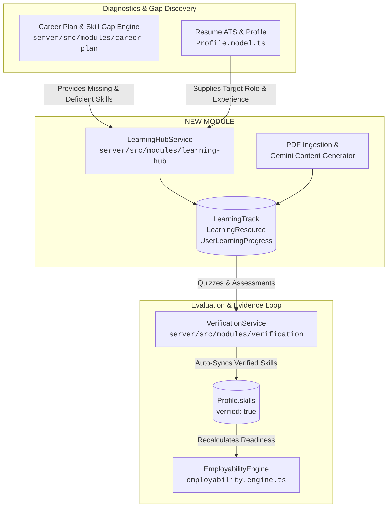
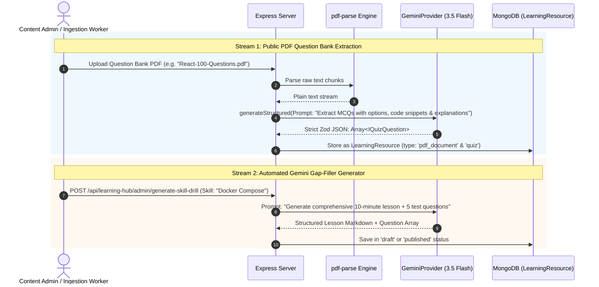
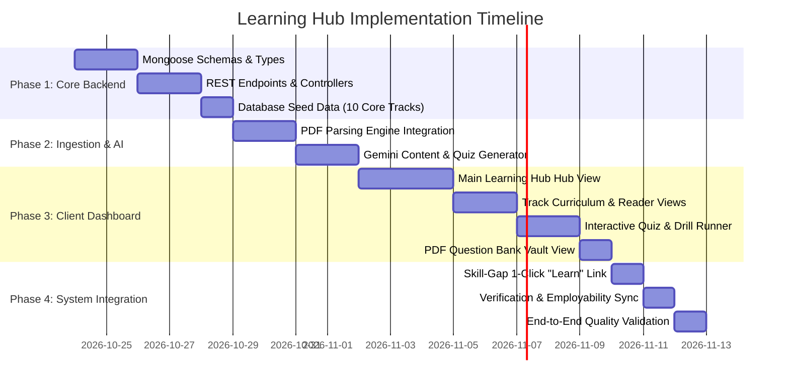

# 🎓 SKILLEZO Game Plan: AI Learning Hub Architecture & Integration

> **Document Type:** System Architecture Blueprint & Integration Master Game Plan  
> **Target System:** SKILLEZO Platform (`client`: Next.js App Router + `server`: Express/TypeScript + MongoDB/Mongoose)  
> **Target Route:** `/dashboard/learning-hub`  
> **Status:** APPROVED STRATEGY / ZERO-REGRESSION IMPLEMENTATION BLUEPRINT  
> **Author:** Antigravity AI Engineering  
> **Date:** October 2026  

---

## 1. Executive Summary & Vision

### 1.1 The Problem We Are Solving
In the current SKILLEZO platform, candidates discover their career status through several sophisticated diagnostics:
1. **Resume Studio & ATS Analysis** identifies weak bullets, missing keywords, and formatting flaws.
2. **Career GPS & Skill Gap Analysis** identifies exact missing and improvement skills against target roles (e.g. missing *Docker*, deficient in *System Design*).
3. **Employability Index** scores candidate market readiness across 5 weighted pillars.
4. **Skill Verification Hub** provides standardized technical assessments that issue cryptographic certificates (`SKZ-CERT-...`).

However, there is an open **educational loop**: when a candidate is told:
> *"You have a High-Priority gap in Docker Containerization and Redis Caching for Full-Stack Engineer"*,

the candidate currently has nowhere inside SKILLEZO to actually acquire or practice that knowledge. The `/dashboard/learning-hub` route is a placeholder `ComingSoonModule`.

### 1.2 The Hybrid Content Solution
As envisioned, the **Learning Hub** bridges this gap using a **4-Tier Hybrid Content Model**:
1. **Curated External Resources:** Authoritative documentation (MDN, React.dev, Docker Docs), high-signal cheat-sheets, and curated free video courses mapped to canonical skills.
2. **Public Question Bank & PDF Ingestion:** Storing and parsing publicly available technical interview question PDFs, cheat-sheets, and syllabus guides into searchable vaults and interactive drills.
3. **Gemini AI Generation & Review Engine:** Utilizing SKILLEZO's existing `GeminiProvider` to generate bite-sized lessons, real-world scenario questions, and code challenge snippets mapped directly to skill deficiencies.
4. **Assessment & Verification Bridge:** Learners practice via timed drills, MCQs, and coding challenges; scoring $\ge 70\%$ automatically unlocks verified credentials, updates `Profile.skills`, and directly boosts their **Employability Index**.

---

## 2. Current Codebase Audit & System Integration Anchors

A comprehensive inspection of the SKILLEZO codebase reveals that all supporting infrastructure is already in place. The Learning Hub does not need to reinvent the wheel—it hooks directly into existing models, engines, and providers.



### 2.1 Backend Existing Anchors

| Component | Codebase Location | Integration Hook for Learning Hub |
| :--- | :--- | :--- |
| **`ProfileModel`** | `server/src/database/models/Profile.model.ts` | Learning Hub tracks update `skills` with `verified: true`, `level`, `score`, and `source: SkillSource.ASSESSMENT`. |
| **`CareerPlanModel`** | `server/src/database/models/CareerPlan.model.ts` | Reads `gapsData.missingSkills` and `gapsData.improvementSkills` to construct a 1-click **"Personalized Curriculum"** for each candidate. |
| **`SkillGapEngine`** | `server/src/modules/career-plan/skill-gap.engine.ts` | Reuses canonical `ROLE_TAXONOMIES` (Full-Stack, Frontend, Backend, AI/ML, DevOps, Mobile) so track categories map 1:1 with industry definitions. |
| **`VerificationService`** | `server/src/modules/verification/` | When a user completes a track's final assessment, it delegates to `VerificationService.submitAssessment()` to mint SHA-256 certificate hashes (`SKZ-CERT-...`). |
| **`EmployabilityEngine`** | `server/src/modules/career-plan/employability.engine.ts` | Technical Readiness (40%) and Skill Alignment (10%) automatically rise as candidates clear learning modules. |
| **`GeminiProvider`** | `server/src/core/ai/providers/gemini.provider.ts` | Provides `generateStructured<T>()` with Zod validation to auto-generate MCQ sets, lesson summaries, and coding snippets. |
| **PDF Extraction** | `server/package.json` (`pdf-parse`) | Already installed and utilized in `resume.service.ts`; will be reused for PDF Question Bank parsing. |

### 2.2 Frontend Existing Anchors

| Component | Codebase Location | Integration Hook for Learning Hub |
| :--- | :--- | :--- |
| **Sidebar Navigation** | `client/components/layout/Sidebar.tsx` | Already contains `{ label: 'Learning Hub', href: '/dashboard/learning-hub', icon: GraduationCap }` under `SKILLS & LEARNING`. |
| **Learning Hub Page** | `client/app/dashboard/learning-hub/page.tsx` | Currently renders `ComingSoonModule`; will be replaced with the full Learning Hub dashboard. |
| **API Client** | `client/lib/api.ts` (`apiFetch`) | Handles cookie-based and Bearer-token authenticated requests to backend endpoints. |
| **Assessment Components** | `client/components/dashboard/verification/` | Reuses modal and quiz runner patterns (`AssessmentModal.tsx`, `AssessmentCard.tsx`, `CertificateModal.tsx`). |

---

## 3. Database Architecture & Data Models (MongoDB / Mongoose)

To support structured tracks, modular resources, question banks, and learner progress without data bloat, three new models will be created in `server/src/database/models/`:

### 3.1 `LearningTrack.model.ts`
Represents an organized learning curriculum (e.g. *"Full-Stack React & Next.js Architecture"*, *"Backend Distributed Systems & Redis"*).

```typescript
export interface ITrackModule {
  id: string;
  title: string;
  description?: string;
  order: number;
  resourceIds: Types.ObjectId[]; // Ordered references to LearningResource
}

export interface ILearningTrack extends Document {
  _id: Types.ObjectId;
  title: string;
  slug: string;
  category: "Frontend" | "Backend" | "Database" | "Cloud" | "DevOps" | "System Design" | "AI/ML";
  description: string;
  targetRoles: string[];        // e.g. ["Full-Stack Engineer", "Frontend Engineer"]
  targetSkills: string[];       // e.g. ["React", "Next.js", "TypeScript"]
  difficulty: "beginner" | "intermediate" | "advanced";
  estimatedMinutes: number;
  iconName: string;            // Lucide icon name
  accentColor: string;         // e.g. "#3D5AFE", "#10B981"
  modules: ITrackModule[];
  finalAssessmentTopicId?: string; // Links to Verification assessment topic (e.g. "react")
  isFeatured: boolean;
  published: boolean;
  enrollmentCount: number;
  createdAt: Date;
  updatedAt: Date;
}
```

### 3.2 `LearningResource.model.ts`
Represents atomic units of content: lessons, external documentation links, PDF cheat-sheets, or interactive question banks.

```typescript
export type ResourceType = 
  | "lesson"          // Markdown-formatted bite-sized tutorial
  | "external_doc"    // Official docs (React, MDN, Docker, PostgreSQL)
  | "external_video"  // Curated high-signal YouTube/freeCodeCamp video
  | "pdf_document"    // Curated question bank, interview guide, cheat-sheet
  | "quiz"            // Interactive MCQ assessment
  | "code_drill";     // Practical coding snippet challenge

export interface IQuizQuestion {
  id: string;
  question: string;
  codeSnippet?: string;
  options: string[];
  correctOptionIndex: number;
  explanation: string;
  difficulty: "beginner" | "intermediate" | "advanced";
}

export interface ILearningResource extends Document {
  _id: Types.ObjectId;
  title: string;
  slug: string;
  type: ResourceType;
  category: string;
  skills: string[];            // e.g. ["React", "Hooks", "Concurrency"]
  difficulty: "beginner" | "intermediate" | "advanced";
  estimatedMinutes: number;
  
  // Content payloads depending on type
  content: {
    markdown?: string;          // Rich text / lesson markdown
    externalUrl?: string;       // Direct link to docs or video
    provider?: string;          // "Official Docs", "freeCodeCamp", "MDN", "YouTube"
    pdfKey?: string;            // PDF storage filename/key
    pdfPageCount?: number;
    downloadAllowed?: boolean;
    questions?: IQuizQuestion[]; // Structured questions for quizzes/drills
  };

  source: "curated" | "public_bank" | "gemini_generated" | "skillezo_original";
  reviewStatus: "draft" | "reviewed" | "published";
  createdAt: Date;
  updatedAt: Date;
}
```

### 3.3 `UserLearningProgress.model.ts`
Tracks candidate enrollment, lesson completions, quiz submissions, and bookmarks.

```typescript
export interface IQuizAttempt {
  resourceId: Types.ObjectId;
  score: number;
  passingScore: number;
  passed: boolean;
  selectedAnswers: Record<string, number>;
  attemptedAt: Date;
}

export interface IUserLearningProgress extends Document {
  _id: Types.ObjectId;
  userId: string;
  enrolledTrackIds: Types.ObjectId[];
  completedResourceIds: Types.ObjectId[];
  inProgressTrackId?: Types.ObjectId;
  lastAccessedResourceId?: Types.ObjectId;
  quizAttempts: IQuizAttempt[];
  bookmarkedResourceIds: Types.ObjectId[];
  totalLearningMinutes: number;
  lastActiveAt: Date;
  createdAt: Date;
  updatedAt: Date;
}
```

---

## 4. Content Ingestion & AI Generation Pipelines



### 4.1 Stream 1: Curated External Resources (Docs, Videos, Cheat-Sheets)
- High-quality, authoritative URLs tagged by exact skill taxonomy (e.g. `React`, `Docker`, `PostgreSQL`).
- Rendered in client cards with provider badges (`MDN Web Docs`, `Official React Docs`, `freeCodeCamp`, `AWS Documentation`).
- Candidates can open embedded reader/viewer or click direct deep-links, tracking completion.

### 4.2 Stream 2: Public Question Bank & PDF Ingestion
- Upload PDF question banks or cheat-sheets through admin endpoint with `multer` memory storage.
- Reuses `pdf-parse` to extract text content and page counts.
- Gemini decomposes the document into:
  1. A searchable PDF document viewer entry with download option.
  2. Extracted interactive quiz questions for direct in-browser drills.

### 4.3 Stream 3: Gemini AI Generation & Validation Engine
- Leverages `GeminiProvider.generateStructured<T>()` with strict schema validation.
- Allows admins or on-demand systems to generate targeted drills for missing skills with high specificity (e.g., *React Server Actions with Zod validation* or *PostgreSQL EXPLAIN ANALYZE indexing*).
- All AI-generated content includes:
  - Concept explanation with real-world architectural context.
  - Practical code snippet or architectural diagram.
  - 4 options per question with detailed rationale for both correct and distractor answers.

### 4.4 Stream 4: Assessment Engine & Bridge to Skill Verification
- When a candidate finishes a learning track, they can take the track's **Final Verification Assessment**.
- Handled seamlessly by `VerificationService`:
  - Grades submission against `ASSESSMENT_BANK`.
  - Mints an immutable SHA-256 certificate: `SKZ-CERT-<HASH>`.
  - Automatically updates `ProfileModel.skills[skill].verified = true` and awards competency levels (1–5).
  - Immediately recalculates the user's **Employability Index**.

---

## 5. Backend REST API Specifications (`server/src/modules/learning-hub`)

Mounted at `/api/learning-hub` in `server/src/server.ts`:

### 5.1 Public / Learner Endpoints

| Method | Endpoint | Description | Auth Required |
| :--- | :--- | :--- | :--- |
| `GET` | `/api/learning-hub/catalog` | List all published tracks and resources with category/skill filters | Optional |
| `GET` | `/api/learning-hub/personalized` | Returns recommended tracks based on candidate's active Career Plan & missing skills | Required |
| `GET` | `/api/learning-hub/tracks/:slug` | Get full track curriculum, modules, and learner progress | Optional |
| `GET` | `/api/learning-hub/resources/:id` | Fetch specific lesson, doc metadata, or quiz (answers omitted) | Required |
| `POST` | `/api/learning-hub/tracks/:id/enroll` | Enroll in a learning track | Required |
| `POST` | `/api/learning-hub/resources/:id/progress` | Mark resource completed / bookmark / update watch-time | Required |
| `POST` | `/api/learning-hub/resources/:id/submit-quiz` | Grade quiz attempt, provide explanations, return score | Required |
| `GET` | `/api/learning-hub/vault/pdfs` | Get list of curated cheat-sheets and question bank PDFs | Required |

### 5.2 Content Administration & AI Endpoints

| Method | Endpoint | Description | Auth Required |
| :--- | :--- | :--- | :--- |
| `POST` | `/api/learning-hub/admin/tracks` | Create or update a learning track | Admin |
| `POST` | `/api/learning-hub/admin/resources` | Create a curated resource or lesson | Admin |
| `POST` | `/api/learning-hub/admin/upload-pdf` | Upload and parse public question bank PDF | Admin |
| `POST` | `/api/learning-hub/admin/generate-drill` | Trigger Gemini to create lesson + quiz for any skill | Admin |

---

## 6. Client Frontend UI/UX Architecture (`/dashboard/learning-hub`)

Replace the placeholder `ComingSoonModule` with a rich, responsive, enterprise-grade learning hub composed of 4 key tabs:

```
client/app/dashboard/learning-hub/
├── page.tsx                           # Main Learning Hub Dashboard
├── track/
│   └── [slug]/
│       └── page.tsx                   # Track Syllabus & Module Navigator
├── learn/
│   └── [id]/
│       └── page.tsx                   # Rich Lesson Reader / Doc Viewer
├── quiz/
│   └── [id]/
│       └── page.tsx                   # Interactive Practice & Drill Runner
└── vault/
    └── page.tsx                       # PDF Question Bank & Cheat-Sheet Vault
```

### 6.1 Component Layout Hierarchy

```
<DashboardLayout>
  <LearningHubHeader>
    - Greeting & Personalized Readiness Progress
    - Quick Action: "Continue Last Lesson"
    - Tab Switcher: [ "My Paths" | "Explore Catalog" | "PDF Question Bank" | "Practice Drills" ]
  </LearningHubHeader>

  <TabContent>
    <!-- TAB 1: Personalized Paths & Skill-Gap Recommendations -->
    <SkillGapRemediationBanner />       <!-- "Based on your Full-Stack Engineer target, 3 skills recommended" -->
    <ActiveTracksSlider />              <!-- Tracks currently in progress with completion % -->
    <RecommendedSkillsGrid />          <!-- Quick 10-minute micro-drills for missing skills -->

    <!-- TAB 2: Explore Catalog -->
    <CatalogFilterBar />               <!-- Categories: Frontend, Backend, DevOps, AI/ML, System Design -->
    <TrackCardGrid />                  <!-- Track cards with difficulty, duration, skill tags, and action buttons -->

    <!-- TAB 3: Question Bank & PDF Vault -->
    <PdfVaultGrid />                   <!-- Cheat-sheets & PDF guides with preview, search, & quiz extraction -->

    <!-- TAB 4: Practice Drills -->
    <PracticeArenaGrid />              <!-- Quick 5-question blitzes by topic with instant AI explanations -->
  </TabContent>
</DashboardLayout>
```

### 6.2 Key UI Features & Micro-Interactions
1. **Skill Gap Remediation Badges:** Direct visual cue: *"Fills Gap for: Full-Stack Engineer"*.
2. **Interactive Code & Quiz Runner:** Syntax-highlighted code snippets, real-time question timers, and immediate feedback revealing why each option is correct or incorrect.
3. **One-Click Certification:** When a candidate passes a track assessment with $\ge 70\%$, a celebratory modal offers instant minting of a verified credential with a direct badge placed on their resume and profile.
4. **PDF Viewer Modal:** Built-in PDF reader with page indexing, keyword search, and a *"Convert to Interactive Quiz"* AI action button.

---

## 7. Phased Implementation Roadmap



### Detailed Phase Milestones:

#### Phase 1: Database Foundation & Core REST Services (Backend)
- [ ] Create `LearningTrack.model.ts`, `LearningResource.model.ts`, and `UserLearningProgress.model.ts` in `server/src/database/models/`.
- [ ] Register new models in `server/src/database/models/index.ts`.
- [ ] Implement `learning-hub.service.ts`, `learning-hub.controller.ts`, and `learning-hub.routes.ts` in `server/src/modules/learning-hub/`.
- [ ] Mount `/api/learning-hub` in `server/src/server.ts`.
- [ ] Seed initial curated tracks and question banks:
  - *React 19 & Next.js Server Components* (Frontend)
  - *Node.js, Express & Microservices* (Backend)
  - *PostgreSQL Indexing & Optimization* (Database)
  - *Docker, Kubernetes & Containerization* (DevOps)
  - *System Design & Distributed Architectures* (System Design)

#### Phase 2: Content Pipeline & Gemini AI Generator
- [ ] Implement `learning-content.generator.ts` using `GeminiProvider.generateStructured<T>()` with strict Zod types.
- [ ] Build PDF question bank parser using `pdf-parse` with chunked question extraction.
- [ ] Provide admin seed endpoints for uploading and cataloging curated PDFs.

#### Phase 3: Client Hub Experience (Next.js App Router)
- [ ] Implement `client/services/learning-hub.service.ts` connecting to backend REST endpoints.
- [ ] Build `/dashboard/learning-hub/page.tsx` replacing `ComingSoonModule`.
- [ ] Build track curriculum view `/dashboard/learning-hub/track/[slug]/page.tsx`.
- [ ] Build practice runner `/dashboard/learning-hub/quiz/[id]/page.tsx` with code snippets and explanations.
- [ ] Build PDF Question Bank Vault `/dashboard/learning-hub/vault/page.tsx`.

#### Phase 4: Closed-Loop Ecosystem Integration
- [ ] In `/dashboard/skill-gap-analysis`, add a **"Learn on Hub"** button beside every missing and improvement skill that opens the exact matched track.
- [ ] Upon passing quizzes $\ge 70\%$, trigger `VerificationService` to mint cryptographic verification hashes and auto-update `Profile.skills`.
- [ ] Ensure `EmployabilityEngine` recalculates immediately, awarding candidates higher Technical Readiness and Employability Scores.

---

## 8. Verification & Acceptance Criteria

1. **Personalization Accuracy:** A candidate targeting *"Backend Engineer"* who has missing skills in *Redis* must see the Redis track at the top of their recommended list.
2. **Deterministic Grading:** Quiz submissions must grade deterministically without AI hallucination, providing clear rationales for every option.
3. **Evidence & Profile Sync:** Passing a track evaluation must immediately set `Profile.skills[skill].verified = true` with the earned score and level, visible on `/dashboard/profile` and `/dashboard/skill-verification`.
4. **Performance & Zero Regressions:** All learning hub API requests must complete in $<100\text{ms}$ (cached via Redis/in-memory where appropriate), and client page transitions must be snappy with clean loading skeletons.
