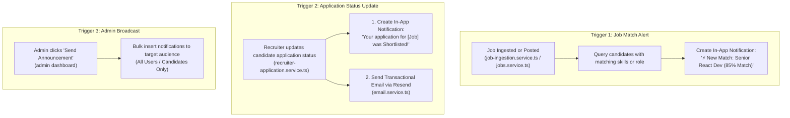
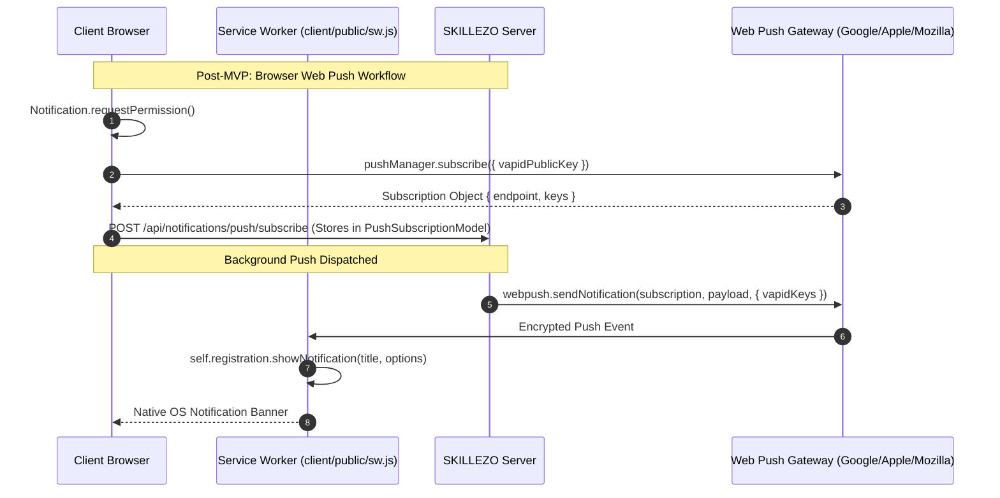

# 🔔 SKILLEZO.AI Notification System Architecture: Soft MVP & Post-MVP Roadmap

---

## 1. Executive Strategy & Scope Boundary

To balance rapid deployment, zero operational headaches, and maximum candidate retention, the notification architecture is partitioned into two clear stages:

```
┌────────────────────────────────────────────────────────────────────────┐
│                        🟢 PHASE 1: SOFT MVP                            │
│                  (Build NOW — Lean, Bulletproof, Zero-Fat)             │
├────────────────────────────────────────────────────────────────────────┤
│ • Delivery Channels : In-App Real-Time Feed + Transactional Email      │
│ • Database Models   : Single lean Notification collection              │
│ • Client Sync       : Lightweight REST Polling (on load / tab focus)   │
│ • Triggers          : Job Match Alerts + Application Status Updates    │
│ • Admin Control     : Simple In-App Broadcast Announcement Form        │
│ • UI Hydration      : Hydrate existing Dropdown & Notifications Page   │
└──────────────────────────────────┬─────────────────────────────────────┘
                                   │
                                   ▼
┌────────────────────────────────────────────────────────────────────────┐
│                       🔵 PHASE 2: POST-MVP                             │
│                  (Scale LATER — Multi-Platform Push)                   │
├────────────────────────────────────────────────────────────────────────┤
│ • Web Push API      : Service Worker (`sw.js`) + VAPID browser push    │
│ • Real-Time Stream  : Persistent Server-Sent Events (SSE) stream       │
│ • Message Queue     : Redis Pub/Sub / BullMQ decoupled workers         │
│ • Digest Crons      : Scheduled daily/weekly job digest emails         │
│ • Granular Matrix   : Per-channel & per-category user preferences DB   │
└────────────────────────────────────────────────────────────────────────┘
```

---

## 2. Comparison Matrix: Soft MVP vs. Post-MVP

| Feature Area | 🟢 Soft MVP Scope (Immediate) | 🔵 Post-MVP Scope (Future Phase) | Engineering Rationale |
| :--- | :--- | :--- | :--- |
| **Delivery Channels** | **In-App Feed + Email (Resend)** | In-App + Email + **Browser Web Push (VAPID)** | 80%+ users block browser push popups; Web Push requires complex service workers, VAPID key lifecycles, and OS permission handling across Chrome/Safari/iOS. |
| **Realtime Sync** | **Lightweight Polling (on load / 60s)** | **Server-Sent Events (SSE)** or WebSockets | Persistent connections on proxies/Vercel risk connection drops and memory leaks; polling for unread counts takes <10 lines of code and is 100% reliable. |
| **Database Collections** | **1 Model: `Notification`** | 3 Models (`Notification`, `PushSubscription`, `NotificationPreference`) | Avoid managing subscription tokens and complex frequency preference matrices during the initial release. |
| **Event Architecture** | **Direct Service Calls** | Decoupled Redis Pub/Sub / Event Bus | For a single-server deployment, direct asynchronous service calls eliminate queue worker infrastructure costs. |
| **Automated Job Alerts** | **Instant In-App Alert on Job Post** | Daily / Weekly Email Digest Crons | Candidate gets immediate value upon logging into the platform without running heavy scheduled digest crons. |
| **Admin Broadcast** | **In-App Platform Announcements** | Multi-channel Push + Email Blast | Admins can broadcast system updates to all candidate feeds without external push provider limits. |

---

## 3. 🟢 SOFT MVP Architecture & Technical Specs

### 3.1. Database Schema: Single `Notification.model.ts`
Path: `server/src/database/models/Notification.model.ts`

```typescript
import { Schema, model, Document } from "mongoose";

export interface INotification extends Document {
  _id: string;
  userId: string; // Target candidate/recruiter ID, or "all" for global broadcasts
  category: "job_alert" | "application" | "verification" | "system";
  priority: "normal" | "high" | "urgent";
  title: string;
  message: string;
  actionUrl?: string | null; // e.g. "/dashboard/job-center?jobId=123"
  actionLabel?: string | null; // e.g. "View Job"
  metadata?: Record<string, any>; // { jobId, applicationId, matchScore }
  read: boolean;
  readAt?: Date | null;
  emailSent?: boolean;
  createdAt: Date;
  updatedAt: Date;
}

const notificationSchema = new Schema<INotification>(
  {
    userId: { type: String, required: true, index: true },
    category: {
      type: String,
      enum: ["job_alert", "application", "verification", "system"],
      required: true,
      index: true,
    },
    priority: {
      type: String,
      enum: ["normal", "high", "urgent"],
      default: "normal",
    },
    title: { type: String, required: true, trim: true },
    message: { type: String, required: true, trim: true },
    actionUrl: { type: String, default: null },
    actionLabel: { type: String, default: null },
    metadata: { type: Schema.Types.Mixed, default: {} },
    read: { type: Boolean, default: false, index: true },
    readAt: { type: Date, default: null },
    emailSent: { type: Boolean, default: false },
  },
  {
    timestamps: true,
    collection: "notification",
  }
);

// High-speed compound index for user's unread badge and paginated feed
notificationSchema.index({ userId: 1, read: 1, createdAt: -1 });

export const NotificationModel = model<INotification>("Notification", notificationSchema);
```

---

### 3.2. Soft MVP REST API Endpoints
Base Route: `/api/notifications`

| Method | Endpoint | Access | Purpose |
| :--- | :--- | :--- | :--- |
| `GET` | `/api/notifications` | Candidate / Recruiter | Returns user's notifications (paginated, `limit=10`, `page=1`). |
| `GET` | `/api/notifications/unread-count` | Candidate / Recruiter | Returns fast `{ count: number }` for the topbar bell badge. |
| `PATCH` | `/api/notifications/:id/read` | Candidate / Recruiter | Marks a single notification as read. |
| `PATCH` | `/api/notifications/read-all` | Candidate / Recruiter | Marks all unread notifications for the user as read. |
| `POST` | `/api/admin/notifications/broadcast`| Admin Only | Dispatches an announcement notification to all candidates or recruiters. |

---

### 3.3. Soft MVP Automated Triggers



1. **Job Match Notification Flow**:
   - When external jobs are ingested via `job-ingestion.service.ts` or a recruiter posts a new job, the service queries candidates whose `ProfileModel` skills overlap with the required skills.
   - For matching candidates, it inserts a `job_alert` notification with deep-link `actionUrl: "/dashboard/job-center?jobId=..."`.
   - Anti-spam guard: Checks that the candidate hasn't received more than 3 job alerts in the last 24 hours.

2. **Application Status Update Flow**:
   - In `recruiter-application.service.ts`, when an application status moves (e.g. `shortlisted`, `interview_scheduled`, `rejected`):
   - Inserts an in-app notification: *"Application Update: You have been shortlisted for [Job Title] at [Company]"*.
   - Sends a transactional email using the existing `sendEmail` helper in [email.service.ts](file:///x:/projects/next.js/office-Project/SKILLEZO.AI/server/src/core/email/email.service.ts).

3. **Admin Announcement Flow**:
   - In `admin.service.ts`, a `broadcastNotification(dto)` method performs a bulk insert for target roles (`all`, `candidate`, or `recruiter`).

---

### 3.4. Soft MVP Frontend Hydration

No new pages need to be created; we simply connect existing components to real API calls:

1. **Topbar Bell Icon & Dropdown** ([NotificationDropdown.tsx](file:///x:/projects/next.js/office-Project/SKILLEZO.AI/client/components/layout/NotificationDropdown.tsx)):
   - Fetches `GET /api/notifications/unread-count` on component mount and on tab focus.
   - When clicked, fetches the latest 5 items from `GET /api/notifications?limit=5`.
   - Clicking an item marks it as read via `PATCH /api/notifications/:id/read` and redirects to the `actionUrl`.
   - "Mark all as read" button calls `PATCH /api/notifications/read-all`.

2. **Notification Center Page** ([app/dashboard/notifications/page.tsx](file:///x:/projects/next.js/office-Project/SKILLEZO.AI/client/app/dashboard/notifications/page.tsx)):
   - Loads paginated notification feed from `GET /api/notifications`.
   - Enables live search and category filtering (`job_alert`, `application`, `system`).
   - "Mark all as read" button calls `PATCH /api/notifications/read-all` and triggers a Sonner toast.

3. **Admin Broadcast Modal** ([app/admin/dashboard/page.tsx](file:///x:/projects/next.js/office-Project/SKILLEZO.AI/client/app/admin/dashboard/page.tsx)):
   - Adds a **"Broadcast Announcement"** button in the admin header or overview tab.
   - Simple modal with: Title, Message Body, Target Role (`All`, `Candidates`, `Recruiters`), and Action URL.
   - Submits to `POST /api/admin/notifications/broadcast`.

---

## 4. 🔵 POST-MVP Architecture (Future Scale & Push)

The following advanced capabilities are scheduled for Phase 2 once the core user base is established:



### Post-MVP Modules & Schemas:
1. **`PushSubscription.model.ts`**:
   - Stores browser push tokens (`endpoint`, `p256dh`, `auth` keys).
   - Handles `410 Gone` expired subscription cleanup.
2. **Web Push Engine (`web-push` npm + VAPID)**:
   - Configures `VAPID_PUBLIC_KEY` and `VAPID_PRIVATE_KEY`.
   - Service worker script `client/public/sw.js` to catch background push events and handle notification clicks.
3. **Real-Time Server-Sent Events (SSE)**:
   - Endpoint: `GET /api/notifications/stream`.
   - Pushes live unread badge counters without polling.
4. **`NotificationPreference.model.ts` & Digest Cron**:
   - Granular opt-in matrix per category (Job alerts, marketing, application status).
   - Scheduled daily or weekly email digest crons for aggregated matches.

---

## 5. Implementation Plan: Soft MVP (Step-by-Step)

The immediate Soft MVP implementation is organized into 4 lean steps:

### Step 1: Backend Foundation
- [ ] Create `server/src/database/models/Notification.model.ts`.
- [ ] Create `server/src/modules/notifications/`:
  - `notification.service.ts` (create, getForUser, getUnreadCount, markAsRead, markAllAsRead, broadcast).
  - `notification.controller.ts` (request handling & auth validation).
  - `notification.routes.ts` (mount on Express app at `/api/notifications`).
- [ ] Register routes in `server/src/server.ts`.

### Step 2: Automated Triggers
- [ ] In `server/src/modules/job-ingestion/job-ingestion.service.ts` & `jobs.service.ts`:
  - After new jobs are saved, invoke `notificationService.createJobMatchNotifications(jobId)`.
- [ ] In `server/src/modules/recruiter-application/recruiter-application.service.ts`:
  - On status transition (`shortlisted`, `rejected`, `interview`), invoke `notificationService.createApplicationStatusNotification(...)` + dispatch Resend email.
- [ ] In `server/src/modules/admin/admin.routes.ts`:
  - Add `POST /api/admin/notifications/broadcast`.

### Step 3: Frontend Hydration (Zero New Mock UI)
- [ ] Create `client/services/notification.service.ts` for clean API calls.
- [ ] Connect [NotificationDropdown.tsx](file:///x:/projects/next.js/office-Project/SKILLEZO.AI/client/components/layout/NotificationDropdown.tsx) to real unread badge count & latest notifications.
- [ ] Connect [app/dashboard/notifications/page.tsx](file:///x:/projects/next.js/office-Project/SKILLEZO.AI/client/app/dashboard/notifications/page.tsx) with search, filter, and mark-all-read API calls.

### Step 4: Admin Broadcast UI & Verification
- [ ] Add the Broadcast modal in [client/app/admin/dashboard/page.tsx](file:///x:/projects/next.js/office-Project/SKILLEZO.AI/client/app/admin/dashboard/page.tsx).
- [ ] Run full test suite (`npm run test`) to ensure zero regressions.

---

*Document Status:* **Approved Architecture Specification**  
*Document Location:* `doc/architecture/NOTIFICATION_SYSTEM_ARCHITECTURE.md`
