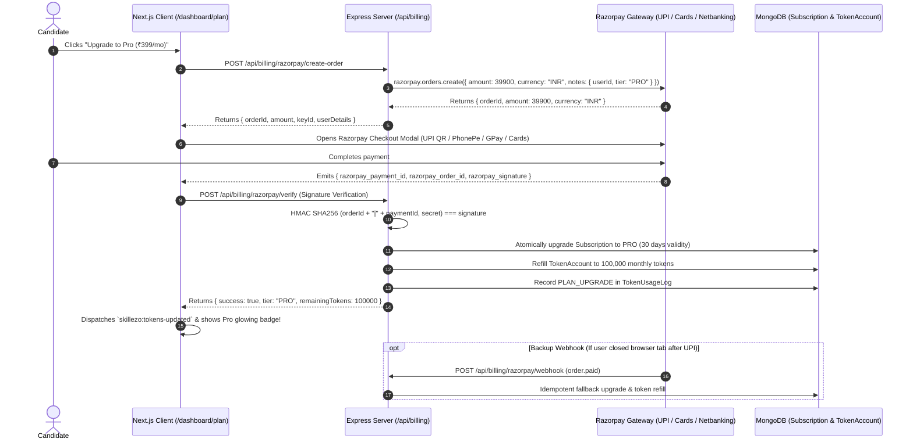

# Phase 21 (Part 4) — Razorpay Payment Gateway, Pro Activation & Automated Quota Refill Plan

---

## 1. Executive Summary & Sprint Objectives

**Sprint:** 5  
**Phase:** 21 — Part 4 (Razorpay Payment Gateway, Order Creation, Signature Verification & 100,000 Token Refill)  
**Status:** 🟡 IN PROGRESS  
**Upstream Dependencies:**  
- Phase 21 Part 1 (Completed: Core `Subscription` & `TokenAccount` models, 5,000 free tokens)  
- Phase 21 Part 2 (Completed: `tokenGuard` middleware, 402 `INSUFFICIENT_TOKENS` paywall response)  
- Phase 21 Part 3 (Completed: Frontend "Plan & Usage" Quota Dashboard, `<UpgradePlanModal />`, Sidebar Token Widget)  

---

### Core Objectives
1. **Frictionless Candidate Checkout Experience with Razorpay**:
   - Instant, secure Razorpay Order creation (`POST /api/billing/razorpay/create-order`) for upgrading to **SKILLEZO Pro** (₹399/mo).
   - In-app checkout modal supporting **UPI (Google Pay, PhonePe, Paytm, QR scan)**, Debit/Credit Cards (RuPay, Visa, Mastercard), and Netbanking across all Indian banks.
   - Built-in development **Mock Checkout** (`MOCK_BILLING_ENABLED=true`) so developers and QA can test upgrades with 1-click zero payment friction.
2. **Cryptographic Payment Verification & Atomic Token Refill**:
   - Instant verification endpoint (`POST /api/billing/razorpay/verify`) computing HMAC SHA256 signatures (`orderId + "|" + paymentId`).
   - Upon verification:
     - Upgrades `Subscription.tier = 'PRO'`, status = `'ACTIVE'`, validity = `now + 30 days`.
     - Automatically grants **100,000 Monthly AI Tokens** in `TokenAccount`.
     - Records an itemized `PLAN_UPGRADE` transaction in `TokenUsageLog`.
3. **Backup Webhook Integration**:
   - Asynchronous webhook listener (`POST /api/billing/razorpay/webhook`) with `x-razorpay-signature` verification to guarantee token delivery if the user closes their browser tab immediately after UPI approval.
   - Idempotency guard prevents duplicate token crediting.
4. **Live Telemetry & Instant UI Reactivity**:
   - Emits `skillezo:tokens-updated` event with `100,000` tokens to update the sidebar widget, plan badge, and quota gauges instantly without page reload.

---

## 2. Subscription Lifecycle Flow



---

## 3. Architecture & Codebase Touchpoints

```
SKILLEZO.AI Codebase
├── server/
│   ├── src/modules/billing/                           <-- [NEW MODULE]
│   │   ├── billing.constants.ts                       <-- Plan definitions (₹399 / 39,900 paise = 100k tokens)
│   │   ├── billing.dto.ts                             <-- Zod validation schemas
│   │   ├── razorpay.service.ts                        <-- Razorpay client & HMAC SHA256 signature verification
│   │   ├── billing.service.ts                         <-- Business logic (orders, verify, token refill, mock mode)
│   │   ├── billing.controller.ts                      <-- Express route controllers
│   │   ├── billing.routes.ts                          <-- Routes mounted at /api/billing
│   │   └── index.ts                                   <-- Public exports
│   ├── src/server.ts                                  <-- Mount /api/billing routes
│   └── tests/unit/modules/billing.service.spec.ts     <-- Unit tests for order, verification, mock & refill
└── client/
    ├── lib/
    │   └── razorpay.ts                                <-- Dynamic Razorpay checkout.js script loader
    ├── services/
    │   └── billing.service.ts                         <-- Client SDK (create order, verify payment, open modal)
    └── components/dashboard/plan/
        ├── UpgradePlanModal.tsx                       <-- Connect "Upgrade to Pro" to Razorpay checkout
        ├── PricingCardMatrix.tsx                      <-- Connect "Get Started with Pro" to Razorpay checkout
        └── PlanUsageGauge.tsx                         <-- Live Pro tier badge & quota reflection
```

---

## 4. Technical Specifications & Endpoints

### 4.1 Environment Configuration (`.env`)
```env
# Razorpay Payment Gateway
RAZORPAY_KEY_ID=rzp_test_...
RAZORPAY_KEY_SECRET=...
RAZORPAY_WEBHOOK_SECRET=...

# Mock Billing for Local Development (true enables 1-click simulated upgrade)
MOCK_BILLING_ENABLED=true
```

### 4.2 Endpoints Specification (`server/src/modules/billing/`)

#### 1. `POST /api/billing/razorpay/create-order`
- **Auth**: Required (`requireAuth`)
- **Body**: `{ billingCycle?: "MONTHLY" | "YEARLY" }`
- **Logic**:
  - Checks if user already has an active Pro subscription.
  - In development (`MOCK_BILLING_ENABLED === true`): Simulates checkout, refills 100,000 tokens, and returns `{ mock: true, url: "/dashboard/plan?upgraded=true" }`.
  - In production: Creates a Razorpay Order (`39,900 paise` = ₹399) with user notes.
- **Response**:
  ```json
  {
    "success": true,
    "data": {
      "orderId": "order_EKwxW8123456",
      "amount": 39900,
      "currency": "INR",
      "keyId": "rzp_test_xxxxxx",
      "planName": "SKILLEZO Pro Monthly",
      "user": {
        "name": "Candidate Name",
        "email": "candidate@example.com"
      }
    }
  }
  ```

#### 2. `POST /api/billing/razorpay/verify`
- **Auth**: Required (`requireAuth`)
- **Body**:
  ```json
  {
    "orderId": "order_EKwxW8123456",
    "paymentId": "pay_EKwxW8765432",
    "signature": "9ef4b893276f..."
  }
  ```
- **Logic**:
  - Validates HMAC SHA256 signature using `RAZORPAY_KEY_SECRET`.
  - Atomically upgrades `Subscription` to `PRO` with 30-day validity.
  - Resets `TokenAccount`: `totalAllowance = 100000`, `consumedTokens = 0`, `remainingTokens = 100000 + bonusTokens`.
  - Logs `PLAN_UPGRADE` in `TokenUsageLog`.
- **Response**: `{ success: true, message: "Subscription upgraded to PRO successfully", tier: "PRO", remainingTokens: 100000 }`

#### 3. `POST /api/billing/razorpay/webhook`
- **Auth**: None (Validates `x-razorpay-signature` against `RAZORPAY_WEBHOOK_SECRET`)
- **Event**: `order.paid` / `payment.captured`
- **Logic**: Provides asynchronous fallback; ensures candidate receives their 100,000 tokens even if network drops during redirect.

---

## 5. Development "Mock Mode" (Instant Local Testing)
When `MOCK_BILLING_ENABLED=true`:
- Clicking "Upgrade to Pro" triggers instant simulation.
- 100,000 tokens are granted immediately to the logged-in candidate.
- Dashboard refreshes displaying the glowing Pro badge and full quota.

---

## 6. Execution Steps
- [x] Create architectural specification for Razorpay.
- [ ] Install `razorpay` in `server/`.
- [ ] Implement `server/src/modules/billing/` (constants, DTO, service, controller, routes).
- [ ] Mount `/api/billing` in `server/src/server.ts`.
- [ ] Implement client-side `razorpay.ts` loader and `billing.service.ts`.
- [ ] Connect checkout modal to `<UpgradePlanModal />` and `<PricingCardMatrix />`.
- [ ] Write automated unit tests for billing service & HMAC verification.
- [ ] Validate TypeScript build (`tsc --noEmit`) and run test suite.
