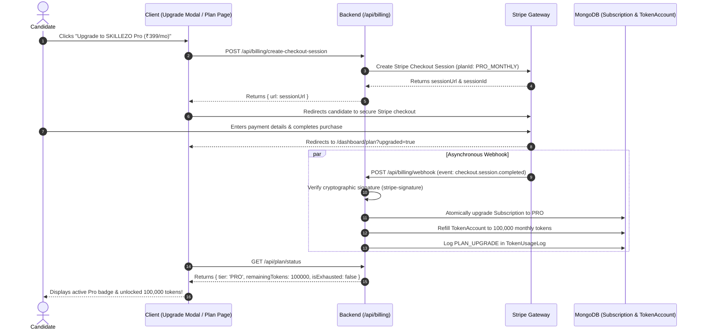

# Phase 21 (Part 4) — Billing, Stripe Checkout & Automated Pro Quota Refill Plan

---

## 1. Executive Summary & Sprint Objectives

**Sprint:** 5  
**Phase:** 21 — Part 4 (Billing, Checkout Session, Webhooks & Automated Quota Refill)  
**Status:** 🟡 READY TO PLAN & IMPLEMENT  
**Upstream Dependencies:**  
- Phase 21 Part 1 (Completed: Core Subscription & Token Account models, 5,000 free tokens)  
- Phase 21 Part 2 (Completed: `tokenGuard` middleware, 402 `INSUFFICIENT_TOKENS` paywall response)  
- Phase 21 Part 3 (Frontend Rebranding to "Plan & Usage", Quota Dashboard & `<UpgradePlanModal />`)  


### Core Objectives
1. **Seamless Candidate Checkout Experience**:
   - Instant, secure checkout session creation (`POST /api/billing/create-checkout-session`) for upgrading to **SKILLEZO Pro** (₹399/mo).
   - Direct redirect to Stripe Hosted Checkout with automated fallback to development **Mock Checkout** (`MOCK_BILLING=true`) so developers and QA can test upgrades with zero payment friction.
2. **Automated Token Refill Engine**:
   - Webhook listener (`POST /api/billing/webhook`) with cryptographic signature verification.
   - Upon successful payment (`checkout.session.completed` / `invoice.payment_succeeded`):
     - Upgrades `Subscription.tier = 'PRO'`, status = `'ACTIVE'`.
     - Automatically resets and grants **100,000 Monthly AI Tokens** in `TokenAccount`.
     - Records an itemized `PLAN_UPGRADE` transaction in `TokenUsageLog`.
3. **Self-Service Customer Billing Portal**:
   - Candidate can access the Stripe Customer Portal (`POST /api/billing/portal-session`) to update credit cards, download tax invoices, or cancel their subscription.
4. **Zero-Breakage Guarantee**:
   - Webhook idempotency protection to prevent double-crediting tokens.
   - Raw body parsing specifically configured for `/api/billing/webhook` before `express.json()`.
   - Existing free users and trial tokens remain completely unaffected until they explicitly choose to upgrade.

---

## 2. Subscription Lifecycle Flow



---

## 3. Architecture & Codebase Touchpoints (Phase 4)

```
SKILLEZO.AI Codebase
├── server/
│   ├── src/modules/billing/                           <-- [NEW MODULE]
│   │   ├── billing.constants.ts                       <-- [NEW] Stripe Price IDs, currency, mock settings
│   │   ├── billing.dto.ts                             <-- [NEW] Zod validation schemas
│   │   ├── billing.service.ts                         <-- [NEW] Checkout creation, webhook handlers, refill
│   │   ├── billing.controller.ts                      <-- [NEW] HTTP endpoints
│   │   ├── billing.routes.ts                          <-- [NEW] Express routes mounted at /api/billing
│   │   ├── billing.test.ts                            <-- [NEW] Unit & webhook tests
│   │   └── index.ts                                   <-- [NEW] Public module exports
│   ├── src/server.ts                                  <-- [UPDATE] Raw body parser for webhook & route mount
│   └── tests/unit/modules/billing.service.spec.ts     <-- [NEW] Automated tests for checkout & webhook refill
└── client/
    ├── services/
    │   └── billing.service.ts                         <-- [NEW] Client SDK for checkout & portal sessions
    └── components/dashboard/plan/
        ├── UpgradePlanModal.tsx                       <-- [CONNECT] Wire "Upgrade to Pro" button to checkout
        └── PricingCardMatrix.tsx                      <-- [CONNECT] Wire Pro plan card button to checkout
```

---

## 4. Technical Specifications & Endpoints

### 4.1 Environment Configuration (`.env`)
```env
# Stripe Billing Configuration
STRIPE_SECRET_KEY=sk_test_...
STRIPE_WEBHOOK_SECRET=whsec_...
STRIPE_PRO_MONTHLY_PRICE_ID=price_...
STRIPE_PRO_YEARLY_PRICE_ID=price_...
MOCK_BILLING_ENABLED=true  # Allows 1-click upgrades in development without real credit cards
```

### 4.2 Raw Body Webhook Handling (`server/src/server.ts`)
Stripe requires the unparsed, raw HTTP request body to verify cryptographic signatures. We mount the webhook endpoint before `express.json()`:
```typescript
app.use(
  "/api/billing/webhook",
  express.raw({ type: "application/json" }),
  billingWebhookHandler
);
```

### 4.3 Endpoints Specification (`server/src/modules/billing/`)

#### 1. `POST /api/billing/create-checkout-session`
- **Auth**: Required (`requireAuth`)
- **Body**: `{ billingCycle: "MONTHLY" | "YEARLY" }`
- **Logic**:
  - Checks if user is already on `PRO`. If so, redirects to billing portal.
  - In Development (`MOCK_BILLING_ENABLED === true`): Instantly upgrades the account to `PRO`, refills 100,000 tokens, and returns `{ url: "/dashboard/plan?mock_upgraded=true" }`.
  - In Production: Creates a Stripe Checkout Session with `client_reference_id = userId`, `customer_email = user.email`, and metadata `{ userId }`.
- **Response**: `{ success: true, data: { url: session.url } }`

#### 2. `POST /api/billing/webhook`
- **Auth**: None (Stripe cryptographic signature verification via `stripe.webhooks.constructEvent`)
- **Events Handled**:
  - `checkout.session.completed`:
    - Reads `userId = session.client_reference_id || session.metadata.userId`.
    - Updates `SubscriptionModel`: `tier = PlanTier.PRO`, `status = SubscriptionStatus.ACTIVE`, `billingCycle = 'MONTHLY'`, `currentPeriodEnd = now + 30 days`.
    - Updates `TokenAccountModel`: `tier = PlanTier.PRO`, `totalAllowance = 100000`, `consumedTokens = 0`, `remainingTokens = 100000 + bonusTokens`.
    - Logs `PLAN_UPGRADE` in `TokenUsageLogModel`.
  - `invoice.payment_succeeded` (Recurring monthly renewal):
    - Resets `consumedTokens = 0`, grants 100,000 tokens for the new monthly cycle, and updates `currentPeriodEnd`.
  - `customer.subscription.deleted` (User cancelled / ended):
    - Sets `Subscription.status = 'CANCELLED'`.
    - Sets `Subscription.tier = 'FREE'`.
    - Resets `totalAllowance = 5000`.

#### 3. `POST /api/billing/portal-session`
- **Auth**: Required (`requireAuth`)
- **Logic**: Creates a Stripe Customer Portal session URL.
- **Response**: `{ success: true, data: { url: portalSession.url } }`

---

## 5. Development "Mock Mode" (Instant Local Testing)

To ensure developers and testers can test the complete upgrade experience locally without needing Stripe test cards, webhook tunnels (e.g. ngrok), or API keys:
- Setting `MOCK_BILLING_ENABLED=true` enables a 1-click simulated upgrade.
- When clicked, the backend immediately simulates a successful checkout, refills 100,000 tokens, and reloads the dashboard showing the glowing **Pro Plan** badge!

---

## 6. Step-by-Step Implementation Roadmap for Phase 4

```
Phase 4 Execution Steps
├── Step 4.1: Install `stripe` package in `server/`
├── Step 4.2: Create `server/src/modules/billing/` (constants, dto, service, controller, routes)
├── Step 4.3: Mount raw-body webhook in `server/src/server.ts`
├── Step 4.4: Create client SDK in `client/services/billing.service.ts`
├── Step 4.5: Connect "Upgrade to Pro" buttons in `<UpgradePlanModal />` and `/dashboard/plan/page.tsx`
├── Step 4.6: Automated Unit Tests (`server/tests/unit/modules/billing.service.spec.ts`)
│   ├── Verify checkout session creation with correct metadata
│   ├── Verify webhook token refill & subscription tier upgrade
│   ├── Verify recurring monthly renewal token reset
│   └── Verify dev mock mode execution
└── Step 4.7: Build verification (`npm run build`) & end-to-end upgrade test
```

---

## 7. Safety, Quality & Idempotency Checklist

| Guarantee | How It Is Achieved |
| :--- | :--- |
| **No Double Refills** | Processed Stripe event IDs are logged in MongoDB; duplicate events are discarded safely. |
| **Zero Downtime** | If Stripe is temporarily unreachable, mock mode or cached plan states keep candidate dashboards active. |
| **Clean Accounting** | Every token refill is logged in `TokenUsageLog` with timestamp and event ID for auditability. |
| **Instant UI Feedback** | Telemetry and status query immediately reflect 100,000 remaining tokens upon checkout return. |
