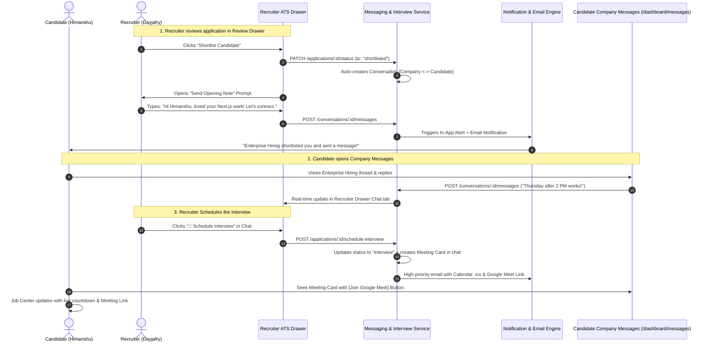

# Phase 22 — Recruiter-Candidate Messaging & Interview Pipeline Implementation Plan

---

## 1. Executive Summary & Core Philosophy

**Phase:** 22  
**Feature:** Two-Way Recruiter-Candidate Messaging & Contextual Interview Pipeline  
**Target:** Candidates & Enterprise Recruiters on SKILLEZO.AI  

### Why Messaging Starts at "Shortlisted" (The Industry Benchmark)
On platforms like **LinkedIn Recruiter, Wellfound (AngelList), Greenhouse, and Ashby**:
1. **Raw Applications are Not Chat Channels:** Recruiters receive dozens of applications. Opening chats for every single submission creates spam and operational overhead.
2. **Shortlisting is the Connection Point:** When a recruiter moves an applicant to `shortlisted`, they are signaling genuine mutual interest. This is the natural inflection point to **unlock a direct two-way communication channel**.
3. **Conversations Lead to Interviews:** Recruiters chat to confirm availability, timezone, and compensation expectations *before* locking in an interview date and sending a meeting link.
4. **Interviews are Structured Events in the Chat:** Once aligned, the recruiter drops an **Interactive Interview Card** (Google Meet / Zoom link, date/time, and round agenda) directly into the conversation.

---

## 2. End-to-End User Experience & Flow



---

## 3. Database Schema Architecture

### A. `ConversationModel` (`server/src/database/models/Conversation.model.ts`)
Tracks the high-level channel between a candidate and an employer for a specific job application.

```typescript
export interface IConversation extends Document {
  _id: Types.ObjectId;
  applicationId: Types.ObjectId;     // Ref: Application
  jobId: Types.ObjectId;             // Ref: Job
  companyId: Types.ObjectId;         // Ref: Company
  candidateId: string;               // Candidate Better-Auth User ID
  recruiterId: string;               // Recruiter Better-Auth User ID
  lastMessage?: {
    content: string;
    senderId: string;
    senderRole: "recruiter" | "candidate" | "system";
    sentAt: Date;
  };
  unreadCountCandidate: number;
  unreadCountRecruiter: number;
  status: "active" | "archived" | "closed";
  createdAt: Date;
  updatedAt: Date;
}
```

### B. `MessageModel` (`server/src/database/models/Message.model.ts`)
Individual messages in the conversation thread, supporting both regular text and rich action cards (interview invites, offers).

```typescript
export type MessageType = "text" | "interview_invite" | "status_change" | "system";

export interface IInterviewDetails {
  roundTitle: string;          // e.g. "Round 1: Technical & System Architecture"
  scheduledAt: Date;           // e.g. 2026-10-16T10:00:00.000Z
  durationMinutes: number;     // e.g. 45
  timezone: string;            // e.g. "Asia/Kolkata (IST)"
  meetingPlatform: "google_meet" | "zoom" | "teams" | "phone" | "other";
  meetingLink: string;         // e.g. "https://meet.google.com/xyz-abcd-efg"
  interviewerName: string;     // e.g. "Dayjafry (Hiring Manager)"
  instructions?: string;
  status: "scheduled" | "completed" | "rescheduled" | "cancelled";
}

export interface IMessage extends Document {
  _id: Types.ObjectId;
  conversationId: Types.ObjectId;    // Ref: Conversation
  senderId: string;                  // Better-Auth User ID
  senderRole: "recruiter" | "candidate" | "system";
  type: MessageType;
  content: string;                   // Text body
  interviewDetails?: IInterviewDetails; // Populated when type === "interview_invite"
  readBy: string[];                  // User IDs who read this message
  createdAt: Date;
  updatedAt: Date;
}
```

### C. `ApplicationModel` Extension (`server/src/database/models/Application.model.ts`)
Attach reference to the active conversation and the current interview schedule:

```typescript
// Add to IApplication:
conversationId?: Types.ObjectId | null;
interviewSchedule?: IInterviewDetails | null;
```

---

## 4. Backend API & Module Architecture

### New Server Module: `server/src/modules/messages/`

```
server/src/modules/messages/
├── messages.dto.ts               # Zod validation schemas
├── messages.service.ts           # Business logic, authorization, unread counters
├── messages.controller.ts        # HTTP request handling
├── messages.routes.ts            # Route mounting with requireAuth
└── index.ts                      # Public module exports
```

#### API Endpoints Matrix:

| Method | Endpoint | Access | Purpose |
| :--- | :--- | :--- | :--- |
| `GET` | `/api/messages/conversations` | Candidate & Recruiter | List all active conversation threads for the user with latest message snippet and unread badges |
| `GET` | `/api/messages/conversations/:id` | Participant | Get full message thread for a conversation |
| `POST` | `/api/messages/conversations/:id/messages` | Participant | Send a message in an existing conversation |
| `PATCH` | `/api/messages/conversations/:id/read` | Participant | Mark conversation messages as read |
| `POST` | `/api/recruiter/applications/:id/schedule-interview` | Recruiter | Transition stage to `interview`, record `interviewSchedule`, and append an `interview_invite` card to the conversation |

---

## 5. Frontend UI/UX Architecture

### A. Candidate Dashboard — "Company Messages Inbox"
**Location:** [`client/app/dashboard/messages/page.tsx`](file:///x:/projects/next.js/office-Project/SKILLEZO.AI/client/app/dashboard/messages/page.tsx)  
**Sidebar Link:** Add **"Messages"** with live unread badge in [`Sidebar.tsx`](file:///x:/projects/next.js/office-Project/SKILLEZO.AI/client/components/layout/Sidebar.tsx).

* **Split-Pane Layout:**
  * **Left Sidebar:** List of conversations grouped by company (Company Name, Job Title, last message preview, timestamp, unread counter).
  * **Main Chat Panel:** Active conversation view with:
    * Job header (Company badge, Job Title, Match score, current stage).
    * Chat history with speech bubbles (Recruiter vs Candidate).
    * Rich **Interview Cards** displaying meeting time, countdown, and **[🟢 Join Google Meet]** button.
    * Textarea input with Enter-to-send and instant optimism.

### B. Recruiter Experience — "In-Drawer Chat Tab"
**Location:** [`client/components/recruiter/CandidateReviewDrawer.tsx`](file:///x:/projects/next.js/office-Project/SKILLEZO.AI/client/components/recruiter/CandidateReviewDrawer.tsx)  

* Add a 4th Tab: **"Chat & Messages"** alongside *Resume*, *Skills*, and *History*.
* When recruiter clicks **"Shortlist"**:
  * An intuitive prompt opens: *"Shortlisted! Send an initial introduction note?"*
  * Saves status and drops the note into the conversation.
* From the **Chat tab**, recruiter can:
  * Chat with candidate while viewing their resume/scores.
  * Click **"📅 Schedule Interview"** button to open the meeting setup dialog.

### C. Interview Scheduling Dialog
**Component:** `ScheduleInterviewModal.tsx`  
* Fields:
  * Round Title (e.g. "Technical Screening Round 1")
  * Date & Time Picker
  * Duration dropdown (30, 45, 60 minutes)
  * Meeting Platform (Google Meet, Zoom, Teams, Phone)
  * Meeting URL
  * Custom Instructions / Preparation notes for candidate
* Action:
  * Posts the interview card into the conversation.
  * Updates Kanban stage to `Interviewing`.
  * Sends calendar invite & email.

### D. Job Center Enhancement
**Location:** [`client/components/dashboard/job-center/AppliedJobsTracker.tsx`](file:///x:/projects/next.js/office-Project/SKILLEZO.AI/client/components/dashboard/job-center/AppliedJobsTracker.tsx)  
* When an application is in `interview`:
  * Instead of `"Next Step: Awaiting recruiter review"`, display:
    * 📅 **"Interview Scheduled — [Date] at [Time]"**
    * ⏱️ Live countdown ("Starts in 2 days")
    * 🎥 **[Join Google Meet]** button
    * 💬 **[Open Company Chat]** shortcut

---

## 6. Phased Implementation Roadmap

### Phase 22.1: Data Models & Backend API
1. Create `Conversation.model.ts` and `Message.model.ts`.
2. Update `Application.model.ts` with `conversationId` and `interviewSchedule`.
3. Implement `messages.service.ts`, `messages.controller.ts`, and `messages.routes.ts`.
4. Register `/api/messages` in `server.ts`.

### Phase 22.2: Shortlist & Interview Transition Hooks
1. Update `updateApplicationStatus` in `recruiter-application.service.ts`:
   * On transition to `shortlisted`: auto-create or fetch conversation.
   * On transition to `interview`: record `interviewSchedule` and dispatch `interview_invite` message.
2. Extend `notification.service.ts` to include meeting links in candidate notifications and transactional emails.

### Phase 22.3: Recruiter Drawer Chat & Scheduler
1. Build `ScheduleInterviewModal.tsx`.
2. Add the **Messages Tab** inside `CandidateReviewDrawer.tsx`.
3. Enable direct messaging and interview scheduling from the drawer.

### Phase 22.4: Candidate Company Messages Inbox & Job Center
1. Create `client/services/message.service.ts`.
2. Build `client/app/dashboard/messages/page.tsx` (Split-pane multi-company inbox).
3. Add "Messages" item with unread badge to candidate navigation.
4. Upgrade `AppliedJobsTracker.tsx` with the rich interview card and join button.

---

## 7. Verification & Testing Matrix

- [x] Moving candidate to `shortlisted` automatically creates a conversation.
- [x] Recruiter sending initial message creates a notification for the candidate.
- [x] Candidate can view all company threads at `/dashboard/messages`.
- [x] Candidate can reply; recruiter sees it in `CandidateReviewDrawer` chat tab.
- [x] Scheduling an interview posts an interactive `interview_invite` card in chat.
- [x] Candidate Job Center displays exact interview date/time, countdown, and working Google Meet link.
- [x] Both `client` and `server` compile with 0 TypeScript errors.
