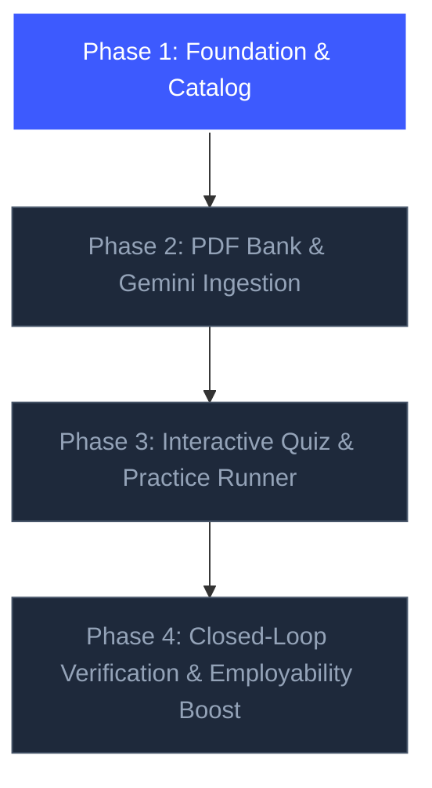

# Phase 23 — Learning Hub: Phase 1 Foundation & Catalog Implementation Plan

> **Sprint:** 5  
> **Phase:** 23 (Part 1)  
> **Target Date:** October 2026  
> **Status:** READY FOR IMPLEMENTATION  
> **Primary Goal:** Establish the robust data foundation, REST API engine, seeding pipeline, and Next.js App Router dashboard UI for the SKILLEZO Learning Hub — ensuring 100% backwards and forward compatibility with upcoming AI and PDF ingestion phases.

---

## 1. Executive Summary & Phase Boundaries

Phase 1 delivers the operational foundation of the **SKILLEZO Learning Hub**. It transitions `/dashboard/learning-hub` from a static `ComingSoonModule` placeholder into a functional, data-driven learning catalog tightly integrated with candidate target roles and skill gaps.



### 1.1 Strict Scope for Phase 1 (IN SCOPE)
- **Database Layer**:
  - Three core MongoDB Mongoose schemas (`LearningTrack`, `LearningResource`, `UserLearningProgress`).
  - Pre-provisioned fields for future phases (`pdfKey`, `quizData`, `isAiGenerated`, `reviewStatus`, `quizAttempts`) with sensible defaults to ensure **zero database migrations** in Phases 2–4.
- **Backend API & Service**:
  - `learning-hub.service.ts`, `learning-hub.controller.ts`, `learning-hub.routes.ts`, and Zod validation DTOs.
  - Endpoints:
    - `GET /api/learning-hub/catalog` (Filterable by category, role, difficulty).
    - `GET /api/learning-hub/tracks/:slug` (Full track syllabus with module hierarchy).
    - `GET /api/learning-hub/personalized` (Matches candidate's active `CareerPlanModel` missing skills).
    - `POST /api/learning-hub/tracks/:id/enroll` (Track enrollment).
    - `POST /api/learning-hub/resources/:id/progress` (Toggle completion status).
  - Mounting `/api/learning-hub` in `server/src/server.ts`.
- **Database Seeder**:
  - High-signal production seed script (`seed-learning-hub.ts`) populating 5 enterprise tracks:
    1. *React 19 & Next.js Server Components Architecture* (Frontend)
    2. *Node.js, Express & Microservices* (Backend)
    3. *PostgreSQL & High-Performance Indexing* (Database)
    4. *Docker, CI/CD & Cloud Infrastructure* (DevOps)
    5. *Distributed System Design & Microservice Scalability* (System Design)
- **Frontend Next.js Client**:
  - Client types in `client/types/learning-hub.ts`.
  - Client API SDK in `client/services/learning-hub.service.ts` using `@/lib/api`.
  - Replaces `ComingSoonModule` in `client/app/dashboard/learning-hub/page.tsx` with:
    - Header showing user learning stats (tracks enrolled, completed, hours logged).
    - Personalized **"Recommended for Your Skill Gaps"** section.
    - Category filter pills (All, Frontend, Backend, Database, Cloud/DevOps, System Design).
    - Track Cards with dynamic difficulty tags, progress bar, and syllabus preview modal.
    - Tab navigation shell preparing users for Phase 2 ("PDF Question Bank") and Phase 3 ("Practice Arena").

### 1.2 Deferred to Subsequent Phases (Compatibility Shield)
- **Phase 2 (Content & Ingestion)**: In-memory `pdf-parse` upload for public question banks, and Gemini-automated lesson generators.
- **Phase 3 (Practice Player)**: Timed interactive quiz player with immediate code evaluation and rationale feedback.
- **Phase 4 (Verification Loop)**: Automatic minting of cryptographic SHA-256 certificate hashes (`SKZ-CERT-...`) on final track quizzes.

---

## 2. Next.js App Router Compatibility Architecture

To guarantee strict compatibility with the Next.js 15 App Router architecture in `client/`:

1. **Client / Server Boundary Cleanliness**:
   - `client/app/dashboard/learning-hub/page.tsx` will be designated `'use client'` to manage active filters, tab selections, modal previews, and optimistic progress toggling.
   - Clean loading skeletons will prevent layout shifts (CLS) while data loads via `learning-hub.service.ts`.
2. **Component Modularity**:
   - Break down the page into reusable sub-components in `client/components/dashboard/learning-hub/`:
     - `LearningHubHeader.tsx`: Stats cards & personalized greeting.
     - `SkillGapRecommendationBanner.tsx`: Highlights tracks fixing current job gaps.
     - `TrackFilterBar.tsx`: Category & difficulty selector pills.
     - `TrackCard.tsx`: Rich track presentation card with progress meter.
     - `TrackSyllabusModal.tsx`: Slide-over/modal showing modules, lessons, and external links.
3. **Design System & Theme Parity**:
   - Utilizes existing Tailwind CSS tokens:
     - Backgrounds: `bg-white dark:bg-slate-900`, `bg-slate-50 dark:bg-slate-950`
     - Borders: `border-slate-200 dark:border-slate-800`
     - Accent: Electric royal blue `#3D5AFE` / `text-[#3D5AFE]` / `bg-[#3D5AFE]`
   - Icons from `lucide-react` (matching `Sidebar.tsx`).
   - Notifications via `sonner` (`toast.success()`).

---

## 3. Detailed File Modification & Creation Manifest

```
SKILLEZO.AI/
├── server/
│   ├── src/database/models/
│   │   ├── LearningTrack.model.ts                  <-- [NEW] Track & module schema
│   │   ├── LearningResource.model.ts               <-- [NEW] Lesson, doc, quiz & PDF schema
│   │   ├── UserLearningProgress.model.ts           <-- [NEW] Enrollment & completion tracker
│   │   └── index.ts                                <-- [UPDATE] Export new models
│   ├── src/database/
│   │   └── seed-learning-hub.ts                    <-- [NEW] Enterprise tracks & resources seed script
│   ├── src/modules/learning-hub/
│   │   ├── learning-hub.dto.ts                     <-- [NEW] Zod validation & DTOs
│   │   ├── learning-hub.service.ts                 <-- [NEW] Catalog & personalization business logic
│   │   ├── learning-hub.controller.ts              <-- [NEW] HTTP request handlers
│   │   ├── learning-hub.routes.ts                  <-- [NEW] Express route definitions
│   │   └── index.ts                                <-- [NEW] Module exports
│   └── src/server.ts                               <-- [UPDATE] Mount /api/learning-hub
│
└── client/
    ├── types/
    │   └── learning-hub.ts                         <-- [NEW] Client TypeScript interfaces
    ├── services/
    │   └── learning-hub.service.ts                 <-- [NEW] API client SDK using apiFetch
    ├── components/dashboard/learning-hub/
    │   ├── LearningHubHeader.tsx                   <-- [NEW] Header with candidate progress stats
    │   ├── SkillGapRecommendationBanner.tsx        <-- [NEW] Gap-driven recommended tracks
    │   ├── TrackFilterBar.tsx                      <-- [NEW] Category & difficulty filter pills
    │   ├── TrackCard.tsx                           <-- [NEW] High-converting track cards
    │   └── TrackSyllabusModal.tsx                  <-- [NEW] Modal showing syllabus & resources
    └── app/dashboard/learning-hub/
        └── page.tsx                                <-- [HYDRATE] Replace ComingSoonModule
```

---

## 4. Implementation Steps & Workflows

### Step 1: Backend Schemas (`server/src/database/models/`)
1. Create `LearningTrack.model.ts`:
   - Attributes: `title`, `slug`, `category`, `description`, `targetRoles`, `targetSkills`, `difficulty`, `estimatedMinutes`, `iconName`, `accentColor`, `modules: [{ id, title, description, order, resourceIds }]`, `published`, `enrollmentCount`.
   - Forward-compatible field: `finalAssessmentTopicId` (ready for Phase 4 `VerificationService` link).
2. Create `LearningResource.model.ts`:
   - Attributes: `title`, `slug`, `type` (`lesson` | `external_doc` | `external_video` | `pdf_document` | `quiz` | `code_drill`), `category`, `skills`, `difficulty`, `estimatedMinutes`, `content: { markdown, externalUrl, provider, pdfKey, questions }`.
   - Forward-compatible fields: `source` (`curated` | `public_bank` | `gemini_generated`), `reviewStatus` (`draft` | `published`).
3. Create `UserLearningProgress.model.ts`:
   - Attributes: `userId`, `enrolledTrackIds`, `completedResourceIds`, `inProgressTrackId`, `bookmarkedResourceIds`, `totalLearningMinutes`.
   - Forward-compatible field: `quizAttempts` (ready for Phase 3).
4. Export models in `server/src/database/models/index.ts`.

### Step 2: Backend REST Module (`server/src/modules/learning-hub/`)
1. `learning-hub.dto.ts`:
   - Strict Zod validation for query params (categories, search strings, pagination).
   - Response DTOs for `TrackCatalogItemDTO`, `TrackDetailDTO`, `PersonalizedRecommendationsDTO`.
2. `learning-hub.service.ts`:
   - `getCatalog(filters, userId)`: Fetches tracks with user's progress percentage.
   - `getTrackBySlug(slug, userId)`: Fetches full track with populated module resources.
   - `getPersonalizedTracks(userId)`: Reads user's `CareerPlanModel` (`missingSkills`, `improvementSkills`) or `ProfileModel.targetRole` and returns matched tracks.
   - `toggleResourceCompletion(userId, resourceId)`: Adds/removes from `completedResourceIds` and increments total learning minutes.
   - `enrollTrack(userId, trackId)`: Adds track to `enrolledTrackIds`.
3. `learning-hub.controller.ts` & `learning-hub.routes.ts`:
   - Clean Express error handling and status responses.
4. Mount in `server/src/server.ts`:
   - `app.use("/api/learning-hub", learningHubRouter);`

### Step 3: Database Seeder (`server/src/database/seed-learning-hub.ts`)
1. Implement seed script creating 5 real-world tracks with structured modules and verified resources:
   - **Track 1**: *React 19 & Next.js Server Components Architecture*
     - Module 1: React 19 Actions & Hooks (`useActionState`, `useOptimistic`)
     - Module 2: Server Components & Streaming SSR
     - Module 3: Modern State Management & Caching
   - **Track 2**: *Node.js, Express & Microservices*
     - Module 1: Event Loop, Streams & Concurrency
     - Module 2: RESTful API Design & Zod Validation
     - Module 3: Rate Limiting & Auth Security
   - **Track 3**: *PostgreSQL & Database Optimization*
     - Module 1: Schema Modeling & Normalization
     - Module 2: Indexing Strategies & EXPLAIN ANALYZE
     - Module 3: ACID Transactions & Concurrency Locks
   - **Track 4**: *Docker, CI/CD & Cloud Infrastructure*
     - Module 1: Multi-stage Docker Builds
     - Module 2: Docker Compose & Local Networking
     - Module 3: GitHub Actions Automation
   - **Track 5**: *Distributed System Design & Microservice Scalability*
     - Module 1: Redis Caching & Cache-Aside Patterns
     - Module 2: Asynchronous Queues & Event-Driven Systems
     - Module 3: Load Balancing & High Availability
2. Add NPM script in `server/package.json`: `"seed:learning-hub": "tsx src/database/seed-learning-hub.ts"`.

### Step 4: Client Types & API Service (`client/`)
1. Create `client/types/learning-hub.ts` mirroring backend DTOs.
2. Create `client/services/learning-hub.service.ts` with methods:
   - `getCatalog(category?, search?)`
   - `getPersonalizedTracks()`
   - `getTrack(slug)`
   - `enrollTrack(trackId)`
   - `toggleResourceProgress(resourceId)`

### Step 5: Client Dashboard Page & Components (`client/app/dashboard/learning-hub/`)
1. Build `LearningHubHeader.tsx`:
   - Shows greeting, enrolled track count, completed lessons, and quick "Continue Last Lesson" badge.
2. Build `SkillGapRecommendationBanner.tsx`:
   - Detects missing skills from candidate profile and displays 1-click recommended tracks.
3. Build `TrackFilterBar.tsx`:
   - Filter chips for `All`, `Frontend`, `Backend`, `Database`, `Cloud/DevOps`, `System Design`.
4. Build `TrackCard.tsx`:
   - Displays icon, category pill, title, estimated hours, difficulty tag, enrolled count, progress bar, and "View Syllabus" CTA.
5. Build `TrackSyllabusModal.tsx`:
   - Detailed modal displaying modules, lesson resources, links to official docs, and completion checkmarks.
6. Replace `client/app/dashboard/learning-hub/page.tsx` with full reactive dashboard.

---

## 5. Backward & Forward Compatibility Matrix

| Future Phase Requirement | How Phase 1 Prepares for It | Breaking Risk |
| :--- | :--- | :---: |
| **Phase 2: PDF Ingestion** | `LearningResource` includes `pdfKey`, `pdfPageCount`, `downloadAllowed`. | **Zero** |
| **Phase 2: Gemini Generation** | `LearningResource` includes `source` (`gemini_generated`) and `reviewStatus` (`draft`/`published`). | **Zero** |
| **Phase 3: Interactive Quizzes** | `LearningResource` includes `content.questions: IQuizQuestion[]`; `UserLearningProgress` includes `quizAttempts`. | **Zero** |
| **Phase 4: Skill Verification** | `LearningTrack` includes `finalAssessmentTopicId` pointing to `VerificationService` assessment topics. | **Zero** |
| **Next.js App Router Standards** | All data-fetching in client components uses `@/lib/api`; server uses standard Express JSON responses. | **Zero** |

---

## 6. Verification & Acceptance Checklist

- [ ] All 3 Mongoose models compile with strict TypeScript types in `server`.
- [ ] Running `npm run seed:learning-hub` successfully seeds the 5 core tracks and resources into MongoDB.
- [ ] `GET /api/learning-hub/catalog` returns HTTP 200 with populated tracks and categories.
- [ ] `GET /api/learning-hub/personalized` returns tracks matching candidate's `CareerPlan` or target role.
- [ ] Client route `http://localhost:3000/dashboard/learning-hub` loads without runtime errors.
- [ ] Category filtering on the client updates the displayed track grid instantly without full page reloads.
- [ ] Clicking a track card opens the Syllabus Modal showing modules and lessons.
- [ ] Toggling a lesson mark-as-done updates the user's progress bar in real time.
- [ ] `npx tsc --noEmit` passes with 0 errors in both `client` and `server`.
