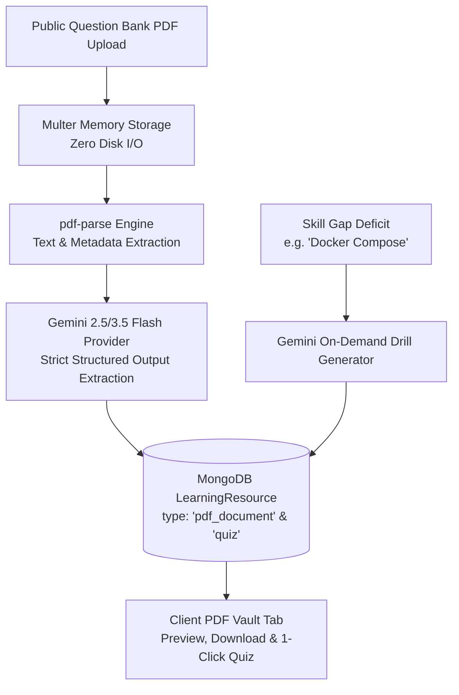
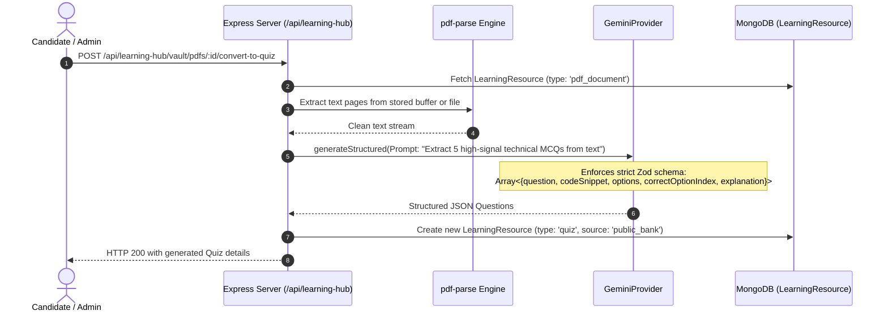

# Phase 23 (Part 2) — Learning Hub: PDF Question Bank & Gemini AI Ingestion Plan

> **Sprint:** 5  
> **Phase:** 23 (Part 2)  
> **Target Date:** October 2026  
> **Status:** COMPLETED & VERIFIED  
> **Primary Goal:** Architect and deliver the **Public Question Bank & PDF Ingestion Engine** combined with the **Gemini AI Content & Drill Generator** for the SKILLEZO Learning Hub — turning static technical interview PDFs and cheat-sheets into searchable vaults and interactive practice drills.

---

## 1. Executive Summary & Sprint Boundaries

Phase 1 established the data foundation, REST catalog, and responsive Next.js App Router dashboard for Learning Hub tracks.

**Phase 2** activates the content ingestion pipelines:
1. **Curated PDF Document & Cheat-Sheet Vault**: Hosting and indexing high-signal technical PDFs (interview question packs, architecture cheat-sheets, commands, and syllabi) with in-browser preview and download.
2. **Automated PDF Question Extraction Engine**: Leveraging `pdf-parse` to extract text from uploaded PDFs and passing chunks to `GeminiProvider` with strict Zod structured outputs to extract interactive MCQs, code snippets, and answer explanations.
3. **On-Demand Gemini Skill Drill Generator**: Enabling on-demand AI generation of rich lessons and 5-question code blitzes for any canonical skill or candidate skill gap.
4. **Hydration of Tab 2 in Client Dashboard**: Replacing the static preview on `/dashboard/learning-hub` (Tab 2: PDF Question Bank) with a searchable, filterable vault with 1-click **"Extract to AI Practice Quiz"**.



### 1.1 Strict Scope for Phase 2 (IN SCOPE)
- **Backend Architecture (`server/src/modules/learning-hub/`)**:
  - `pdf-vault.service.ts`: Handles PDF document storage, indexing, metadata extraction, and PDF binary serving.
  - `gemini-content.generator.ts`: Service integrating with `GeminiProvider` to parse raw PDF text and extract structured `IQuizQuestion[]` arrays, as well as on-demand skill drill generation.
  - `learning-hub-upload.middleware.ts`: Dedicated `multer` memory storage filter validating PDF mime types and file limits ($\le 15\text{MB}$).
  - Endpoints:
    - `GET /api/learning-hub/vault/pdfs`: List all indexed cheat-sheets and question banks (filter by category/skill).
    - `GET /api/learning-hub/vault/pdfs/:id/file`: Stream PDF binary for inline browser preview and download.
    - `POST /api/learning-hub/vault/pdfs/:id/convert-to-quiz`: Gemini-powered 1-click conversion of PDF sections into an interactive `LearningResource` quiz.
    - `POST /api/learning-hub/admin/upload-pdf`: Multipart endpoint to ingest and index new technical PDFs.
    - `POST /api/learning-hub/admin/generate-drill`: On-demand Gemini generator for missing skill drills.
- **Database Seeder**:
  - Ingestion and indexing of 5 starter high-demand PDF cheat-sheets/interview packs:
    1. *React 19 & Next.js 15 Full-Stack Interview Guide*
    2. *Node.js Backend Concurrency & Event Loop Q&A Bank*
    3. *PostgreSQL Indexing & Performance Tuning Cheat-Sheet*
    4. *Docker & Kubernetes Production Commands & Architecture Manual*
    5. *System Design Distributed Patterns & Tradeoffs Vault*
- **Frontend Next.js App Router (`client/`)**:
  - New components in `client/components/dashboard/learning-hub/pdf-vault/`:
    - `PdfVaultGrid.tsx`: Filterable card grid for PDF guides with category tags, page counts, and badges.
    - `PdfPreviewModal.tsx`: In-browser PDF preview iframe with download button and metadata details.
    - `PdfQuizConverterDialog.tsx`: Modal displaying AI-extracted questions from the PDF, ready to practice.
  - Full hydration of **Tab 2: PDF Question Bank** in `client/app/dashboard/learning-hub/page.tsx`.

### 1.2 Deferred to Phase 3
- **Phase 3 (Practice Arena & Drill Runner)**: Full-screen interactive timer, stepper, and code editor runner for taking the quizzes generated in Phase 2.

---

## 2. Codebase Deep-Dive & Existing Technical Touchpoints

Our codebase audit reveals that all required primitives already exist and can be plugged in directly:

| Subsystem | Existing File in Repo | Phase 2 Integration Hook |
| :--- | :--- | :--- |
| **In-Memory Upload** | `server/src/core/middleware/upload.middleware.ts` | Reuses `multer.memoryStorage()` pattern for zero-disk, 100% stateless PDF processing. |
| **PDF Extraction Engine** | `server/src/modules/resume/resume.parser.ts` | Reuses `pdf-parse/lib/pdf-parse.js` to extract raw text, page count, and structural metadata from `Buffer`. |
| **AI Structured Provider** | `server/src/core/ai/providers/gemini.provider.ts` | Reuses `generateStructured<T>()` with JSON schema enforcement to parse question blocks without hallucinations. |
| **Mongoose Schema** | `server/src/database/models/LearningResource.model.ts` | Uses already pre-provisioned fields: `content.pdfKey`, `content.pdfPageCount`, `content.questions`, `content.downloadAllowed`, `source: 'public_bank'`, and `reviewStatus`. |
| **Client Navigation** | `client/app/dashboard/learning-hub/page.tsx` | Tab 2 button and conditional view already stubbed with `activeTab === 'pdf_vault'`. |

---

## 3. Data Architecture & Schema Specifications

The schemas created in Phase 1 were designed to anticipate Phase 2 with **zero schema changes required**. 

### 3.1 PDF Resource Representation in `LearningResourceModel`
A PDF Question Bank entry is stored as:
```typescript
{
  title: "React 19 & Next.js 15 Comprehensive Interview Guide",
  slug: "react-19-nextjs-interview-guide-pdf",
  type: "pdf_document",
  category: "Frontend",
  skills: ["React", "Next.js", "Server Components"],
  difficulty: "advanced",
  estimatedMinutes: 45,
  content: {
    provider: "SKILLEZO Curated Vault",
    pdfKey: "react-19-interview-guide.pdf",
    pdfPageCount: 28,
    downloadAllowed: true,
    markdown: "Comprehensive 28-page technical question bank covering React 19 Actions, Fiber architecture, RSC streaming, and Core Web Vitals.",
    // Populated once converted or seeded
    questions: [
      {
        id: "q_r19_1",
        question: "How does useActionState manage pending state transitions in React 19?",
        codeSnippet: "const [state, formAction, isPending] = useActionState(fn, null);",
        options: [
          "It uses internal startTransition to track isPending without manual boolean states.",
          "It blocks the main thread until the Promise resolves.",
          "It requires an external Redux store to track async dispatches.",
          "It executes synchronously on the server before client hydration."
        ],
        correctOptionIndex: 0,
        explanation: "useActionState natively wraps the action in a transition, automatically managing pending state and errors without manual useState toggles.",
        difficulty: "intermediate"
      }
    ]
  },
  source: "public_bank",
  reviewStatus: "published"
}
```

---

## 4. Gemini AI Ingestion & Question Extraction Engine



### 4.1 Strict Structured AI Extraction Prompt
The extraction prompt sent to `GeminiProvider` guarantees deterministic outputs:

```typescript
const EXTRACTION_SYSTEM_INSTRUCTION = `
You are an expert technical assessor for elite software engineering candidates.
Analyze the provided technical document text and extract high-signal, accurate technical questions.
For every question:
1. Provide a precise, non-ambiguous question.
2. Include a clean code snippet when applicable (using TypeScript, SQL, Bash, or modern JS).
3. Provide exactly 4 distinct multiple-choice options.
4. Specify the 0-indexed correct option.
5. Provide a rigorous 2-sentence explanation of why the correct option is right and the others are incorrect.
6. Designate difficulty as 'beginner', 'intermediate', or 'advanced'.
Do not hallucinate facts. Rely strictly on established engineering principles.
`;
```

---

## 5. Backend REST API Specifications (`server/src/modules/learning-hub/`)

Mounted at `/api/learning-hub/vault` and `/api/learning-hub/admin`:

| Method | Route | Description | Auth |
| :--- | :--- | :--- | :--- |
| `GET` | `/api/learning-hub/vault/pdfs` | List all available PDF documents & cheat-sheets with category & search filters | Optional |
| `GET` | `/api/learning-hub/vault/pdfs/:id` | Fetch specific PDF metadata and summary | Optional |
| `GET` | `/api/learning-hub/vault/pdfs/:id/preview` | Stream PDF file binary with `Content-Type: application/pdf` for iframe rendering | Optional |
| `POST` | `/api/learning-hub/vault/pdfs/:id/convert-to-quiz` | Trigger Gemini extraction to turn a PDF into an interactive practice quiz | Required |
| `POST` | `/api/learning-hub/admin/upload-pdf` | Admin endpoint to upload new PDF documents (multer memory buffer) | Admin |
| `POST` | `/api/learning-hub/admin/generate-drill` | Generate on-demand lesson + 5-question blitz for any target skill | Admin |

---

## 6. Frontend Next.js Architecture (`client/components/dashboard/learning-hub/pdf-vault/`)

### 6.1 Component Hierarchy for Tab 2

```
client/components/dashboard/learning-hub/pdf-vault/
├── PdfVaultHeader.tsx               # Vault title, search bar, category chips, upload trigger
├── PdfCard.tsx                      # PDF card with thumbnail, page count, skill tags, actions
├── PdfPreviewModal.tsx              # Clean modal rendering PDF preview iframe + download CTA
└── PdfQuizConverterModal.tsx        # Modal showing extracted questions with "Start Drill" CTA
```

### 6.2 Key User Interactions
1. **Browse & Filter**: Candidates can filter cheat-sheets by *Frontend*, *Backend*, *Database*, *DevOps*, and *System Design*.
2. **Instant Preview**: Clicking a card opens `PdfPreviewModal`, streaming the PDF directly in the browser with zoom and page controls.
3. **One-Click Convert to AI Quiz**: Clicking *"Extract Practice Quiz"* triggers a quick AI loader ($\sim 2-3\text{s}$) and presents the candidate with interactive questions extracted from that specific PDF.

---

## 7. Phase 2 Implementation Roadmap & Step-by-Step Manifest

```
SKILLEZO.AI/
├── server/
│   ├── src/core/middleware/
│   │   └── pdf-upload.middleware.ts                <-- [NEW] 15MB PDF memory filter
│   ├── src/modules/learning-hub/
│   │   ├── pdf-vault.service.ts                    <-- [NEW] PDF indexing & serving logic
│   │   ├── gemini-content.generator.ts             <-- [NEW] Gemini PDF & drill extractor
│   │   ├── learning-hub.controller.ts              <-- [UPDATE] Add PDF vault & generator handlers
│   │   ├── learning-hub.routes.ts                  <-- [UPDATE] Mount vault & admin routes
│   │   └── seed-pdf-vault.ts                       <-- [NEW] Starter PDF documents seed
│
└── client/
    ├── types/learning-hub.ts                       <-- [UPDATE] Add PdfDocument & QuizExtract types
    ├── services/learning-hub.service.ts            <-- [UPDATE] Add PDF vault endpoints
    ├── components/dashboard/learning-hub/pdf-vault/
    │   ├── PdfVaultHeader.tsx                      <-- [NEW] Search & category filter bar
    │   ├── PdfCard.tsx                             <-- [NEW] High-conversion PDF card
    │   ├── PdfPreviewModal.tsx                     <-- [NEW] In-browser PDF reader dialog
    │   └── PdfQuizConverterModal.tsx               <-- [NEW] Extracted quiz preview modal
    └── app/dashboard/learning-hub/page.tsx         <-- [HYDRATE] Replace Tab 2 preview with live vault
```

### Execution Steps:
- [x] **Step 1 (Middleware & Services)**: Create `pdf-upload.middleware.ts`, `pdf-vault.service.ts`, and `gemini-content.generator.ts`.
- [x] **Step 2 (Routes & Controller)**: Update `learning-hub.controller.ts` and `learning-hub.routes.ts` with PDF vault endpoints.
- [x] **Step 3 (Seed Data)**: Create `seed-pdf-vault.ts` populating 5 enterprise PDF cheat-sheets into MongoDB.
- [x] **Step 4 (Client SDK & Types)**: Add vault methods to `client/services/learning-hub.service.ts` and update `learning-hub.ts`.
- [x] **Step 5 (Client Components)**: Build `PdfCard.tsx`, `PdfPreviewModal.tsx`, `PdfQuizConverterModal.tsx`, and hydrate Tab 2 in `client/app/dashboard/learning-hub/page.tsx`.
- [x] **Step 6 (Verification)**: Run `npm run type-check` on server and `next build` on client to ensure 100% green build.

---

## 8. Verification & Acceptance Criteria

1. **PDF Indexing & Retrieval**: `GET /api/learning-hub/vault/pdfs` returns all published cheat-sheets with accurate page counts and metadata.
2. **Zero-Disk Streaming**: `GET /api/learning-hub/vault/pdfs/:id/preview` streams the PDF binary without writing temporary files to disk.
3. **Structured AI Extraction**: `POST /api/learning-hub/vault/pdfs/:id/convert-to-quiz` returns $\ge 3$ strictly validated multiple-choice questions without AI hallucination.
4. **Client UI Responsiveness**: Tab 2 displays PDF cards with quick search, category filtering, instant modal preview, and interactive quiz extraction.
5. **Type Safety & Zero Regressions**: `tsc --noEmit` and `next build` compile with 0 errors across the workspace.
