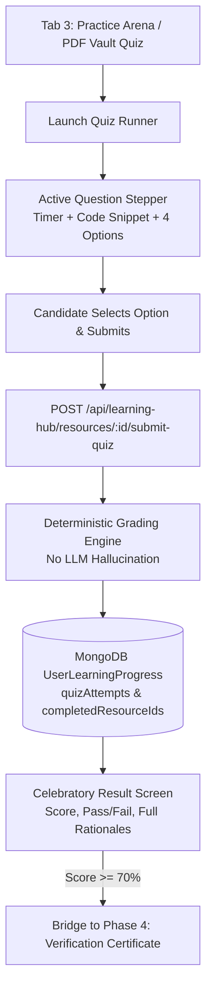
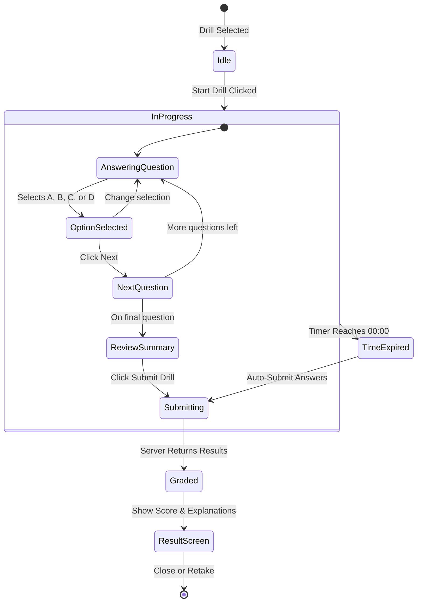

# Phase 23 (Part 3) — Learning Hub: Interactive Practice Arena & AI Drill Runner Plan

> **Sprint:** 5  
> **Phase:** 23 (Part 3)  
> **Target Date:** October 2026  
> **Status:** READY FOR EXECUTION  
> **Primary Goal:** Architect and deliver the **Interactive Practice Arena & AI Drill Runner** for the SKILLEZO Learning Hub — transforming static extracted questions and curriculum quizzes into a timed, interactive, syntax-highlighted code drill player with instant Gemini answer rationales and persistent progress tracking.

---

## 1. Executive Summary & Sprint Boundaries

Phase 1 established the track catalog and module syllabus drawers.  
Phase 2 delivered the Technical PDF Vault with on-the-fly PDF generation and Gemini AI question extraction.

**Phase 3 activates the active learning loop**:
1. **Interactive Practice Arena (Hydration of Tab 3)**: Replacing the static preview card on `/dashboard/learning-hub` (Tab 3: Practice Arena) with a live catalog of rapid-fire drills, filterable by skill and difficulty.
2. **On-Demand AI Skill Blitz Generator**: Giving candidates the ability to generate a bespoke 5-question code blitz for any canonical skill or identified skill gap on demand using Gemini Flash.
3. **Enterprise Quiz Runner Player**: Building a distraction-free, responsive quiz runner featuring:
   - Real-time countdown timer (e.g., 2 minutes per question).
   - Code snippet preview with dark-mode styling and syntax formatting.
   - Instant visual feedback mode (reveal rationale immediately upon answer or in review mode).
   - Deterministic grading and explanation review.
4. **Backend Grading & Progress Sync**:
   - `POST /api/learning-hub/resources/:id/submit-quiz`: Computes deterministic score, checks passing threshold ($\ge 70\%$), stores the attempt into `UserLearningProgressModel.quizAttempts`, and marks the resource completed.



---

## 2. In Scope vs. Deferred

### 2.1 Strict Scope for Phase 3 (IN SCOPE)

#### Backend Architecture (`server/src/modules/learning-hub/`)
1. **Deterministic Quiz Submission Endpoint**:
   - `POST /api/learning-hub/resources/:id/submit-quiz`:
     - Validates payload: `{ selectedAnswers: Record<string, number> }` (map of question ID to chosen option index).
     - Compares against `correctOptionIndex` from `LearningResourceModel.content.questions`.
     - Calculates score percentage, total questions, correct count, and pass status ($\ge 70\%$).
     - Appends `IQuizAttempt` to `UserLearningProgressModel`.
     - Returns detailed question-by-question breakdown with complete explanations and correct answers.
2. **Practice Catalog Endpoint**:
   - `GET /api/learning-hub/practice/drills`:
     - Queries all resources where `type: 'quiz'` or resources with non-empty `content.questions`.
     - Formats lightweight cards with question count, target skills, difficulty, and user's previous best score.
3. **On-Demand AI Blitz Generator Endpoint**:
   - `POST /api/learning-hub/practice/generate-blitz`:
     - Accepts `{ skill: string; difficulty?: string }`.
     - Calls `GeminiContentGenerator.generateSkillQuiz(skill, difficulty)` to create 5 high-signal technical MCQs with code snippets.
     - Saves as a new `quiz` resource in MongoDB.
     - Returns the created resource so the runner can launch it immediately.

#### Frontend Architecture (`client/`)
1. **Hydration of Tab 3 in [page.tsx](file:///x:/projects/next.js/office-Project/SKILLEZO.AI/client/app/dashboard/learning-hub/page.tsx)**:
   - Replace placeholder card with `<PracticeArenaView />`.
   - Grid of available practice drills (PDF-extracted drills, Track quizzes, and AI-generated blitzes).
   - "Generate AI Drill" quick-action banner tailored to candidate's missing skills.
2. **New Components in `client/components/dashboard/learning-hub/practice/`**:
   - `PracticeArenaView.tsx`: Drill catalog, filter chips (All, Frontend, Backend, DevOps, etc.), and quick launch.
   - `DrillCard.tsx`: Card showing drill title, skills, difficulty badge, question count, and "Start Drill" button.
   - `QuizRunnerModal.tsx`: Complete modal runner with:
     - Header: Question counter (`Question 2 of 5`), progress bar, and timer pill.
     - Code Display: Pre-formatted monospace box with copy button.
     - Option Selectors: Clean selectable cards with hover states, letter badges (A, B, C, D), and checked states.
     - Navigation: "Previous", "Next", "Flag for Review", and "Submit Quiz".
   - `QuizResultModal.tsx`: Results view featuring:
     - Animated score percentage circle.
     - Pass/Fail banner with threshold ($\ge 70\%$).
     - Question breakdown accordion (view which questions were correct/incorrect with explanations).
     - CTAs: "Retake Drill", "Review Explanations", "Take Verification Assessment".
   - `GenerateBlitzModal.tsx`: 1-click modal allowing user to type or select a missing skill to generate an AI drill.

---

### 2.2 Deferred to Phase 4
- **Phase 4 (Closed-Loop Verification Bridge)**:
  - Automatically minting SHA-256 certificate hashes (`SKZ-CERT-...`) via `VerificationService` on qualifying tracks.
  - Automatically updating `ProfileModel.skills[skill].verified = true` with competency levels.
  - Direct deep-links from `/dashboard/skill-gap-analysis` with "Learn on Hub" action buttons.

---

## 3. Data Models & API Contracts

### 3.1 Submission Request & Response DTOs

```typescript
// Payload sent by client
export interface SubmitQuizRequestDTO {
  selectedAnswers: Record<string, number>; // { "q_r19_1": 0, "q_r19_2": 2 }
  timeSpentSeconds?: number;
}

// Response returned by server
export interface SubmitQuizResponseDTO {
  resourceId: string;
  resourceTitle: string;
  score: number;             // e.g. 80 (percentage)
  passingScore: number;      // 70
  passed: boolean;           // true if score >= 70
  totalQuestions: number;
  correctAnswersCount: number;
  timeSpentSeconds?: number;
  attemptedAt: string;
  results: {
    questionId: string;
    question: string;
    codeSnippet?: string;
    selectedOptionIndex: number;
    correctOptionIndex: number;
    isCorrect: boolean;
    explanation: string;
  }[];
}
```

### 3.2 Quiz Runner State Machine



---

## 4. Implementation Steps & Work Breakdown

### Step 1: Backend Grading & Practice APIs
1. In `server/src/modules/learning-hub/learning-hub.service.ts`:
   - Implement `submitQuiz(userId, resourceId, dto: SubmitQuizRequestDTO)`:
     - Fetch `LearningResourceModel.findById(resourceId)`.
     - Grade submitted answers against `correctOptionIndex`.
     - Update or insert attempt into `UserLearningProgressModel.quizAttempts`.
     - If passed ($\ge 70\%$), add `resourceId` to `completedResourceIds`.
   - Implement `listPracticeDrills(category, search)`:
     - Query resources with quizzes or questions.
   - Implement `generateBlitz(userId, skill, difficulty)`:
     - Use `GeminiContentGenerator.generateSkillQuiz(skill, difficulty)`.
2. In `server/src/modules/learning-hub/learning-hub.controller.ts`:
   - Add `submitQuiz`, `listPracticeDrills`, and `generateBlitz` methods.
3. In `server/src/modules/learning-hub/learning-hub.routes.ts`:
   - Route `POST /resources/:id/submit-quiz` -> `controller.submitQuiz`.
   - Route `GET /practice/drills` -> `controller.listPracticeDrills`.
   - Route `POST /practice/generate-blitz` -> `controller.generateBlitz`.

### Step 2: Client Services & Types
1. In `client/types/learning-hub.ts`:
   - Add `SubmitQuizRequestDTO`, `SubmitQuizResponseDTO`, and `PracticeDrillSummary`.
2. In `client/services/learning-hub.service.ts`:
   - Add `submitQuiz(resourceId, data)`.
   - Add `getPracticeDrills(category, search)`.
   - Add `generateBlitz(skill, difficulty)`.

### Step 3: Client Quiz Runner & Arena Components
1. Create `client/components/dashboard/learning-hub/practice/`:
   - `QuizRunnerModal.tsx`: Responsive quiz container with question timer, code snippet renderer, option buttons, and answer review.
   - `QuizResultModal.tsx`: Score breakdown, pass/fail badge, and explanation viewer.
   - `DrillCard.tsx`: Card UI for launching practice sessions.
   - `GenerateBlitzModal.tsx`: AI skill blitz creator modal.
   - `PracticeArenaView.tsx`: Grid view replacing Tab 3 placeholder.
2. In `client/app/dashboard/learning-hub/page.tsx`:
   - Connect Tab 3 to `<PracticeArenaView />`.
   - Connect "Start Practice" CTA from `PdfQuizConverterModal` directly into `QuizRunnerModal`.

### Step 4: Verification & Build Validation
1. Verify Next.js build: `npm run build` in `client/` (0 compilation or TypeScript errors).
2. Verify Server build: `npm run build` in `server/` (tsup build clean).
3. Test end-to-end:
   - Start a quiz from PDF Vault or Practice Arena.
   - Complete 5 questions, verify timer countdown.
   - Submit answers, verify deterministic score and explanation display.
   - Verify progress saves in MongoDB.

---

## 5. Acceptance Criteria

1. **Deterministic Accuracy**:
   - Scores must be calculated mathematically on the server; no hallucination or random scoring.
2. **Instant Feedback & Education**:
   - After submission (or in practice mode), every question must clearly explain *why* the correct answer is right and *why* the others are incorrect.
3. **Progress Persistence**:
   - Submitted scores and completion IDs must persist in `UserLearningProgressModel`.
4. **Seamless PDF Vault to Quiz Flow**:
   - Clicking "Start Practice" in the PDF Vault quiz modal must seamlessly launch the Quiz Runner without page reload.
5. **Zero Performance Lag**:
   - Submission grading must complete in $< 150\text{ms}$.
