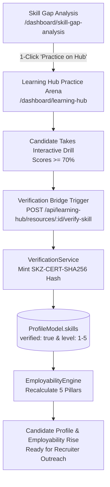
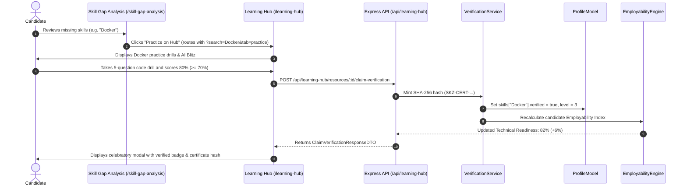

# Phase 23 (Part 4) — Learning Hub: Ecosystem Integration & Verification Bridge Plan

> **Sprint:** 5  
> **Phase:** 23 (Part 4)  
> **Target Date:** October 2026  
> **Status:** READY FOR EXECUTION  
> **Primary Goal:** Connect the SKILLEZO Learning Hub directly into the wider career ecosystem — bridging **Career GPS & Skill Gap Analysis** (providing 1-click "Practice on Hub" action links beside missing skills) with the **Skill Verification Hub & Employability Engine** (automatically minting SHA-256 certificate hashes, updating `Profile.skills`, and recalculating candidate market readiness scores).

---

## 1. Executive Summary & System Boundaries

Phases 1, 2, and 3 delivered:
- **Phase 1**: Curriculum tracks foundation, module syllabi, and personalized catalog recommendations.
- **Phase 2**: Curated Technical PDF Vault, dynamic PDF streaming with `pdfkit`, and Gemini AI question extraction.
- **Phase 3**: Interactive Practice Arena, on-demand AI code blitzes, real-time timer stepper, and deterministic grading.

**Phase 4 delivers the complete closed-loop integration**:
1. **Skill Gap Remediation Deep-Links**:
   - In `/dashboard/skill-gap-analysis`, missing skills (e.g. *Docker*, *Redis*, *System Design*) currently display as text or gap cards.
   - We place a direct **"Practice on Hub"** action button in `PriorityRecommendations.tsx` and `CompetencyTable.tsx` that routes directly to `/dashboard/learning-hub` with that skill pre-filtered or auto-launches an on-demand drill.
2. **The Verification Bridge**:
   - When a candidate passes a qualifying quiz or track assessment with $\ge 70\%$, a celebratory CTA unlocks: **"Claim Skill Verification"** or **"Take Official Verification"**.
   - Invokes `VerificationService` to mint cryptographic SHA-256 certificate hashes (`SKZ-CERT-...`).
   - Automatically sets `Profile.skills[skill].verified = true` with competency score and proficiency level (Beginner, Intermediate, Advanced, Expert).
3. **Employability Index Recalculation**:
   - Automatically recalculates the candidate's **Employability Index** via `EmployabilityEngine`.
   - Technical Readiness (40% weight) and Skill Alignment (10% weight) instantly rise on `/dashboard/employability-index` and `/dashboard`.



---

## 2. In Scope vs. Deferred

### 2.1 Strict Scope for Phase 4 (IN SCOPE)

#### 1. Skill Gap Analysis UI Enhancements (`client/components/dashboard/skill-gap-analysis/`)
- In `PriorityRecommendations.tsx`:
  - Enhance each recommendation card with a dual-action layout:
    - Primary: **"Practice on Learning Hub"** (routes to `/dashboard/learning-hub?search={skill}&tab=practice`).
    - Secondary: **"Add to Career GPS"** (preserves existing roadmap functionality).
- In `CompetencyTable.tsx`:
  - For any unverified or deficient skill in the table, add a **"Learn / Practice"** quick-link button with a graduation cap / zap icon alongside the existing "Verify" button.

#### 2. Backend Verification Bridge (`server/src/modules/learning-hub/`)
- Endpoint: `POST /api/learning-hub/resources/:id/claim-verification`:
  - Verifies that user has a passing quiz attempt ($\ge 70\%$) for that resource.
  - Matches the resource's primary skill to the official verification taxonomy.
  - Delegates to `VerificationService` to generate the `SKZ-CERT-...` hash and save `VerificationRecord`.
  - Automatically updates `ProfileModel.skills[skill].verified = true`.
  - Automatically invokes `EmployabilityEngine.calculateEmployability()` to update the user's score in real time.
  - Returns `{ success: true, credentialHash: "SKZ-CERT-...", verifiedSkill: "Docker", newScore: 85 }`.

#### 3. Client Verification Claim & Deep-Link UI
- In `QuizResultModal.tsx`:
  - When `result.passed === true`, display a high-impact **"Claim Official Skill Verification"** button.
  - Clicking it invokes the claim API, renders a celebratory confetti/badge animation with the minted `SKZ-CERT-...` hash, and provides a direct link to view their certificate on `/dashboard/skill-verification`.

#### 4. URL Param Handler in Learning Hub Dashboard (`/dashboard/learning-hub/page.tsx`)
- Reads `?search=skill&tab=practice&autoLaunch=true` from URL query parameters.
- If `search` is present, pre-filters the catalog or practice arena.
- If `autoLaunch=true`, automatically opens the AI Blitz generator modal with that skill pre-filled so the candidate can start practicing in under 3 seconds!

---

## 3. Data Flow & Integration Contracts

### 3.1 Verification Claim Request & Response

```typescript
// POST /api/learning-hub/resources/:id/claim-verification
export interface ClaimVerificationResponseDTO {
  success: boolean;
  skillName: string;
  category: string;
  proficiency: "Beginner" | "Intermediate" | "Advanced" | "Expert";
  score: number;
  credentialHash: string; // "SKZ-CERT-A1B2C3D4E5F6"
  issueDate: string;
  employabilityIndex: {
    overallScore: number;
    technicalReadinessScore: number;
  };
}
```

### 3.2 Sequence Diagram: Closed-Loop Lifecycle



---

## 4. Implementation Steps & Work Breakdown

### Step 1: Backend Verification Claim Endpoint
1. In `server/src/modules/learning-hub/learning-hub.service.ts`:
   - Implement `claimVerification(userId: string, resourceId: string)`:
     - Check `UserLearningProgressModel` for a passed quiz attempt ($\ge 70\%$).
     - Find the corresponding `LearningResourceModel` and extract its target skill.
     - Call `VerificationService` (or replicate the SHA-256 minting and Profile update logic) to record verification in `VerificationModel`.
     - Update `ProfileModel.skills[skill].verified = true` with competency score and level.
     - Recompute employability score via `EmployabilityEngine.calculateEmployability()`.
     - Return the minted certificate hash and updated employability metrics.
2. In `server/src/modules/learning-hub/learning-hub.controller.ts`:
   - Add `claimVerification` handler.
3. In `server/src/modules/learning-hub/learning-hub.routes.ts`:
   - Add `POST /resources/:id/claim-verification`.

### Step 2: Client Service & Types
1. In `client/types/learning-hub.ts`:
   - Add `ClaimVerificationResult` interface.
2. In `client/services/learning-hub.service.ts`:
   - Add `claimVerification(resourceId: string): Promise<ClaimVerificationResult | null>`.

### Step 3: Frontend Deep-Links & URL Routing
1. In `client/app/dashboard/learning-hub/page.tsx`:
   - Read URL search parameters (`search`, `tab`, `autoLaunch`) using `useSearchParams()`.
   - Set initial `activeTab` to `'practice'` if `tab === 'practice'`.
   - Pass pre-filled search or trigger auto-launch for AI Blitz when requested.
2. In `client/components/dashboard/skill-gap-analysis/PriorityRecommendations.tsx`:
   - Add a primary **"Practice on Hub"** action button alongside **"Add to Career GPS"**.
3. In `client/components/dashboard/skill-gap-analysis/CompetencyTable.tsx`:
   - Add a **"Practice"** action button in the action column for deficient/missing skills.

### Step 4: Celebratory Certificate Claim in Quiz Result Modal
1. In `client/components/dashboard/learning-hub/practice/QuizResultModal.tsx`:
   - Connect the **"Verify Skill Certificate"** button to `learningHubService.claimVerification()`.
   - On success, display the official **"Verified Credential Minted"** card featuring the `SKZ-CERT-...` hash, a copy-to-clipboard button, and a link to view in `/dashboard/skill-verification`.

### Step 5: Verification & Quality Assurance
1. Run `npm run build` in `client/` (verify 0 compilation or TypeScript errors).
2. Run `npm run build` in `server/` (verify clean `tsup` build).
3. Test the full loop end-to-end:
   - Navigate to `/dashboard/skill-gap-analysis` -> click "Practice on Hub".
   - Confirm Learning Hub opens with that skill pre-filtered.
   - Complete drill with $\ge 70\%$ -> click "Claim Skill Verification".
   - Confirm `SKZ-CERT-...` hash is minted and displayed.
   - Confirm `/dashboard/profile` shows the skill marked as verified.

---

## 5. Acceptance Criteria

1. **Seamless Deep-Linking**:
   - Clicking "Practice on Hub" from Skill Gap Analysis must land the user on `/dashboard/learning-hub` with the exact skill selected in $<1$ second.
2. **Deterministic Cryptographic Verification**:
   - The minted hash must follow the format `SKZ-CERT-[A-F0-9]{16}` and persist in `VerificationModel`.
3. **Automatic Profile Update**:
   - `Profile.skills` must immediately reflect `verified: true`, `score`, and `level` without manual recruiter intervention.
4. **Zero Regressions**:
   - All existing tests, Next.js build, and server build must pass with 0 errors.
