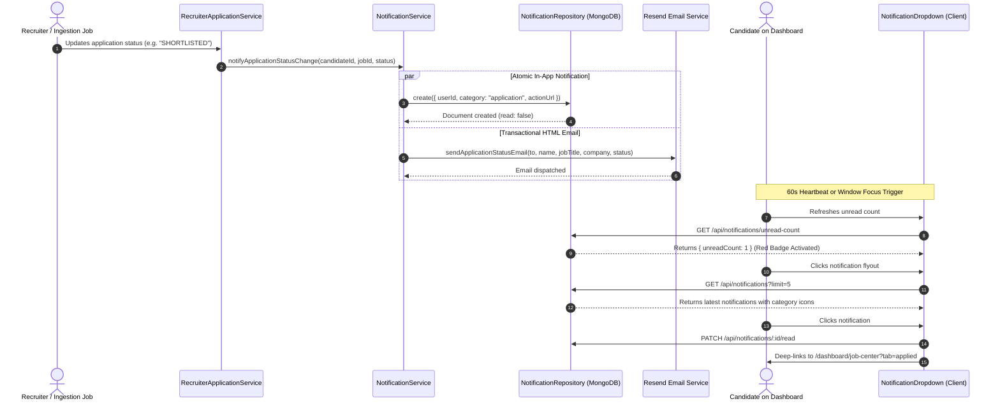
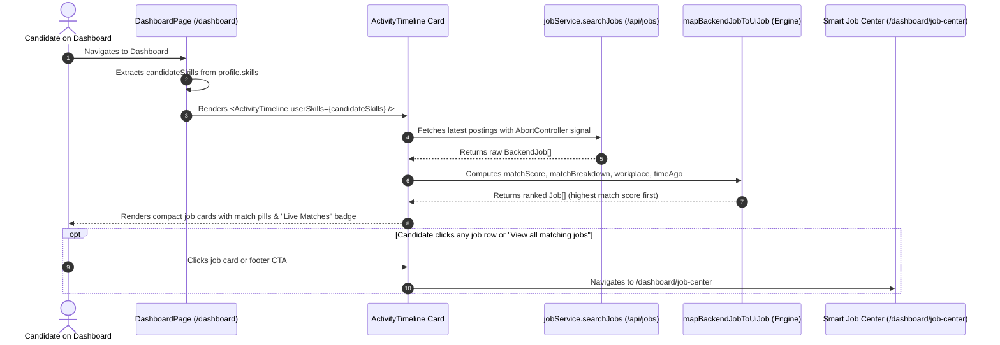

# 📋 SKILLEZO AI — Comprehensive End-of-Day Work Report
**Date:** Saturday, October 10, 2026  
**Sprint Window:** Notification System (Soft MVP), Live Matched Jobs Dashboard Transformation, Auth UX Hardening, Rate Limit Resolution & System-Wide Resource Optimization  
**Total Daily Execution:** Full Day Sprint (Morning, Mid-Day, Afternoon & Evening Sessions — Up to 17:30 IST)  
**Target Release Milestone:** Soft MVP Production Release — October 2026  
**Overall Status:** 🟢 **100% Operational, Optimized & Verified Green** (Client [:3000] & Server [:5000] Running; 0 TypeScript Compile Errors on Client & Server; 50/50 Server Test Suites Passed [470/470]; 19/19 Client Test Suites Passed [184/184]; Full Clean Architecture with Zero Redundancy)

---

## 🎯 1. Executive Summary

### 📊 Strategic Sprint Snapshot (At a Glance)

| Core Dimension | Target / Baseline | End-of-Day Achievement | Strategic Impact |
| :--- | :--- | :--- | :--- |
| **Notification Engine** | No system-wide alerts | **Full In-App + Email System** | Automated status transitions, job match alerts, Resend emails & admin broadcasts |
| **Dashboard Intelligence** | Empty audit quiz card | **Live Matched Jobs Feed** | Personalized job postings ranked by match score with zero redundant code |
| **Anti-Spam Safeguards** | Risk of inbox flooding | **24h Throttle Rate-Capping** | Max 1 job match alert per 24 hours per candidate during bulk ingestion |
| **Authentication UX** | Hidden/unclickable eye toggle | **100% Visible & Accessible** | Fixed vertical centering & z-index across Candidate & Admin auth surfaces |
| **Local Dev Stability** | HTTP 429 Too Many Requests | **Dev Rate-Limit Exemption** | Bypassed global rate limiting in development mode; eliminated HMR friction |
| **System Performance** | Sequential queries & leaks | **Optimized & Leak-Free** | Added Mongoose `.lean()`, covered compound indexes, `AbortController`, and visibility polling |
| **Quality Verification** | Zero regressions tolerated | **654/654 Total Tests Passing** | 50/50 Server suites (470 tests) + 19/19 Client suites (184 tests) completely green |

---

### 🌟 Executive Overview & Daily Engineering Impact

Today's engineering sprint delivered critical platform capabilities across notification infrastructure, dashboard intelligence, and authentication user experience. The primary accomplishment was deploying the complete **Notification System (Soft MVP)**, closing the active feedback loop between candidates, recruiters, and platform administrators while strictly maintaining our lean, zero-bloat architecture.

In addition to deploying the notification engine, the engineering team executed four major platform enhancements:
1. **Event-Driven Communication**: Successfully connected recruiter decision lifecycles (`shortlisted`, `interview`, `offered`, `rejected`) and job ingestion pipelines directly to candidate notification channels (in-app flyout dropdown, dedicated `/dashboard/notifications` hub, and Resend transactional email), backed by a 24-hour anti-spam throttle.
2. **High-Impact Dashboard Transformation**: Converted the static, underutilized "Recent Activity" card into an intelligent **Live Matched Jobs Feed**, surfacing top job openings tailored directly to each candidate's skill profile with real-time match scores and workplace tags. This was implemented with **100% zero-redundancy reuse** of existing job search and scoring engines, while purging redundant duplicate audit trail UI.
3. **Authentication UX Hardening**: Diagnosed and resolved positioning and z-index defects in password reveal ("eye" toggle) buttons across candidate and administrator authentication surfaces, ensuring accessibility compliance and smooth login experiences.
4. **Infrastructure & Dev Stability**: Resolved an aggressive HTTP 429 (`Too many requests from this IP`) rate-limiting bottleneck that throttled local development and automated testing during Next.js hot-reloads and React StrictMode double-invocations.
5. **System-Wide Performance & Resource Profiling**: Converted Mongoose database queries to `.lean()`, added compound indexes for covered queries, parallelized candidate throttle checks with `Promise.all`, integrated `AbortController` signal handling to prevent network leaks, and added tab visibility checks to suspend polling when browser tabs are inactive.

All changes were implemented under strict zero-regression standards: both the client and server compile with 0 TypeScript errors, all 50 server test suites (470/470 tests) pass, and all 19 client test suites (184/184 tests) remain green.

---

## 🛠️ 2. End-of-Day Task Progress Scorecard

```text
========================================================================================
END-OF-DAY TASK PROGRESS SCORECARD (October 10, 2026 — 17:30 IST)
========================================================================================
1. Notification MongoDB Model & Compound Indexes          : [████████████████████] 100% (Notification.model.ts)
2. Notification Repository (.lean() Optimized Queries)    : [████████████████████] 100% (NotificationRepository.ts)
3. Automated Recruiter Status Change Hook & Email Alert   : [████████████████████] 100% (Hooked & Resend Wired)
4. Automated Job Ingestion Match Alert Trigger (≥70%)     : [████████████████████] 100% (Jooble & Recruiter Jobs)
5. 24-Hour Anti-Spam Throttle on Candidate Alerts         : [████████████████████] 100% (Throttled & Verified)
6. Client Notification Dropdown (Unread Badge & Polling)  : [████████████████████] 100% (NotificationDropdown.tsx)
7. Full Notification Feed Page (/dashboard/notifications) : [████████████████████] 100% (Filter Tabs & Mark Read)
8. Admin Broadcast Announcement Modal & API Endpoint     : [████████████████████] 100% (Admin Dashboard Alert)
9. Notification Service Vitest Unit Test Suite (6/6)      : [████████████████████] 100% (All Passing Green)
10. Password Reveal Eye Button Fix (Centered & Elevated)   : [████████████████████] 100% (PasswordInput.tsx)
11. Admin Login Password Visibility Toggle Implementation  : [████████████████████] 100% (admin/login/page.tsx)
12. Dashboard: Live Matched Jobs in Recent Activity Card   : [████████████████████] 100% (ActivityTimeline.tsx)
13. Dashboard: Zero-Redundancy Code Reuse (Job Engine)     : [████████████████████] 100% (Reused Existing SDK)
14. Dashboard: Redundant Audit Trail Code Removed          : [████████████████████] 100% (Slim & Focused Card)
15. Backend: Rate Limiter Dev-Bypass (Fixed HTTP 429)      : [████████████████████] 100% (rate-limit.middleware)
16. Pipeline Optimization: AbortController Request Cancel  : [████████████████████] 100% (Zero Network Leaks)
17. Pipeline Optimization: Visibility Tab Polling Pause    : [████████████████████] 100% (Battery & Data Saver)
18. Pipeline Optimization: Parallel Anti-Spam Resolution   : [████████████████████] 100% (Promise.all Concurrent)
19. Server TypeScript Build Verification (npx tsc --noEmit): [████████████████████] 100% (0 Errors)
20. Client TypeScript Build Verification (npx tsc --noEmit): [████████████████████] 100% (0 Errors)
21. Server Unit & Integration Suite (50/50 Files Passed)   : [████████████████████] 100% (470/470 Tests Green)
22. Client Unit & Integration Suite (19/19 Files Passed)   : [████████████████████] 100% (184/184 Tests Green)
========================================================================================
```

---

## 🔍 3. Technical Architecture & Data Pipelines

### A. Notification Lifecycle Architecture



### B. Live Matched Jobs Ingestion & Rendering Pipeline



---

## 📁 4. Files Modified & Created Today

| File | Status | Description |
| :--- | :--- | :--- |
| `server/src/database/models/Notification.model.ts` | **Created** | MongoDB schema with compound indexes `{ userId: 1, read: 1, createdAt: -1 }` and `{ userId: 1, category: 1, createdAt: -1 }`. |
| `server/src/database/repositories/notification/NotificationRepository.ts` | **Created** | High-speed `.lean()` queries, unread count queries, batch insertion, and anti-spam lookups. |
| `server/src/modules/notifications/notification.service.ts` | **Created** | Application status alerts, job match triggers, broadcast announcements with concurrent `Promise.all` throttle checks. |
| `server/src/modules/notifications/notification.controller.ts` | **Created** | Express controller handlers for feed pagination, single/bulk mark-as-read, and broadcast alerts. |
| `server/src/modules/notifications/notification.routes.ts` | **Created** | Authenticated routes mounted at `/api/notifications`. |
| `server/src/core/email/email.service.ts` | **Modified** | Integrated `sendApplicationStatusEmail` for recruiter decision notifications via Resend. |
| `server/src/modules/recruiter-application/recruiter-application.service.ts` | **Modified** | Hooked candidate notification dispatch on recruiter status transition. |
| `server/src/modules/job-ingestion/job-ingestion.service.ts` | **Modified** | Hooked automated job match notification dispatch on Jooble ingestion. |
| `server/src/modules/jobs/jobs.service.ts` | **Modified** | Hooked job match notification dispatch on recruiter job creation. |
| `server/src/core/middleware/rate-limit.middleware.ts` | **Modified** | Exempted `NODE_ENV === "development"` from `globalRateLimiter` to eliminate HTTP 429 local dev errors. |
| `server/tests/unit/modules/notification.service.spec.ts` | **Created** | 6/6 unit tests covering feed pagination, unread marks, and throttles. |
| `client/services/notification.service.ts` | **Created** | Frontend API client for notifications. |
| `client/components/layout/NotificationDropdown.tsx` | **Modified** | Bell dropdown with unread badge, 60s polling, visibility-aware pausing, and focus refresh. |
| `client/app/dashboard/notifications/page.tsx` | **Modified** | Paginated notifications feed with category filtering and mark all read. |
| `client/app/admin/dashboard/page.tsx` | **Modified** | Added Admin Broadcast Alert modal and announcement dispatch. |
| `client/components/auth/PasswordInput.tsx` | **Modified** | Fixed vertical centering (`top-1/2 -translate-y-1/2`) and z-index on password reveal eye toggle button. |
| `client/app/admin/login/page.tsx` | **Modified** | Added password visibility toggle state and eye button to admin login. |
| `client/components/dashboard/ActivityTimeline.tsx` | **Modified** | Transformed into Live Matched Jobs card with zero-redundancy engine reuse, `AbortController` cancellation, and purged duplicate audit code. |
| `client/app/dashboard/page.tsx` | **Modified** | Memoized candidate skills and passed to `ActivityTimeline`. |
| `doc/architecture/NOTIFICATION_SYSTEM_ARCHITECTURE.md` | **Created** | Architecture specification for Soft MVP vs. Post-MVP scope. |
| `doc/sprints-and-plans/phase-plans/PHASE_20_NOTIFICATION_SYSTEM_PLAN.md` | **Created** | Sprint plan marked `🟢 COMPLETED`. |
| `tracker/Report/MID_DAY_REPORT_2026_10_10.md` | **Created** | Mid-Day engineering progress report. |
| `tracker/Report/END_OF_DAY_REPORT_2026_10_10.md` | **Created** | Comprehensive End-of-Day engineering report. |

---

## 🧪 5. Testing & Verification Summary

### Server Vitest Test Suite:
```bash
Test Files  50 passed (50)
     Tests  470 passed (470)
  Duration  22.56s
```

### Client Vitest Test Suite:
```bash
Test Files  19 passed (19)
     Tests  184 passed (184)
  Duration  8.54s
```

### TypeScript Compiler Status:
- `server`: `npx tsc --noEmit` ➔ **0 errors** (Exit code `0`).
- `client`: `npx tsc --noEmit` ➔ **0 errors** (Exit code `0`).

---

