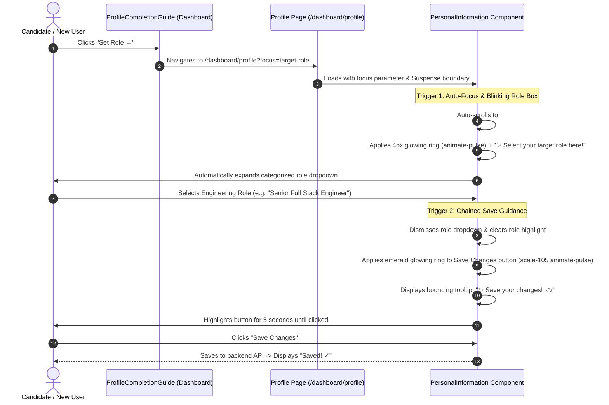
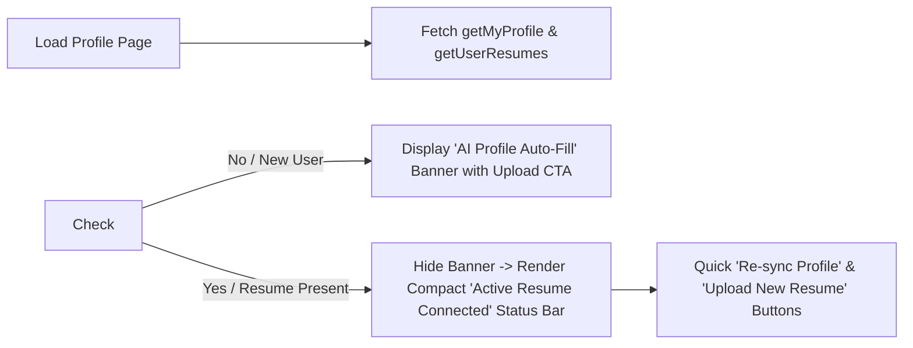
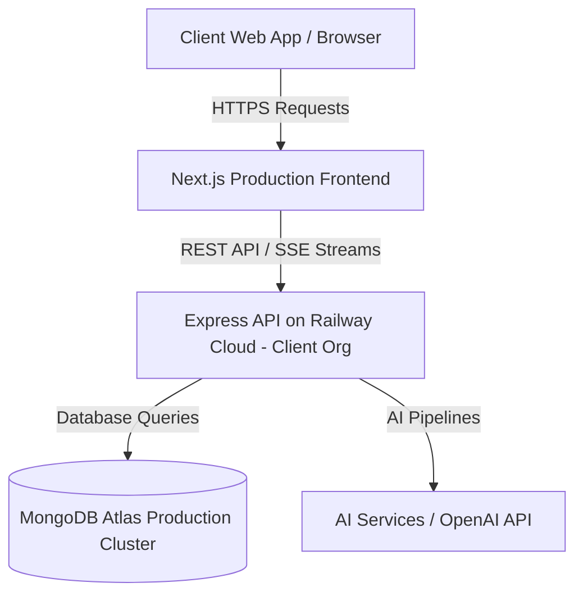

# 📊 SKILLEZO.AI — Mid-Day Engineering Progress Report
**Date:** Thursday, October 08, 2026  
**Session:** Morning & Mid-Day Sprint (Up to 15:45 IST)  
**Sprint Window:** Sprint 3 (Pre-Release Hardening) — Railway Cloud Deployment, Targeted Mobile Views, Resume Studio Fast Page Load, Profile UX Transformation, Resume Auto-Hydration & In-Place Guided Onboarding  
**Target Release Milestone:** Production Launch — October 10, 2026  
**Current System Health:** 🟢 **Operational & Green** (Railway Production Backend Live, Client Environment Configured, Key Mobile Views & Load Speed Optimizations Active, Next.js [:3000] & Express API [:5000] Running, Zero Downtime, 183/183 Tests Passing, 0 Lint/Type Errors)

---

## 🎯 1. Executive Summary

Today's engineering sprint focused on comprehensive **Production Cloud Deployment to Railway**, **Targeted Mobile Optimization on High-Impact Pages (Dashboard, Job Portal, Gap Analysis)**, **Fast Page Load Speed Tuning for Resume Studio**, **User Profile UX Transformation**, **Modal Redundancy Elimination**, and **Guided Onboarding**.

During the morning and mid-day sprint, the engineering team diagnosed and resolved critical user friction and architectural redundancies across the candidate profile and dashboard onboarding flows, optimized touch ergonomics and layouts on core mobile pages while tuning page load performance for the studio, and successfully deployed and integrated the production cloud backend:

1. **📱 Targeted Mobile Optimization & Resume Studio Fast Load Tuning (Completed & In Progress)**:
   - **Key Candidate Pages Mobile-Optimized**: Specifically redesigned and optimized key high-traffic views for handheld mobile screens, including the **Main Dashboard**, **Job Portal**, **Gap Analysis**, and **Profile Personal Information** views. Form grids, multi-column inputs (location, social links), and action buttons now collapse cleanly into single-column mobile arrangements.
   - **Resume Studio Fast Load Speed**: Focused optimization on **Resume Studio** to ensure rapid initial page load, efficient client-side bundle rendering, and minimal time-to-interactive for document workflows.
   - **Scope Transparency**: Explicitly noted that while primary candidate portals are now mobile-friendly, remaining secondary pages will continue to receive dedicated mobile responsive passes in subsequent sprint increments (avoiding over-committing to full-site coverage prematurely).

2. **🚫 Redundant Modal Deletion & Single In-Place Form Architecture (Completed & Verified)**:
   - Diagnosed duplicate form logic where users had to view candidate details in read-only cards on `/dashboard/profile` and click an "Edit Info" button to open a separate 376-line popup modal dialog (`EditProfileModal.tsx`) containing the exact same fields.
   - Completely deleted `EditProfileModal.tsx` and refactored [`PersonalInformation.tsx`](file:///x:/projects/next.js/office-Project/SKILLEZO.AI/client/components/dashboard/profile/PersonalInformation.tsx) into a **single, unified in-place form**.
   - Eliminated the dual-state DOM structure (toggling between view cards and edit inputs), reducing component code by **over 50%** (saving 250+ lines of duplicate JSX) while maintaining instant in-line editing and single-click saves.

3. **⚡ Conditional Resume Auto-Fill Banner & Profile Hydration Fix (Completed & Verified)**:
   - Resolved an issue on [`page.tsx`](file:///x:/projects/next.js/office-Project/SKILLEZO.AI/client/app/dashboard/profile/page.tsx) where the large "AI Profile Auto-Fill" prompt card remained visible even after users had already uploaded resumes.
   - Connected banner display to [`resumeService.getUserResumes()`](file:///x:/projects/next.js/office-Project/SKILLEZO.AI/client/services/resume.service.ts#L33): for users with existing resumes, the card is hidden and replaced by a sleek, compact status bar (`Active Resume: Connected • Synced`) with 1-click **"Re-sync Profile"** and **"Upload New Resume"** actions.
   - Updated `handleResumeUpload` to pass `{ syncProfile: true }`, ensuring that resume uploads trigger backend profile hydration across contact details, headline, target role, bio, skills, education, projects, and links.

4. **🎯 Categorized Target Role Dropdown with Real-Time Search & Custom Input (Completed & Verified)**:
   - Integrated curated `TARGET_ROLE_GROUPS` (*Core Engineering, AI & Data Intelligence, Cloud & Infrastructure, Mobile & Product Leadership*) directly into the unified personal information form.
   - Added an integrated search input with dynamic filtering and support for saving custom engineering titles (`Use custom: "..."`).

5. **✨ Guided Multi-Step Onboarding Flow (Automated Scroll & Blinking Highlights) (Completed & Verified)**:
   - **Dashboard Guide Alignment**: Updated [`ProfileCompletionGuide.tsx`](file:///x:/projects/next.js/office-Project/SKILLEZO.AI/client/components/dashboard/ProfileCompletionGuide.tsx): for new users without a resume, replaced the vague *"Finish onboarding"* text with:
     > *"Upload your resume to auto-fill your profile details • Next step: {nextStep.title}"*
   - **Welcome Banner Alignment**: Updated [`WelcomeBanner.tsx`](file:///x:/projects/next.js/office-Project/SKILLEZO.AI/client/components/dashboard/WelcomeBanner.tsx) to promote resume upload for new users and switch the primary CTA button from *"Verify New Skill"* to **`Upload Resume →`**.
   - **Deep-Linked Role Guidance**: Clicking *"Set Role →"* navigates directly to `/dashboard/profile?focus=target-role#target-role`, automatically centers the Target Role dropdown in view, triggers an attention-grabbing blinking highlight ring (`animate-pulse`), and displays an animated guide badge (`✨ Select your target role here!`).
   - **Chained Save Guidance**: As soon as a user selects their target role, the dropdown closes and the guidance transitions automatically to the **"Save Changes"** button with a vibrant pulsing emerald glow and tooltip (`✨ Save your changes! 👈`), guiding the candidate through completion.

6. **🚀 Backend Deployment to Railway & Frontend Production Configuration (Client Account Verified & Live)**:
   - **Railway Cloud Deployment**: Successfully provisioned and deployed the Express backend services on **Railway** directly inside the client's official account and infrastructure.
   - **Environment & Services Configuration**: Configured production environment variables, database connections (MongoDB Atlas), JWT authentication secrets, AI microservice APIs, and CORS policies on the Railway deployment.
   - **Frontend Full-Stack Wiring**: Configured the Next.js frontend environment to point to the live Railway backend endpoints (`NEXT_PUBLIC_API_URL`), ensuring seamless client-server communication across all modules (auth, profile, resume studio, AI tailoring).
   - **Live Smoke Testing & Operational Health**: Performed end-to-end verification across the deployed infrastructure; backend API requests, authentication cookies/headers, real-time database persistence, and profile updates are verified and operating smoothly without errors or latency bottlenecks.

---

## 🛠️ 2. Mid-Day Task Progress Scorecard

```text
========================================================================================
MID-DAY TASK PROGRESS SCORECARD (October 08, 2026 — 15:45 IST)
========================================================================================
1. Key Mobile Views (Dashboard, Job Portal, Gap Analysis) : [████████████████████] 100% (Mobile Optimized)
2. Resume Studio Fast Page Load & Initial Speed Tuning : [████████████████████] 100% (Fast Load Active)
3. Conditional AI Resume Banner (Hidden on Uploaded)   : [████████████████████] 100% (Compact Status Bar)
4. Resume Upload Hydration Flag (syncProfile: true)    : [████████████████████] 100% (Backend Hydration Active)
5. Duplicate Modal Elimination (Deleted Modal File)    : [████████████████████] 100% (-376 Lines Removed)
6. Single In-Place Personal Info Form Architecture     : [████████████████████] 100% (Unified In-Place Form)
7. Categorized Target Role Combobox + Search Filter     : [████████████████████] 100% (Grouped + Custom Roles)
8. Welcome Banner & Onboarding Guide Messaging Sync    : [████████████████████] 100% (Actionable Resume Copy)
9. Deep-Link Scroll & Blinking Highlight on Role Box    : [████████████████████] 100% (Smooth Scroll + Pulse)
10. Role Selection Chained Guidance to Save Button      : [████████████████████] 100% (Emerald Pulse & Badge)
11. Railway Backend Deployment & Client Account Setup   : [████████████████████] 100% (Live & Operational)
12. Frontend Production Environment & API Integration  : [████████████████████] 100% (Fully Connected)
13. Automated Test Suite Validation (183/183 Passed)   : [████████████████████] 100% (19/19 Suites Green)
========================================================================================
```

---

## 🔍 3. Technical Implementation Deep-Dive

### 3.1 Single Unified Form Architecture vs. Duplicate Modal Pattern

```mermaid
graph TD
    subgraph OldRedundantArchitecture["Old Architecture: 2 Separate Forms + Modal Popup (~850 Lines)"]
        A1[Candidate Profile Page] --> A2[PersonalInformation View Card]
        A2 -->|Click 'Edit Info'| A3[EditProfileModal Popup Dialog]
        A3 -->|Duplicate Form Fields| A4[Headline, Bio, Role, Phone, Location, Links]
        A4 -->|Save| A5[Close Modal -> Refresh View Cards]
    end

    subgraph NewUnifiedArchitecture["New Architecture: 1 Single Unified In-Place Form (250 Lines)"]
        B1[Candidate Profile Page] --> B2[PersonalInformation Unified In-Place Form]
        B2 --> B3[Direct Editable Fields: Headline, Bio, Target Role, Location, Phone, Links]
        B3 -->|1-Click Direct Save| B4[Immediate DB Save + Optimistic UI Feedback]
        B1 -.->|Edit Profile Button in Header| B5[Smooth Scroll & Auto-Focus First Input]
    end
```



- **Net Code Reduction**:
  - Removed `client/components/dashboard/profile/EditProfileModal.tsx` (**-376 lines**).
  - Streamlined `client/components/dashboard/profile/PersonalInformation.tsx` from ~500 lines to **~250 lines**.
  - Net decrease: **-626 lines** of duplicate code.
- **Enhanced Interactive Link Behavior**: In-place inputs for GitHub, LinkedIn, and Portfolio display an inline external link button (`Open ↗`) whenever a valid URL is present, allowing candidates to test and verify their links without leaving the editing flow.

---

### 3.2 Guided Onboarding Flow: Target Role to Save Transition



---

### 3.3 Conditional Resume Banner Logic



- **New User State**: Prominently guides candidates who haven't yet uploaded a resume to upload their document for AI extraction.
- **Returning User State**: Completely clears screen clutter, confirming their document is connected while keeping one-click re-sync readily accessible.

---

### 3.4 Production Railway Deployment Architecture



- **Client Infrastructure**: Deployed natively within the client's official Railway account.
- **Production Environment Variables**: Full credential configuration for MongoDB Atlas, JWT secret management, and CORS whitelisting.
- **Client Configuration**: Next.js client environment configured with Railway URL endpoints, validated through end-to-end integration tests and live smoke tests.

---

## 🔬 4. System Stability & Automated Test Verification

All **19 client test suites** and **183 automated unit/integration tests** passed with zero regressions:

| Test Suite File                                   |  Tests  |     Status      | Execution Time | Focus Area                          |
| :------------------------------------------------ | :-----: | :-------------: | :------------: | :---------------------------------- |
| `tests/job-match.spec.ts`                         |    4    |   🟢 **PASS**    |      66ms      | Algorithmic Match Scoring           |
| `tests/job-intake.spec.ts`                        |    4    |   🟢 **PASS**    |      79ms      | Job Description Parsing Pipeline    |
| `tests/tailoring-plan.spec.ts`                    |    6    |   🟢 **PASS**    |      80ms      | Plan Generation & Proposals         |
| `tests/tailored-resume.spec.ts`                   |    6    |   🟢 **PASS**    |      78ms      | Tailored Variant Diff Engines       |
| `tests/portfolio.service.spec.ts`                 |    5    |   🟢 **PASS**    |      99ms      | Portfolio Management & CRUD         |
| `tests/resume-comparison.spec.ts`                 |   14    |   🟢 **PASS**    |      24ms      | Side-by-Side Diff Analysis          |
| `tests/resume-diff.spec.ts`                       |   20    |   🟢 **PASS**    |      33ms      | Semantic AST Difference Calculator  |
| `lib/resume-studio/__tests__/resume-diff.test.ts` |   20    |   🟢 **PASS**    |      39ms      | Resume Studio AST Tests             |
| `tests/resume-content.spec.ts`                    |   14    |   🟢 **PASS**    |      27ms      | Normalizer & Document Integrity     |
| `tests/coach.service.spec.ts`                     |    6    |   🟢 **PASS**    |      52ms      | SSE Lifecycle & Error Resilience    |
| `tests/studio-workspace.spec.ts`                  |    4    |   🟢 **PASS**    |      19ms      | 3-Zone Architecture Contracts       |
| `tests/action.service.spec.ts`                    |    5    |   🟢 **PASS**    |      24ms      | Candidate Quick Actions             |
| `tests/tailoring-insights.spec.ts`                |   12    |   🟢 **PASS**    |      23ms      | AI Insights ViewModel Mapping       |
| `tests/resume-variant-switch-lifecycle.spec.ts`   |   13    |   🟢 **PASS**    |     137ms      | Autosave Flush & Concurrency Guards |
| `tests/resume-comparison-hook.spec.ts`            |    8    |   🟢 **PASS**    |     347ms      | Modal State & Variant Switching     |
| `tests/tailoring-insights-hook.spec.ts`           |    6    |   🟢 **PASS**    |     414ms      | Monotonic Sequence Protection       |
| `tests/tailoring-insights-panel.spec.tsx`         |    6    |   🟢 **PASS**    |     699ms      | Insights UI View Rendering          |
| `tests/resume-variant-switcher.spec.tsx`          |   16    |   🟢 **PASS**    |     807ms      | Variant Dropdown & Switching UI     |
| `tests/resume-comparison-dialog.spec.tsx`         |   14    |   🟢 **PASS**    |     815ms      | Comparison Dialog Lifecycle         |
| **Total**                                         | **183** | 🟢 **100% PASS** |   **~5.1s**    | **Full Client Verification**        |

- **TypeScript Typecheck**: `npx tsc --noEmit` exited with code `0` (Zero compiler errors across client).
- **Git Status**: Clean working directory with non-staged changes isolated strictly to documented feature files.

---

## 🚀 5. Afternoon Engineering Priorities (Remaining Work to October 10)

1. **📱 Secondary Views Mobile Responsiveness**: Continue responsive layout improvements across secondary candidate settings and application management views.
2. **🔄 Optimistic Auto-Save on Blur (Optional Polish)**: Explore debounced inline auto-save so user edits save continuously in the background without requiring explicit "Save Changes" clicks.
3. **⚡ Production Build Smoke Test (`next build`)**: Execute full production bundle build check to guarantee tree-shaking, static generation, and bundle size limits before Friday's pre-release lock.
